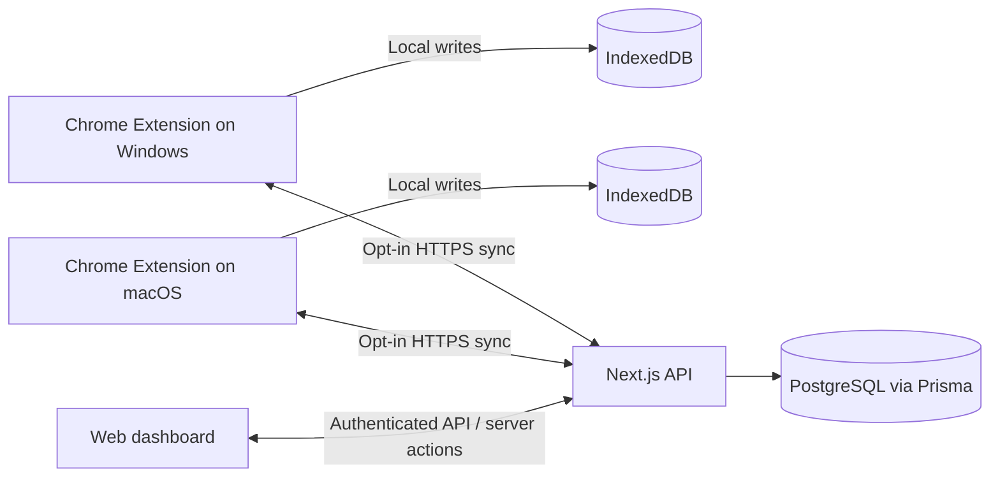

# SessionHub — Product & Engineering Reference Pack

> **Status:** Monorepo initialized (M1) and the first local extension slice works: save windows to IndexedDB, list/search, restore into new windows, rename/delete/export. No backend, accounts or sync yet. See [`docs/PROGRESS.md`](./docs/PROGRESS.md) for verified status.
>
> **Updated:** 2026-10-16  
> **Product:** SessionHub (working name)  
> **Targets:** Chrome on Windows and macOS; companion responsive web application  
> **Hosting target:** Self-hosted VPS / Coolify / Docker

## Development

Requirements: Node 24 (`.nvmrc`), pnpm 11 (`packageManager` in `package.json`).

```bash
pnpm install                 # also runs `wxt prepare` for the extension
pnpm check                   # lint + typecheck + unit tests (all packages, via Turborepo)
pnpm build                   # extension -> apps/extension/.output/chrome-mv3, web -> apps/web/.next
pnpm test:e2e                # builds, then runs the extension in real Chromium (Playwright)
pnpm test:perf               # builds, then the 120-tab timing baseline (heavier: about 2-3 GB RAM)
pnpm --filter @sessionhub/extension dev   # WXT dev mode with reload
pnpm --filter @sessionhub/web dev         # Next.js on http://localhost:3000
```

Database (M3, needs Docker):

```bash
cp packages/database/.env.example packages/database/.env
pnpm db:up                   # PostgreSQL 18 on 127.0.0.1:54329 (dev db + sessionhub_test), waits for the healthcheck
pnpm db:migrate              # prisma migrate dev against the dev database
pnpm test:db                 # resets sessionhub_test, applies all migrations, runs integration tests
pnpm db:down                 # stop (add -v to delete the data volume)
```

Production-like stack (web image + migrations + PostgreSQL, needs Docker):

```bash
cp infra/docker/.env.example infra/docker/.env   # set POSTGRES_PASSWORD and BETTER_AUTH_SECRET
docker compose -f infra/docker/compose.yaml up -d --build --wait   # http://localhost:3030
pnpm test:docker             # builds the images and tests the stack in an isolated compose project
```

Migrations run as their own one-shot `migrate` service (`prisma migrate deploy`) before `web` starts; to apply new migrations on an existing stack: `docker compose -f infra/docker/compose.yaml run --rm migrate`.

Web app auth (M3): `cp apps/web/.env.example apps/web/.env.local` and set `BETTER_AUTH_SECRET` (`openssl rand -base64 32`). API: `/api/v1/sessions` (list/detail/create/update/delete, contract in `docs/SYNC_PROTOCOL.md` 13a). Pages: `/signup`, `/login`, and the signed-in dashboard `/app` (Overview), `/app/sessions`, `/app/devices`, `/app/settings`. `pnpm test:e2e` now also runs the web auth E2E against `sessionhub_test`, so it needs `pnpm db:up` first.

AI agents: Prisma 7 blocks `prisma migrate reset` (used by `pnpm test:db`) when an agent runs it. Ask the user for explicit consent **for each run** and pass their exact words in `PRISMA_USER_CONSENT_FOR_DANGEROUS_AI_ACTION`; never reuse earlier consent, invent it, or bypass the check.

First-time E2E setup on a new machine: `pnpm --filter @sessionhub/extension exec playwright install chromium`.

**Load the extension in Chrome:** run `pnpm build`, open `chrome://extensions`, enable Developer mode, choose **Load unpacked** and select `apps/extension/.output/chrome-mv3`.

| Workspace | Purpose |
|---|---|
| `apps/extension` | WXT MV3 extension: background worker, popup, manager page, IndexedDB (Dexie) |
| `apps/web` | Next.js App Router: landing page, Better Auth email/password (`/signup`, `/login`, `/app`), `/api/auth/*`, `/api/health` |
| `packages/database` | Server-only Prisma 7 schema, migrations and client (PostgreSQL); never imported by the extension (lint-enforced) |
| `packages/contracts` | Zod schemas: saved session, export file format |
| `packages/core` | Pure logic: URL classification, capture normalization, restore planning, search |
| `packages/ui` | Shared design tokens (Tailwind v4 `@theme`) |
| `packages/eslint-config`, `packages/typescript-config` | Shared lint and TS settings |

## What this package is

A repository-ready, Markdown-first specification for creating a local-first browser session manager with optional cross-device cloud synchronization. It consolidates the development brief and adds detailed system architecture, user flows, data structures, sync semantics, and visual layout references.

The documents under `docs/` remain the product specification; implementation lives in `apps/` and `packages/`. A described feature is not implemented until `docs/PROGRESS.md` records a verified code path and test.

## Start here

| File | Purpose | When to read |
|---|---|---|
| [`PROMPT_FOR_CODEX_CLAUDE.md`](./PROMPT_FOR_CODEX_CLAUDE.md) | Full development brief / agent launch prompt | At the beginning of a new coding assignment |
| [`AGENTS.md`](./AGENTS.md) | Persistent rules for coding agents | Every coding session |
| [`CLAUDE.md`](./CLAUDE.md) | Claude-specific pointer to shared rules | Every Claude Code session |
| [`docs/PRD.md`](./docs/PRD.md) | Goals, personas, scope, acceptance criteria | Prioritization and product work |
| [`docs/COMPETITOR_RESEARCH.md`](./docs/COMPETITOR_RESEARCH.md) | Competitor capability matrix and product lessons | Feature and market research |
| [`docs/SYSTEM_DESIGN.md`](./docs/SYSTEM_DESIGN.md) | Components, boundaries, deployment, data flow, design decisions | Architecture or backend changes |
| [`docs/UI_UX_DESIGN.md`](./docs/UI_UX_DESIGN.md) | Screens, navigation, layout specs, detailed ASCII wireframes, interaction rules | Any frontend or extension UI work |
| [`docs/USER_FLOWS.md`](./docs/USER_FLOWS.md) | End-to-end task flows and edge cases | Feature implementation and UX reviews |
| [`docs/DATA_MODEL.md`](./docs/DATA_MODEL.md) | Entities, relations, indexes, retention | Database development |
| [`docs/SYNC_PROTOCOL.md`](./docs/SYNC_PROTOCOL.md) | Incremental push/pull, conflicts, idempotency, offline replay | Cross-device synchronization |
| [`docs/SECURITY_PRIVACY.md`](./docs/SECURITY_PRIVACY.md) | Authentication and permission threat model | All auth, sync, and publish changes |
| [`docs/TEST_PLAN.md`](./docs/TEST_PLAN.md) | Functional, integration, failure-injection, and release tests | Testing and verification |
| [`docs/ROADMAP.md`](./docs/ROADMAP.md) | Milestones, priorities, definitions of done | Planning and sprint execution |
| [`docs/PROGRESS.md`](./docs/PROGRESS.md) | **Living handoff**: completed work, blockers, next actions | Start and end of every agent session |
| [`docs/REFERENCES.md`](./docs/REFERENCES.md) | Official standards, framework documentation, competitor links | Validating assumptions and upgrading APIs |
| [`references/ui-layout-preview.html`](./references/ui-layout-preview.html) | Static visual reference for the web dashboard / extension surfaces | UI review in a browser |

## Suggested reading order for an agent

1. `AGENTS.md` and `docs/PROGRESS.md`.
2. `docs/PRD.md` + `docs/SYSTEM_DESIGN.md`.
3. Task-specific documents (UI/UX, sync, data model, testing, privacy).
4. `docs/ROADMAP.md`, then implement a tested vertical slice.
5. Update `docs/PROGRESS.md` with verified results before ending.

## Core architecture at a glance



**Non-negotiable invariants:**

- A saved session and an automatic recovery snapshot are different entities.
- Syncing session *metadata* does not remotely open, close, or change live browser tabs.
- Local recovery remains useful when the user is signed out or offline.
- Cloud sync is **off by default** and requires an explicit privacy disclosure/opt-in.
- A normal web page cannot directly enumerate Chrome tabs; live browser actions require the installed extension and a trusted, user-approved interaction.
- Browser runtime tab/window/group IDs are ephemeral; persistent domain IDs must be application-level UUIDs.
- A successful cloud sync is not, by itself, an independent backup.

## Planned project structure

```text
sessionhub/
├── apps/
│   ├── extension/              # WXT / React / MV3
│   └── web/                    # Next.js web app + API routes
├── packages/
│   ├── core/                   # Domain logic: sessions, restore planning
│   ├── contracts/              # Zod request/response + domain DTOs
│   ├── database/               # Prisma schema/migrations (server only)
│   ├── sync/                   # Pure sync algorithms; no secrets
│   ├── ui/                     # Shared cross-surface UI primitives
│   ├── eslint-config/
│   └── typescript-config/
├── docs/
├── references/
├── infra/
│   └── docker/
├── .github/workflows/
├── AGENTS.md
├── CLAUDE.md
├── README.md
├── pnpm-workspace.yaml
└── turbo.json
```

## Keeping the references alive

These are **initial proposed designs**, not irrevocable decisions. When implementation reveals a necessary change:

1. Preserve the user safety / privacy invariants.
2. Record the decision and reasoning in `docs/SYSTEM_DESIGN.md`.
3. Update affected UX, API, data, and test references in the same pull request.
4. Mark what is actually implemented in `docs/PROGRESS.md`—never confuse a specification with shipped functionality.

Use the prompt file as a reusable project kickoff brief. Do **not** paste it on every agent turn if the agent can read the repository; ask the agent to read the references and resume from `docs/PROGRESS.md` instead.
