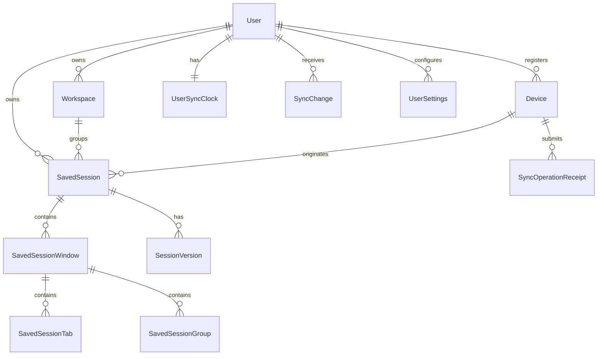

# SessionHub — Data Model and Persistence Boundaries

> **Status:** Proposed logical schema. Model/table and field names are illustrative until real Prisma migrations exist.
>
> **Critical boundary:** The Chrome extension stores local data in IndexedDB; only the Next.js API imports Prisma and reads/writes PostgreSQL.

## 1. Domain glossary

| Domain object | Definition | Default persistence |
|---|---|---|
| `LiveBrowserState` | Ephemeral observed tabs/windows/groups from current Chrome profile | Extension memory + bounded local cache |
| `SavedSession` | Named user-edited reusable browser layout | IndexedDB; optional PostgreSQL sync |
| `SavedSessionVersion` | Immutable revision of a saved session | IndexedDB history; synced server history |
| `RecoverySnapshot` | Automatic checkpoint of a device's observed browser state | IndexedDB only by default |
| `Workspace` | Named project grouping of saved sessions | IndexedDB; optional PostgreSQL sync |
| `Device` | A Chrome extension installation/browser profile identity | Local ID; cloud row when paired |
| `SyncOperation` | Durable requested mutation with idempotency and base version | Local outbox; server receipt |
| `SyncChange` | Canonical ordered server mutation notification | PostgreSQL append-only changelog |

**Browser API IDs are not domain IDs.** A Chrome `tab.id`, `window.id` or `groupId` can change after restart/restore. Persist stable UUIDs in the saved record; if local runtime mapping is needed, store it in a temporary adapter layer.

## 2. Cloud entity relationships



`User` and other auth tables should follow Better Auth's actual Prisma adapter migration output rather than being hand-recreated from an outdated example.

## 3. Server-side entity definitions

### User (auth-managed)

- Authentication provider ID and email/verification fields from Better Auth.
- Prefer auth-generated IDs and schemas; test that domain foreign keys match them.
- One-to-many: devices, workspaces, sessions, change events, settings.

### Device

| Field | Type / constraint | Notes |
|---|---|---|
| `id` | UUID PK | App-generated persistent device identifier |
| `userId` | FK indexed | Account scope |
| `installationId` | UUID, unique per user | Stable per browser profile install |
| `displayName` | string length <=120 | User-editable, e.g. "Windows Desktop" |
| `browser` / `platform` | normalized enums/string | Never relied on for access control |
| `createdAt` / `lastSeenAt` | timestamp | Last seen ≠ continuously online |
| `revokedAt` | nullable timestamp | Revocation prevents API access |
| `authCredentialVersion` | integer | Helps invalidate rotated/revoked device creds |

Do not use IP address or user agent string as device identity. Avoid exposing unnecessary device fingerprint data.

### Workspace

- `id` UUID PK; `userId` FK; `name`, `description?`, `icon?`, `color?`, `position`.
- `version` positive integer; `createdAt`, `updatedAt`, `deletedAt?`.
- Unique workspace name per user is optional; allow duplicates only if UX can disambiguate.
- All updates use optimistic concurrency.

### SavedSession

- `id` UUID PK, `userId` FK, `workspaceId?` FK scoped to same user.
- `sourceDeviceId` FK, nullable only for imported or migrated sessions.
- `name`, `description?`, `isPinned`, `isArchived`, `version`, `schemaVersion`.
- `createdAt`, `updatedAt`, `deletedAt?`, `lastRestoredAt?`.
- Derived counts (`tabCount`, `windowCount`) may be cached, but must be maintained transactionally.
- `sourceDeviceId` is provenance, not a command target.

### SavedSessionWindow

- `id` UUID PK, `sessionId` FK, `sortOrder`, optional `label`.
- Capture window position/bounds only when needed and disclosed; never assume two devices share screen geometry.
- Prefer opening to default browser bounds on another device.

### SavedSessionGroup

- `id` UUID PK, `windowId` FK, `name`, `color?`, `collapsed?`, `sortOrder`.
- Group ID is a persistent SessionHub UUID, not original Chrome numeric `groupId`.

### SavedSessionTab

- `id` UUID PK, `windowId` FK, `groupId?` FK, `title`, `url`, `faviconUrl?` (do not trust arbitrary icon URLs for HTML injection), `sortOrder`, `pinned`.
- Additional `restoreEligibility` classification and explanatory `reason` if URL is unsupported.
- Domain/hostname for search may be computed server-side after allowed URL parsing.
- Never store cookies, request headers, page contents, or auth tokens separately.
- Apply configurable URL stripping, exclusion, and bounds (e.g. title <=1,024, URL <=8,192 bytes after validation; exact limits are an implementation decision).

### SessionVersion

- `id` UUID PK; `sessionId` FK, `userId` FK, `version` integer, `createdAt`, `authorDeviceId?`.
- Immutable, versioned JSON snapshot with normalized window/group/tab structure, checksum, optional operation reference.
- Unique `(sessionId, version)`.
- Version payload schema is validated on write and on export/import; historical schema readers are maintained.
- Consider compression on the server only if benchmarks justify it.

### UserSyncClock

- `userId` PK/FK, `lastSequence` BIGINT not null.
- Updated under a transactional per-user row lock whenever an accepted server mutation appends a change.
- Prevents commit-order race conditions with naive standalone DB sequences.

### SyncChange

- `id` UUID PK; `userId` FK; `sequence` BIGINT; `entityType`, `entityId`, `changeKind` (`upsert`/`delete`), `entityVersion`, `payload`, `createdAt`.
- Unique `(userId, sequence)` and indexed for `(userId, sequence ASC)`.
- Payload is sanitized canonical DTO (or a pointer to a persistent version that is fetched with proper authorization).
- Retain a change history long enough for offline clients; after pruning, clients with expired cursors must perform a safe full rebootstrap.

### SyncOperationReceipt

- `userId` FK, `deviceId` FK, `clientOperationId` UUID, `resultStatus`, `resultPayload`, `createdAt`.
- Unique `(userId, deviceId, clientOperationId)`.
- Persist receipt **in the same transaction** as successful mutation/change.
- Retention should be long enough for the maximum offline replay period. For MVP favor conservative indefinite receipts and monitor storage; never prune receipts blindly while stale clients can retry.

### UserSettings

- `userId` PK/FK, schemaVersion, syncEnabledAt? (server record mirrors explicit client consent), optional sync preferences and account export/deletion metadata.
- Local-only URL exclusion preferences stay local unless user explicitly chooses to sync privacy settings.
- Avoid accidentally treating synced settings as proof of new client consent.

### AuditEvent

- Security-relevant events only: account sign-in, device pairing, device revoke, account deletion request, significant export. Sanitize logs; **never** log full URL lists/tokens by default.

## 4. Local IndexedDB schema (Dexie concept)

```text
LocalSessionStore (scope = 'local' or userAccountId):
  savedSessions:          id, scope, version, updatedAt, data, syncState
  sessionVersions:        id, sessionId, version, data, checksum, createdAt
  recoverySnapshots:      id, profileId, capturedAt, checksum, data
  workspaces:             id, scope, version, data, syncState
  outbox:                 operationId, scope, entityId, expectedVersion,
                          type, body, createdAt, attempts, nextRetryAt, status
  syncState:              accountScope, cursor, lastSyncAt, lastError
  conflictDrafts:         id, scope, entityId, mine, server, detectedAt, status
  restoreJobs:            jobId, sessionId, steps, successes, failures, status
  deviceInfo:             installationId, createdAt, friendlyName
  localPreferences:       name, value
```

Use transactional writes when editing a synced entity: **update local entity + add outbox operation atomically**. Pull application similarly commits remote entity updates, cursor and conflict states in a single transaction per page.

### Implemented local schema (Dexie versions 1 and 2, verified 2026-10-16)

Source: `apps/extension/src/lib/db.ts`. Database name `sessionhub`.

| Table | Primary key / indexes | Record |
|---|---|---|
| `sessions` | `id`, `[scope+updatedAt]` | Full `SavedSession` (contracts schema) plus `scope: "local"`; windows/groups/tabs are nested in the record |
| `device` | `key` (`"this-device"`) | `installationId` (UUID), `friendlyName` (default "This browser"), `createdAt` |
| `recoverySnapshots` (v2) | `id`, `capturedAt`, `[capturedAt+tabCount]` | Immutable checkpoint: `capturedAt`, `reason` (`automatic`/`manual`), `fingerprint`, counts, and `session` (a `SavedSession` whose id equals the snapshot id). Local only, never synced |
| `recoveryState` (v2) | `key` (`"state"`) | `dirty`, `lastChangeAt`, `lastSnapshotAt`, `lastFingerprint`, `lastError` |
| `restoreJobs` | `id`, `sessionId`, `createdAt` | Restore plan, append-only per-tab outcomes across attempts, `attempts` (absent on older records = 1), optional `interruptedAt`, status `running` / `completed` / `partial` / `failed` |

Not yet created: `sessionVersions`, `workspaces`, `outbox`, `syncState`, `conflictDrafts`, `localPreferences`. Add them as new Dexie versions; never edit version 1.

Every session write is validated with `savedSessionSchema` before it reaches IndexedDB. Edits are read-modify-write inside one transaction with an `expectedVersion` check (`VersionConflictError` on mismatch). Restore jobs are pruned on every worker start (`RESTORE_JOB_RETENTION`: newest 50 within 30 days; the newest job and any `running` job are never pruned).

**Recovery checkpoints (implemented):** every material browser change (tab created/removed/moved/attached/detached/replaced, URL/pinned/group change, window created/removed, group changes, browser startup/install) writes `dirty: true` and `lastChangeAt`. The clean-to-dirty transition arms a one-shot `recovery-debounce` alarm (30 s; Chrome before 120 rounds up to 1 min); a `recovery-periodic` alarm (30 min) is the safety net. A run reads all normal windows (incognito and SessionHub's own pages excluded), fingerprints URLs/order/pinned/groups (titles ignored), skips the insert if the fingerprint matches the last one, and stores nothing when there are no tabs. Insert + retention + state update happen in one transaction; the dirty flag is cleared only if no change arrived after the capture started. Retention (`RECOVERY_RETENTION`): newest 50 within 7 days, always keeping the newest checkpoint and the largest recent one. The v1 -> v2 upgrade is covered by a test.

**Restore job lifecycle (implemented):** created as `running` with `attempts: 1` before any tab opens -> outcomes appended per window -> status settled from outcomes (`completed` when every planned tab has an `opened` outcome, `failed` when none has, otherwise `partial`), also when a step throws. `restore.retry` claims a `partial`/`failed` job by switching it to `running` and incrementing `attempts` in one transaction (a `running` or `completed` job is refused), then runs `planRetry`: only planned tabs with no `opened` outcome in any attempt, re-classified, in new windows. A tab therefore never opens twice for the same job. On every worker start, jobs still `running` whose `updatedAt` is earlier than that worker's start time are settled from their outcomes and stamped `interruptedAt` (restores only run inside the worker, so such a job's worker is gone); jobs touched after the start time belong to the new worker and are left alone.

**Implemented bounds** (`SESSION_LIMITS` in `packages/contracts/src/session.ts`): name 200 chars, tab title 1,024 chars (truncated on capture), URL 8,192 chars (longer URLs are stored truncated and classified `invalid`), group title 256, device name 120, 200 windows per session, 2,000 tabs and 500 groups per window (capture fails with a clear error above these).

**Implemented eligibility values:** `restorable` (http/https with a host), `browser-internal` (`chrome:`, `chrome-extension:`, `about:`, `devtools:`, `view-source:` and other browser schemes), `local-file` (`file:`), `unsafe` (`javascript:`, `data:`, `blob:`, `vbscript:`), `unsupported` (any other scheme), `invalid` (unparseable, empty or too long). Classifier: `packages/core/src/url-classification.ts`, `URL_CLASSIFIER_VERSION = 1`.

### Account/profile isolation

Browser installations may be signed into different SessionHub accounts at different times. Namespace local records by account scope. On logout:

- Keep local-only data unless explicitly deleted.
- Hide another user's cached cloud records from subsequent users.
- Do not send queued operations from account A while signed into account B.
- Ask before migrating local-only sessions into an authenticated account.
- On re-login, resume only with matching account/device authorization.

This is a release-blocking data-isolation consideration.

## 5. Data shape / export schema

Versioned export. Implemented as `sessionExportSchema` in `packages/contracts/src/session-export.ts`; the session object follows `savedSessionSchema` (fields below are a subset: real exports also carry `schemaVersion`, timestamps, `sourceDeviceId`, `version`, group objects and per-tab `eligibility`):

```json
{
  "format": "sessionhub.session-export",
  "schemaVersion": 1,
  "exportedAt": "2026-10-16T08:00:00Z",
  "session": {
    "id": "e16e808c-b32b-4fc5-a2c8-c1a04003024e",
    "name": "Frontend research",
    "sourceDeviceName": "Windows Desktop",
    "windows": [
      {
        "id": "170c8810-86e0-4417-a57b-04a3d31742e3",
        "sortOrder": 0,
        "groups": [],
        "tabs": [
          {
            "id": "b7117d8d-9d95-4fae-b1b2-36d71d624b68",
            "title": "TypeScript Docs",
            "url": "https://www.typescriptlang.org/docs/",
            "pinned": false,
            "sortOrder": 0,
            "groupId": null
          }
        ]
      }
    ]
  }
}
```

Import must verify `format`, supported `schemaVersion`, structural bounds, ID collisions, duplicated ordering and URL classification. Never execute imported content as HTML/JavaScript. Imported sessions receive a safe new local identity and don't overwrite existing sessions by default.

**Implemented (2026-10-16)** in `packages/core/src/session-import.ts`:

1. Reject files over 10 MB (`IMPORT_MAX_BYTES`) before parsing.
2. `JSON.parse`; then `format` must equal `sessionhub.session-export`; a `schemaVersion` above the current one gets an "update the extension" error. Only version 1 exists, so there is no migration path yet.
3. Full `sessionExportSchema` validation (bounds, UUIDs, unique ids, group references). The first issue and its path are shown to the user.
4. Every session, window, group and tab gets a fresh UUID; group links are remapped.
5. Windows, groups and tabs are re-sorted by `sortOrder` (ties keep file order) and renumbered from 0.
6. Every URL is re-classified; the file's `eligibility` values are ignored and differences are counted.
7. Empty windows are dropped; a file with no tabs is rejected.
8. The result has `version: 1`, `createdAt`/`updatedAt` set to import time, the original `name` and `sourceDeviceName`, and `sourceDeviceId: null`. **`sourceDeviceId: null` marks an imported session** and the UI labels it "Imported from <device>".

The extension stores it with Dexie `add()` (not `put()`), so even an id collision fails instead of replacing a record.

## 6. Indexing and query guidance

- `SavedSession (userId, updatedAt DESC, id)` pagination.
- `SavedSession (userId, workspaceId, updatedAt DESC)` workspace filters.
- `SavedSessionTab (windowId, sortOrder)` window order.
- `SavedSessionWindow (sessionId, sortOrder)` session window order.
- `SessionVersion (sessionId, version DESC)` history.
- `SyncChange (userId, sequence)` incremental pull.
- `SyncOperationReceipt (userId, deviceId, clientOperationId)` idempotency.
- Foreign keys must enforce account consistency through service-layer ownership validation, and where feasible via relational constraints.

For global search, start with indexed normalized titles/domains and bounded full-text search where appropriate; never bring the entire user's history into memory for a server-side filter.

## 7. Retention, deletion and migration

- Automatic local recovery snapshots: rolling retention with count/size limits; protect last known good checkpoint.
- Saved sessions: user-managed, versions retained according to documented policy.
- Deletion: soft delete/tombstone first, propagate in changelog, eventually garbage collect after safe retention.
- Sync change pruning: a client whose cursor predates the earliest available event must rebootstrap while preserving its pending local outbox.
- DB backups: encrypted off-host with documented restoration; a successful replica sync is not an independent backup.
- Prisma schema migrations: forward-compatible, safe steps with test migrations and a backup plan.
- IndexedDB schema migrations: incremental versions, tested downgrade/export fallback, no destructive bulk upgrades without recovery path.

## 8. Future collaboration caution

Do not pretend a `WorkspaceMembership` table makes collaboration safe. True team workspaces require a new explicit ACL/sharing model, ownership rules, audit and conflict semantics. Keep MVP entities account-owned and document any future migration separately.
