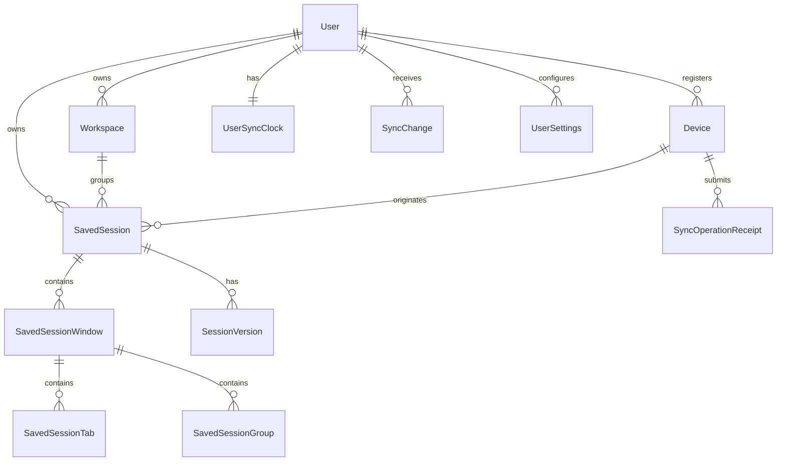

# SessionHub — Data Model and Persistence Boundaries

> **Status:** Proposed logical schema. Model/table and field names are illustrative until real Prisma migrations exist.
>
> **Critical boundary:** The Chrome extension stores local data in IndexedDB; only the Next.js API imports Prisma and reads/writes PostgreSQL.

## 1. Domain glossary

| Domain object | Definition | Default persistence |
|---|---|---|
| `LiveBrowserState` | Ephemeral observed tabs/windows/groups from current Chrome profile | Extension memory + bounded local cache |
| `SavedSession` | Named user-edited reusable browser layout | IndexedDB; optional PostgreSQL sync |
| `SavedSessionVersion` | Immutable revision of a saved session | IndexedDB history; synced server history |
| `RecoverySnapshot` | Automatic checkpoint of a device's observed browser state | IndexedDB only by default |
| `Workspace` | Named project grouping of saved sessions | IndexedDB; optional PostgreSQL sync |
| `Device` | A Chrome extension installation/browser profile identity | Local ID; cloud row when paired |
| `SyncOperation` | Durable requested mutation with idempotency and base version | Local outbox; server receipt |
| `SyncChange` | Canonical ordered server mutation notification | PostgreSQL append-only changelog |

**Browser API IDs are not domain IDs.** A Chrome `tab.id`, `window.id` or `groupId` can change after restart/restore. Persist stable UUIDs in the saved record; if local runtime mapping is needed, store it in a temporary adapter layer.

## 2. Cloud entity relationships



`User` and other auth tables should follow Better Auth's actual Prisma adapter migration output rather than being hand-recreated from an outdated example.

## 3. Server-side entity definitions

### User (auth-managed)

- Authentication provider ID and email/verification fields from Better Auth.
- Prefer auth-generated IDs and schemas; test that domain foreign keys match them.
- One-to-many: devices, workspaces, sessions, change events, settings.

### Device

| Field | Type / constraint | Notes |
|---|---|---|
| `id` | UUID PK | App-generated persistent device identifier |
| `userId` | FK indexed | Account scope |
| `installationId` | UUID, unique per user | Stable per browser profile install |
| `displayName` | string length <=120 | User-editable, e.g. "Windows Desktop" |
| `browser` / `platform` | normalized enums/string | Never relied on for access control |
| `createdAt` / `lastSeenAt` | timestamp | Last seen ≠ continuously online |
| `revokedAt` | nullable timestamp | Revocation prevents API access |
| `authCredentialVersion` | integer | Helps invalidate rotated/revoked device creds |

Do not use IP address or user agent string as device identity. Avoid exposing unnecessary device fingerprint data.

### Workspace

- `id` UUID PK; `userId` FK; `name`, `description?`, `icon?`, `color?`, `position`.
- `version` positive integer; `createdAt`, `updatedAt`, `deletedAt?`.
- Unique workspace name per user is optional; allow duplicates only if UX can disambiguate.
- All updates use optimistic concurrency.

### SavedSession

- `id` UUID PK, `userId` FK, `workspaceId?` FK scoped to same user.
- `sourceDeviceId` FK, nullable only for imported or migrated sessions.
- `name`, `description?`, `isPinned`, `isArchived`, `version`, `schemaVersion`.
- `createdAt`, `updatedAt`, `deletedAt?`, `lastRestoredAt?`.
- Derived counts (`tabCount`, `windowCount`) may be cached, but must be maintained transactionally.
- `sourceDeviceId` is provenance, not a command target.
- **Implemented 2026-10-18 (organizing):** `tags` (`text[]`, default empty): free-form labels, at most 10 of up to 32 characters, normalized on every write (trimmed, inner spaces collapsed, repeats dropped ignoring case (compared lowercased), the first spelling kept; `normalizeTags` in `packages/core/src/session-organize.ts`). `description` is shown as **Notes** (up to 2,000 characters, trimmed, empty stored as null). The extension now stores `description`, `tags`, `isPinned` and `isArchived` on the local session too (optional in `savedSessionSchema`: absent means empty for this browser's sessions, and "not known yet" for an account's, whose uploads then leave the server's value). Exports carry them; an import keeps notes and tags but is neither pinned nor archived; a duplicate is "Name (copy)" with the same notes and tags, unpinned and not archived. Dexie v7 (no new index) rebuilds every account once so cached sessions learn values set on the website.

### SavedSessionWindow

- `id` UUID PK, `sessionId` FK, `sortOrder`, optional `label`.
- **Implemented 2026-10-18:** optional `state` (`normal`, `maximized`, `fullscreen`) and `bounds` `{ left, top, width, height }` (integer pixels, `left`/`top` may be negative for a screen left of or above the main one, sizes positive, each at most 100,000). Bounds are kept only for a normal window (`normalizePlacement` in `packages/core/src/window-placement.ts`, used by capture, API writes and import). A minimized window is saved as `normal` at the bounds Chrome reports for it; kiosk full screen as `fullscreen`. Windows saved before have neither and reopen as before. Server columns: `state` (`window_state` enum), `bounds_left`, `bounds_top`, `bounds_width`, `bounds_height`, all nullable, all four bounds or none.
- **Decision (user's choice, 2026-10-18):** a session's windows reopen at their saved position and size only on the computer that saved it (its `sourceDeviceId` is this browser's installation id or its device id in the connected account: `savedOnThisBrowser` in `apps/extension/src/lib/device-repository.ts`). Other computers and imports (no source) get Chrome's default placement, since screens differ. Maximized and full screen apply everywhere. Opening into one new window or this window uses no saved placement. Disclosed on the privacy page and in the sync consent text.

### SavedSessionGroup

- `id` UUID PK, `windowId` FK, `name`, `color?`, `collapsed?`, `sortOrder`.
- Group ID is a persistent SessionHub UUID, not original Chrome numeric `groupId`.

### SavedSessionTab

- `id` UUID PK, `windowId` FK, `groupId?` FK, `title`, `url`, `faviconUrl?` (do not trust arbitrary icon URLs for HTML injection), `sortOrder`, `pinned`.
- Additional `restoreEligibility` classification and explanatory `reason` if URL is unsupported.
- Domain/hostname for search may be computed server-side after allowed URL parsing.
- Never store cookies, request headers, page contents, or auth tokens separately.
- Apply configurable URL stripping, exclusion, and bounds (e.g. title <=1,024, URL <=8,192 bytes after validation; exact limits are an implementation decision).

### SessionVersion

- `id` UUID PK; `sessionId` FK, `userId` FK, `version` integer, `createdAt`, `authorDeviceId?`.
- Immutable, versioned JSON snapshot with normalized window/group/tab structure, checksum, optional operation reference.
- Unique `(sessionId, version)`.
- Version payload schema is validated on write and on export/import; historical schema readers are maintained.
- Consider compression on the server only if benchmarks justify it.

### UserSyncClock

- `userId` PK/FK, `lastSequence` BIGINT not null.
- Updated under a transactional per-user row lock whenever an accepted server mutation appends a change.
- Prevents commit-order race conditions with naive standalone DB sequences.

### SyncChange

- `id` UUID PK; `userId` FK; `sequence` BIGINT; `entityType`, `entityId`, `changeKind` (`upsert`/`delete`), `entityVersion`, `payload`, `createdAt`.
- Unique `(userId, sequence)` and indexed for `(userId, sequence ASC)`.
- Payload is sanitized canonical DTO (or a pointer to a persistent version that is fetched with proper authorization).
- Retain a change history long enough for offline clients; after pruning, clients with expired cursors must perform a safe full rebootstrap.

### SyncOperationReceipt

- `userId` FK, `deviceId` FK, `clientOperationId` UUID, `resultStatus`, `resultPayload`, `createdAt`.
- Unique `(userId, deviceId, clientOperationId)`.
- Persist receipt **in the same transaction** as successful mutation/change.
- Retention should be long enough for the maximum offline replay period. For MVP favor conservative indefinite receipts and monitor storage; never prune receipts blindly while stale clients can retry.

### UserSettings

- `userId` PK/FK, schemaVersion, syncEnabledAt? (server record mirrors explicit client consent), optional sync preferences and account export/deletion metadata.
- Local-only URL exclusion preferences stay local unless user explicitly chooses to sync privacy settings.
- Avoid accidentally treating synced settings as proof of new client consent.

### AuditEvent

- Security-relevant events only: account sign-in, device pairing, device revoke, account deletion request, significant export. Sanitize logs; **never** log full URL lists/tokens by default.

### Implemented server schema (Prisma 7.10.0, PostgreSQL 18, verified 2026-10-16)

Source: `packages/database/prisma/schema.prisma`, migrations `20261016052129_init`, `20261016101018_device_pairing_and_credentials`, `20261016160300_rate_limit_buckets`. All entities in this section exist, with these decisions:

- **Operational table** `rate_limit_buckets` (`key` PK, `tokens`, `allowed`, `updated_at` indexed): shared rate-limit state for all web instances (`SYNC_PROTOCOL.md` 13a). No user data; truncating it only resets budgets.

- **Auth tables** (`user`, `session`, `account`, `verification`) are exactly what the Better Auth CLI (`auth generate`, v1.7.9, email/password, Prisma/PostgreSQL) produced: string ids and camelCase columns. Only Prisma back-relation fields were added to `User`. Regenerate when auth plugins change and diff.
- **Domain tables** use snake_case table and column names, app-generated UUID primary keys, `timestamptz(3)` timestamps and `varchar` limits equal to the contracts limits.
- **Same-account ownership in the database:** composite foreign keys `(workspace_id, user_id)`, `(source_device_id, user_id)`, `(author_device_id, user_id)`, `(device_id, user_id)` and `(session_id, user_id)` reference `(id, user_id)` unique keys, and `(group_id, window_id)` references `(id, window_id)`, so a row can never point at another user's workspace/device/session or at a group in another window. These use `ON DELETE NO ACTION`: hard-deleting a device or workspace that is still referenced fails; services must clear the reference first (soft delete via `revoked_at` / `deleted_at` is the normal path).
- Deleting a user cascades to all of their rows and nobody else's; deleting a saved session cascades to windows, groups, tabs and versions.
- **Receipts (implemented 2026-10-16, `SYNC_PROTOCOL.md` 13f):** one row per `(user_id, device_id, client_operation_id)` for every accepted, conflicting or rejected push operation; `result_payload` is the stored result (without `replayed`). Not pruned.
- Unique keys: `(user_id, installation_id)` on devices, `(user_id, sequence)` on sync changes, primary key `(user_id, device_id, client_operation_id)` on receipts, `(session_id, version)` on versions, and `sort_order` per parent for windows, groups and tabs.
- Naming reconciliations: group **`title`** (matches the contracts DTO; section 3 said `name`); **no `favicon_url` column** (clients use the browser's favicon cache); Postgres enum values use `_` where contracts use `-` (`browser_internal`), mapped in the service layer.
- **Write semantics (API, 2026-10-16):** each accepted create/update writes a `session_versions` row whose `payload` is the full detail DTO and whose `checksum` is SHA-256 over id-independent content (name, description, workspace, pinned, archived, ordered groups and tabs with group positions). Deletes write a tombstone and a `sync_changes` delete row but no `session_versions` row. Web writes store `source_device_id = NULL`, `source_device_name = "Web"`. Child rows are deleted and recreated with new ids when the structure changes.
- `AuditEvent.kind` is an enum: `sign_in`, `device_paired`, `device_revoked`, `account_deletion_requested`, `data_exported`.

## 4. Local IndexedDB schema (Dexie concept)

```text
LocalSessionStore (scope = 'local' or userAccountId):
  savedSessions:          id, scope, version, updatedAt, data, syncState
  sessionVersions:        id, sessionId, version, data, checksum, createdAt
  recoverySnapshots:      id, profileId, capturedAt, checksum, data
  workspaces:             id, scope, version, data, syncState
  outbox:                 operationId, scope, entityId, expectedVersion,
                          type, body, createdAt, attempts, nextRetryAt, status
  syncState:              accountScope, cursor, lastSyncAt, lastError
  conflictDrafts:         id, scope, entityId, mine, server, detectedAt, status
  restoreJobs:            jobId, sessionId, steps, successes, failures, status
  deviceInfo:             installationId, createdAt, friendlyName
  localPreferences:       name, value
```

Use transactional writes when editing a synced entity: **update local entity + add outbox operation atomically**. Pull application similarly commits remote entity updates, cursor and conflict states in a single transaction per page.

### Implemented local schema (Dexie versions 1 to 6, verified 2026-10-17)

Source: `apps/extension/src/lib/db.ts`. Database name `sessionhub`.

| Table | Primary key / indexes | Record |
|---|---|---|
| `sessions` | `id`, `[scope+updatedAt]` | Full `SavedSession` (contracts schema) plus `scope` (`"local"` or `"account:<account id>"`) and, for account-scoped records only, `sync: { serverVersion, state }` and `workspaceId` (v6: null = none; absent = not known yet, so uploads leave the server's as it is); windows/groups/tabs are nested in the record. Exports never include `workspaceId` |
| `device` | `key` (`"this-device"`) | `installationId` (UUID), `friendlyName` (default "This browser"), `createdAt` |
| `recoverySnapshots` (v2) | `id`, `capturedAt`, `[capturedAt+tabCount]` | Immutable checkpoint: `capturedAt`, `reason` (`automatic`/`manual`), `fingerprint`, counts, and `session` (a `SavedSession` whose id equals the snapshot id). Local only, never synced |
| `recoveryState` (v2) | `key` (`"state"`) | `dirty`, `lastChangeAt`, `lastSnapshotAt`, `lastFingerprint`, `lastError` |
| `restoreJobs` | `id`, `sessionId`, `createdAt` | Restore plan, append-only per-tab outcomes across attempts, `attempts` (absent on older records = 1), optional `interruptedAt`, status `running` / `completed` / `partial` / `failed`. Since 2026-10-17: optional `target` (`new-windows` / `one-window` / `this-window`, never a window id; absent = new windows) and `plan.alreadyOpen` (`{ sourceTabId, url }` of tabs left out because they were already open in the target window); optional `lazy: true` when background tabs were unloaded after opening (retries do the same). No new Dexie version (no index change) |
| `account` (v3) | `key` (`"pairing"`, `"connection"`, `"notice"`) | Pending pairing (device code), the connection (API origin, device id, `account: { id, name, email }`, access and refresh tokens) and the last involuntary disconnect reason. `account.id` is absent on connections saved before v4 until the next account check fills it in |
| `outbox` (v4) | `++seq`, `&id`, `[scope+seq]`, `entityId` | One pending change of an account-scoped session or workspace: `id` (clientOperationId), `scope`, `entityType` (`savedSession`, or `workspace` since v6), `entityId`, `action` (`upsert` with the full session and its known `workspaceId`, or only a workspace's changed fields, as `payload`; or `delete` with `null`, plus `waitFor` on a workspace delete), `expectedVersion`, `status` (`queued` / `sending` / `conflict` / `rejected`), `attempts`, `nextAttemptAt`, `lastError`, timestamps. `seq` is the upload order. `conflict` and `rejected` keep the payload and hold back the entity's later operations until resolved |
| `sessionTombstones` (v4) | `id`, `scope` | Deleted account-scoped session (`id`, `scope`, `deletedAt`) the server may still list |
| `syncState` (v4) | `scope` | Per account: `enabledAt` (local consent; nothing uploads without it), `cursor` (pull slice), `lastSyncAt` (last completed run, upload and download), `lastError` and `lastErrorCode` (NETWORK = offline), `failures` and `nextAttemptAt` (backoff). Field additions need no new Dexie version (no index change). `bootstrap` (`{ cursor, after }`) while a full rebuild is in progress |
| `serverCopies` (v5) | `id`, `scope` | The newest server state (`action`, `version`, `payload` = server detail or null) of a session whose local changes are still waiting; settled when they are accepted (`SYNC_PROTOCOL.md` 13g) |
| `workspaces` (v6) | `id`, `scope` | A workspace of an account (account scope only): `name`, `description`, `icon`, `color`, `position`, timestamps, `sync: { serverVersion, state: pending / synced / error, lastError }`, and `deletedAt` while a delete made here waits for the account (hidden). The v6 upgrade clears every account's `cursor` and `bootstrap`, so each rebuilds once and learns its workspaces and assignments (`SYNC_PROTOCOL.md` 13j) |

Not yet created: `sessionVersions`, `localPreferences`. `conflictDrafts` isn't needed: the held operation keeps the local payload and `serverCopies` the server's (`SYNC_PROTOCOL.md` 13i). Add them as new Dexie versions; never edit an existing version.

**Account scope and outbox (implemented, v4):**

- **Visibility.** `local` records are always visible. A record scoped `account:<id>` is visible only while the stored connection has that account id; another account's cached sessions read as missing for list, get, rename, delete and restore (a hidden record is never edited or deleted). A connection without an id (saved before v4) shows only `local` data. Disconnecting hides the account's cached sessions and queued operations without deleting them; reconnecting the same account shows them again.
- **What is account-scoped.**
  - Sessions the user chose in the upload preview are **moved** (user's decision, 2026-10-16) into the account scope, each with a queued create, in one transaction with the consent record (`syncState.enabledAt`).
  - While sync is on, new captures and imports are saved into the account scope with their create queued (USER_FLOWS.md Flow 2); otherwise they stay `local`.
  - Pulled sessions land there too.
  - Turning sync off sets `enabledAt` to null and changes nothing else: account sessions stay (shown as "Sync off"), queued changes wait, new saves stay local.
- **Atomic changes.** Renaming or deleting an account-scoped session writes the session, its outbox operation and (for a delete) its tombstone in one IndexedDB transaction; a failure leaves all of them unchanged (tested by failing the last write). Local sessions never get operations, and a local delete is still a hard delete.
- **Versions.** The local `version` keeps guarding edits between extension pages. `sync.serverVersion` (null until the first accepted upload) is what uploads build on: an entity's first pending operation has `expectedVersion = serverVersion ?? 0`, and each later one `previous + 1`, because every accepted server write adds exactly 1 (create -> 1, update and delete -> +1).
- **Merging.** While an entity's latest operation is still `queued` (never handed to the network), a new edit replaces its payload under the same id and base version, and a delete turns it into a delete. Deleting a session whose create was never sent drops the create and leaves no tombstone, so nothing about it is ever uploaded. Once `sending`, an operation is immutable and never returns to `queued`; later changes append new operations. The uploader must commit `sending` before the request leaves.
- **Tombstones** are kept until the server's delete has been pulled back (purged by the pull slice), so a pull can't resurrect a session before its delete is uploaded. They hold no tabs or URLs.
- **Upload (implemented, `SYNC_PROTOCOL.md` 13f):** session `sync.state` becomes `synced` after the server accepts the last pending operation, `conflict` after a version conflict or a rejection to review, `error` when a change can never be uploaded as is (invalid or too large).
- **Download (implemented, `SYNC_PROTOCOL.md` 13g):** pulled and bootstrapped sessions are written into the account scope as `synced` (local `version` = previous + 1; the server version in `sync.serverVersion`), following `packages/sync/src/reconcile.ts`.
- **Review (implemented, `SYNC_PROTOCOL.md` 13i):** held operations carry `lastErrorCode` and `conflictServerVersion`; a resolution removes the session's operations and applies the chosen outcome in one transaction. A local-only outcome always gets fresh ids and no `sync` metadata/outbox entry. When the account version may exist but no copy/delete is held, the same transaction resets this account's pull/bootstrap position; consent and unrelated pending work remain. This reuses existing tables; no IndexedDB schema migration is needed.

Every session write is validated with `savedSessionSchema` before it reaches IndexedDB. Edits are read-modify-write inside one transaction with an `expectedVersion` check (`VersionConflictError` on mismatch). Restore jobs are pruned on every worker start (`RESTORE_JOB_RETENTION`: newest 50 within 30 days; the newest job and any `running` job are never pruned).

**Recovery checkpoints (implemented):** every material browser change (tab created/removed/moved/attached/detached/replaced, URL/pinned/group change, window created/removed, group changes, browser startup/install) writes `dirty: true` and `lastChangeAt`. The clean-to-dirty transition arms a one-shot `recovery-debounce` alarm (30 s; Chrome before 120 rounds up to 1 min); a `recovery-periodic` alarm (30 min) is the safety net. A run reads all normal windows (incognito and SessionHub's own pages excluded), fingerprints URLs/order/pinned/groups (titles ignored), skips the insert if the fingerprint matches the last one, and stores nothing when there are no tabs. Insert + retention + state update happen in one transaction; the dirty flag is cleared only if no change arrived after the capture started. Retention (`RECOVERY_RETENTION`): newest 50 within 7 days, always keeping the newest checkpoint and the largest recent one. The v1 -> v2 upgrade is covered by a test.

**Storage full (implemented):** any IndexedDB quota failure (detected through Dexie's `QuotaExceededError`, wrapped `AbortError`s, `cause` chains and bulk `failures`) returns error code `storage-full` with a command-specific message saying what didn't happen. Save, import and rename write nothing. A restore that can't create its job opens nothing; one that can't record a tab's outcome stops and says tabs may have opened. A checkpoint that hits the quota evicts down to half of the existing checkpoints (still keeping the newest and the largest recent one) and retries once; if that also fails, or nothing could safely be evicted, it records "Storage for SessionHub is full..." as `lastError` and keeps the existing checkpoints. User saves and imports do **not** delete checkpoints to make room.

**Restore job lifecycle (implemented):** for the current window, the window is checked first (still open, normal, not private) and its open URLs read for "skip tabs already open"; a window that can't take tabs fails the command before any job exists. Then the job is created as `running` with `attempts: 1` before any tab opens -> each tab's outcome appended before the next tab opens (a worker killed in between can leave only the tab it was opening unrecorded) -> status settled from outcomes (`completed` when every planned tab has an `opened` outcome, `failed` when none has, otherwise `partial`), also when a step throws. `restore.retry` claims a `partial`/`failed` job by switching it to `running` and incrementing `attempts` in one transaction (a `running` or `completed` job is refused), then runs `planRetry`: only planned tabs with no `opened` outcome in any attempt, re-classified, in new windows. A tab therefore never opens twice for the same job. On every worker start, jobs still `running` whose `updatedAt` is earlier than that worker's start time are settled from their outcomes and stamped `interruptedAt` (restores only run inside the worker, so such a job's worker is gone); jobs touched after the start time belong to the new worker and are left alone.

**Implemented bounds** (`SESSION_LIMITS` in `packages/contracts/src/session.ts`): name 200 chars, tab title 1,024 chars (truncated on capture), URL 8,192 chars (longer URLs are stored truncated and classified `invalid`), group title 256, device name 120, 200 windows per session, 2,000 tabs and 500 groups per window (capture fails with a clear error above these).

**Implemented eligibility values:** `restorable` (http/https with a host), `browser-internal` (`chrome:`, `chrome-extension:`, `about:`, `devtools:`, `view-source:` and other browser schemes), `local-file` (`file:`), `unsafe` (`javascript:`, `data:`, `blob:`, `vbscript:`), `unsupported` (any other scheme), `invalid` (unparseable, empty or too long). Classifier: `packages/core/src/url-classification.ts`, `URL_CLASSIFIER_VERSION = 1`.

### Account/profile isolation

Browser installations may be signed into different SessionHub accounts at different times. Namespace local records by account scope. On logout:

- Keep local-only data unless explicitly deleted.
- Hide another user's cached cloud records from subsequent users.
- Do not send queued operations from account A while signed into account B.
- Ask before migrating local-only sessions into an authenticated account.
- On re-login, resume only with matching account/device authorization.

This is a release-blocking data-isolation consideration.

## 5. Data shape / export schema

Versioned export. Implemented as `sessionExportSchema` in `packages/contracts/src/session-export.ts`; the session object follows `savedSessionSchema` (fields below are a subset: real exports also carry `schemaVersion`, timestamps, `sourceDeviceId`, `version`, group objects and per-tab `eligibility`):

```json
{
  "format": "sessionhub.session-export",
  "schemaVersion": 1,
  "exportedAt": "2026-10-16T08:00:00Z",
  "session": {
    "id": "e16e808c-b32b-4fc5-a2c8-c1a04003024e",
    "name": "Frontend research",
    "sourceDeviceName": "Windows Desktop",
    "windows": [
      {
        "id": "170c8810-86e0-4417-a57b-04a3d31742e3",
        "sortOrder": 0,
        "groups": [],
        "tabs": [
          {
            "id": "b7117d8d-9d95-4fae-b1b2-36d71d624b68",
            "title": "TypeScript Docs",
            "url": "https://www.typescriptlang.org/docs/",
            "pinned": false,
            "sortOrder": 0,
            "groupId": null
          }
        ]
      }
    ]
  }
}
```

Import must verify `format`, supported `schemaVersion`, structural bounds, ID collisions, duplicated ordering and URL classification. Never execute imported content as HTML/JavaScript. Imported sessions receive a safe new local identity and don't overwrite existing sessions by default.

**Implemented (2026-10-16)** in `packages/core/src/session-import.ts`:

1. Reject files over 10 MB (`IMPORT_MAX_BYTES`) before parsing.
2. `JSON.parse`; then `format` must equal `sessionhub.session-export`; a `schemaVersion` above the current one gets an "update the extension" error. Only version 1 exists, so there is no migration path yet.
3. Full `sessionExportSchema` validation (bounds, UUIDs, unique ids, group references). The first issue and its path are shown to the user.
4. Every session, window, group and tab gets a fresh UUID; group links are remapped.
5. Windows, groups and tabs are re-sorted by `sortOrder` (ties keep file order) and renumbered from 0.
6. Every URL is re-classified; the file's `eligibility` values are ignored and differences are counted.
7. Empty windows are dropped; a file with no tabs is rejected.
8. The result has `version: 1`, `createdAt`/`updatedAt` set to import time, the original `name` and `sourceDeviceName`, and `sourceDeviceId: null`. **`sourceDeviceId: null` marks an imported session** and the UI labels it "Imported from <device>".

The extension stores it with Dexie `add()` (not `put()`), so even an id collision fails instead of replacing a record.

## 6. Indexing and query guidance

- `SavedSession (userId, updatedAt DESC, id)` pagination.
- `SavedSession (userId, workspaceId, updatedAt DESC)` workspace filters.
- `SavedSessionTab (windowId, sortOrder)` window order.
- `SavedSessionWindow (sessionId, sortOrder)` session window order.
- `SessionVersion (sessionId, version DESC)` history.
- `SyncChange (userId, sequence)` incremental pull.
- `SyncOperationReceipt (userId, deviceId, clientOperationId)` idempotency.
- Foreign keys must enforce account consistency through service-layer ownership validation, and where feasible via relational constraints.

For global search, start with indexed normalized titles/domains and bounded full-text search where appropriate; never bring the entire user's history into memory for a server-side filter.

## 7. Retention, deletion and migration

- Automatic local recovery snapshots: rolling retention with count/size limits; protect last known good checkpoint.
- Saved sessions: user-managed, versions retained according to documented policy.
- Deletion: soft delete/tombstone first, propagate in changelog, eventually garbage collect after safe retention.
- Sync change pruning: a client whose cursor predates the earliest available event must rebootstrap while preserving its pending local outbox.
- DB backups: encrypted off-host with documented restoration; a successful replica sync is not an independent backup.
- Prisma schema migrations: forward-compatible, safe steps with test migrations and a backup plan.
- IndexedDB schema migrations: incremental versions, tested downgrade/export fallback, no destructive bulk upgrades without recovery path.

## 8. Future collaboration caution

Do not pretend a `WorkspaceMembership` table makes collaboration safe. True team workspaces require a new explicit ACL/sharing model, ownership rules, audit and conflict semantics. Keep MVP entities account-owned and document any future migration separately.
