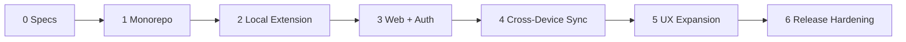

# SessionHub — Development Roadmap & Acceptance Backlog

**Status:** M2 and M3 done; M0 and M1 each have one open item; M4 done (10 of 10); M5 and M6 not started (verified 2026-10-16). See `PROGRESS.md`.  
**Delivery principle:** End-to-end tested vertical slices before broad UI feature completion.

## Recommended ordering

## M0 — Architectural validation and specifications

- [x] Initial proposed PRD and system design written.
- [x] UI/UX structure, wireframes, user flows written.
- [x] Initial data model, sync contract, privacy model, tests/backlog written.
- [x] Agent validates versions/APIs against latest official docs before installing packages. (2026-10-16, see SYSTEM_DESIGN.md section 14)
- [ ] Open security/UX decisions resolved and recorded.

**Done when:** Proposed decisions agree with Chrome extension capabilities, WXT, auth and database versions. No claim that code is complete.

## M1 — Monorepo setup

- [x] Initialize pnpm/Turborepo, TypeScript strict shared configs.
- [x] Initialize WXT extension with popup/background/manager entrypoints.
- [x] Initialize Next.js App Router and shared UI tokens.
- [x] Create `packages/core`, `contracts`, `database`, `sync`, `ui` with lint/build boundaries. (`sync` added 2026-10-16 with the pull rules)
- [x] Configure Vitest, React Testing Library, Playwright baseline.
- [x] Set up local dev env docs and CI lint/typecheck/build. (CI workflow written, not yet run on GitHub)

**Done when:** Dev apps launch in isolation, lint/typecheck/build pass; recorded commands work.

## M2 — Functional local extension MVP (highest priority)

- [x] Capture current/all Chrome windows, tabs, groups using supported APIs.
- [x] Normalize and classify URLs; assign stable persistent IDs.
- [x] Persist session atomically in IndexedDB (Dexie or equivalent).
- [x] Popup quick-save and recent sessions view.
- [x] Manager list/search, rename/delete local saved sessions.
- [x] Restore full session in **new windows by default** with preview.
- [x] Show unsupported/failed tabs; partial restore retry.
- [x] Automatic snapshots with bounded retention and MV3 alarms.
- [x] Versioned JSON export/import validation.
- [x] Tests for restart, quota failure, large tab count, service-worker interruption. (Browser restart and worker stop in real Chromium; quota failure with injected Dexie errors only, a real quota could not be forced; 120 live tabs in real Chromium with baselines in `TEST_PLAN.md` 5.1; 500-tab capture as a unit test.)

**Done when:** Local saving/recovery works without account/internet after restart and tests pass.

## M3 — Web app, authentication and cloud data APIs

- [x] Add PostgreSQL, Prisma schema and safe migrations. (Initial migration; integration tests run it from scratch.)
- [x] Integrate Better Auth with correct current adapter/version. (1.7.9, Prisma adapter, auth models regenerated from the real config: no changes.)
- [x] Implement signup/sign-in/password reset/account security. (Sign-up, sign-in, sign-out, rate limiting, safe redirects, password reset with session revocation, email confirmation, change password; email via Resend or Mailpit.)
- [x] Build web dashboard shell from UI/UX specification. (Overview, Saved sessions, Devices, Settings; see UI_UX_DESIGN.md 18c for deviations.)
- [x] Add session/workspace/device list/detail/read/write API with ownership checks. (`/api/v1/sessions`, `/api/v1/workspaces`, `/api/v1/devices` list/rename/revoke; device registration belongs to M4 pairing.)
- [x] Emit server sync changes for all web mutations. (Every session create/update/delete writes `sync_changes` with a gap-free per-user sequence.)
- [x] Create Docker local Compose and healthchecks. (`compose.dev.yaml`: PostgreSQL for development; `compose.yaml`: postgres -> `prisma migrate deploy` job -> web, all with healthchecks; tested by `pnpm test:docker`.)
- [x] Unit/API/auth tests including cross-user access denial.

**Done when:** Signed-in user can create/manage canonical saved-session records via web without Chrome extension APIs.

## M4 — Secure cross-device synchronization

- [x] Design/implement extension-compatible pairing with explicit trusted origins and revocable device credentials. (Device flow + rotating hashed credentials, one host permission for the configured server; SECURITY_PRIVACY.md 5a.)
- [x] Implement local account scope and durable operation outbox. (2026-10-16: scope + outbox + tombstones in IndexedDB, atomic with each edit; nothing uploads until push exists)
- [x] Add server per-user sync clock and atomic ordered changelog. (Since M3: `user_sync_clocks` locked first, gap-free `sync_changes` for every session and workspace write; DB-tested including concurrency. `sync/push` will reuse it.)
- [x] Implement versioned `/api/v1/sync/push` with idempotency receipts. (2026-10-16: receipts for accepted, conflicting and rejected operations; extension uploader with backoff)
- [x] Implement paginated `/api/v1/sync/pull` with safe cursors. (2026-10-16: HMAC-bound cursors, `CURSOR_EXPIRED` + `/sync/bootstrap`)
- [x] Add offline backoff, worker restart continuation, pull echo reconciliation. (2026-10-16: shared backoff with Retry-After; `sending` resent and bootstrap resumed after a worker restart; own echoes ignored, held server copies settled after acceptance)
- [x] Handle versions/tombstones/conflicts and preserve both copies when needed. (2026-10-16: tombstones never undone; conflicts keep both sides; conflict review with keep mine / keep the other version / keep both, verified across two real profiles)
- [x] UX states for local-only/pending/synced/error/conflict. (2026-10-16: status chip, per-session labels, Account view sync card with opt-in and upload preview; UI_UX_DESIGN.md 18e)
- [x] Two distinct profile test: Windows-origin session appears on Mac simulation. (`apps/web/e2e/sync-two-profiles.spec.ts`: create, rename and delete across two real extension profiles)
- [x] Test browser actions are never executed on source/remote device without local confirmation. (same spec: tab URLs unchanged on the receiving profile around every pull; pull code has no browser access)

**Done when:** Multi-device saved sessions sync reliably with no data loss under retry/offline/concurrent edits.

## M5 — Full experience / refinement

- [ ] Side panel with live tab tree, search, focus/move/group.
- [ ] Workspace switcher and saved-session assignment. (2026-10-17: server and sync side done: sync push takes workspace operations and a session's `workspaceId`, bootstrap carries workspaces, SYNC_PROTOCOL.md 13f/13g. Extension store, switcher and assignment: next PR.)
- [ ] Advanced session inspector, tags/filters/sort/bulk select.
- [ ] Versions and recovery timeline with useful preview.
- [ ] Device management and revocation UX.
- [ ] Responsive mobile web session library.
- [ ] Accessibility and keyboard audit.
- [ ] High-volume virtualization and performance tuning.

**Done when:** UI meets documented workflows and passes accessibility/mobile/high-volume tests.

## M6 — Production hardening and release

- [ ] Validate required Chrome permissions and MV3 compliance.
- [ ] Complete privacy policy/user-data disclosures and store copy.
- [ ] Run abuse/security, race/concurrency and restore failure tests.
- [x] Add rate limiting, observability with URL redaction, resource limits. (2026-10-16/17: shared PostgreSQL rate limits incl. reads and Better Auth; structured redacted JSON logs with request ids; bounded body reads, database timeouts, 5,000 sessions per account; SECURITY_PRIVACY.md 8a)
- [ ] Production Dockerfile and Coolify deployment checklist. (Dockerfile: done, `infra/docker/web.Dockerfile`; checklist: `docs/DEPLOYMENT.md` with proxy/client IP, TLS, environment and deploy order, 2026-10-17; backups section pending.)
- [ ] Verify TLS, trusted proxy, DB migration and off-host backup restore. (App side done 2026-10-17: trusted-proxy client IP, https required in production, HSTS, `Secure` cookies; verifying on a real deployment, `DEPLOYMENT.md` checks, is pending.)
- [x] CI production extension ZIP and web build. (2026-10-17: `extension-zip` job, built twice and checked by `check-release-zip.ts`; the web production image is built by the `docker` job on every PR. `DEPLOYMENT.md` section 6)
- [ ] Document release/rollback process and known limitations.

**Done when:** Release candidate meets `TEST_PLAN.md`, operational deployment has been verified and user-facing security claims are accurate.

## Later / intentionally deferred

- Cloud backup of automatic recovery history (separate opt-in and storage costs).
- WebSocket/near-real-time changes.
- E2EE/zero-knowledge vault with audited key management.
- Shared/team workspaces and collaboration permissions.
- Firefox/Edge support, mobile extension behavior where platform supports it.
- AI-driven tab grouping, usage analytics and billing.

## Scope control rules

- If M2 is not functional, don't prioritize visual polish over local recovery.
- If auth/sync security is unresolved, don't ship device pairing.
- No addition to MVP without user value, threat model, test acceptance and impact to architecture.
- An unchecked roadmap item is not implemented; update only after verifying code/tests.
