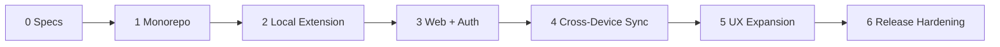

# SessionHub — Development Roadmap & Acceptance Backlog

**Status:** M0 version validation and M1 done; M2 in progress (first local slice verified 2026-10-16). See `PROGRESS.md`.  
**Delivery principle:** End-to-end tested vertical slices before broad UI feature completion.

## Recommended ordering

## M0 — Architectural validation and specifications

- [x] Initial proposed PRD and system design written.
- [x] UI/UX structure, wireframes, user flows written.
- [x] Initial data model, sync contract, privacy model, tests/backlog written.
- [x] Agent validates versions/APIs against latest official docs before installing packages. (2026-10-16, see SYSTEM_DESIGN.md section 14)
- [ ] Open security/UX decisions resolved and recorded.

**Done when:** Proposed decisions agree with Chrome extension capabilities, WXT, auth and database versions. No claim that code is complete.

## M1 — Monorepo setup

- [x] Initialize pnpm/Turborepo, TypeScript strict shared configs.
- [x] Initialize WXT extension with popup/background/manager entrypoints.
- [x] Initialize Next.js App Router and shared UI tokens.
- [ ] Create `packages/core`, `contracts`, `database`, `sync`, `ui` with lint/build boundaries. (core, contracts, ui done; `database` deferred to M3 and `sync` to M4 so no empty packages exist)
- [x] Configure Vitest, React Testing Library, Playwright baseline.
- [x] Set up local dev env docs and CI lint/typecheck/build. (CI workflow written, not yet run on GitHub)

**Done when:** Dev apps launch in isolation, lint/typecheck/build pass; recorded commands work.

## M2 — Functional local extension MVP (highest priority)

- [x] Capture current/all Chrome windows, tabs, groups using supported APIs.
- [x] Normalize and classify URLs; assign stable persistent IDs.
- [x] Persist session atomically in IndexedDB (Dexie or equivalent).
- [x] Popup quick-save and recent sessions view.
- [x] Manager list/search, rename/delete local saved sessions.
- [x] Restore full session in **new windows by default** with preview.
- [x] Show unsupported/failed tabs; partial restore retry.
- [ ] Automatic snapshots with bounded retention and MV3 alarms.
- [x] Versioned JSON export/import validation.
- [ ] Tests for restart, quota failure, large tab count, service-worker interruption. (browser restart and worker stop in real Chromium, 500-tab capture as a unit test: done; quota failure and large live-browser restore: pending)

**Done when:** Local saving/recovery works without account/internet after restart and tests pass.

## M3 — Web app, authentication and cloud data APIs

- [ ] Add PostgreSQL, Prisma schema and safe migrations.
- [ ] Integrate Better Auth with correct current adapter/version.
- [ ] Implement signup/sign-in/password reset/account security.
- [ ] Build web dashboard shell from UI/UX specification.
- [ ] Add session/workspace/device list/detail/read/write API with ownership checks.
- [ ] Emit server sync changes for all web mutations.
- [ ] Create Docker local Compose and healthchecks.
- [ ] Unit/API/auth tests including cross-user access denial.

**Done when:** Signed-in user can create/manage canonical saved-session records via web without Chrome extension APIs.

## M4 — Secure cross-device synchronization

- [ ] Design/implement extension-compatible pairing with explicit trusted origins and revocable device credentials.
- [ ] Implement local account scope and durable operation outbox.
- [ ] Add server per-user sync clock and atomic ordered changelog.
- [ ] Implement versioned `/api/v1/sync/push` with idempotency receipts.
- [ ] Implement paginated `/api/v1/sync/pull` with safe cursors.
- [ ] Add offline backoff, worker restart continuation, pull echo reconciliation.
- [ ] Handle versions/tombstones/conflicts and preserve both copies when needed.
- [ ] UX states for local-only/pending/synced/error/conflict.
- [ ] Two distinct profile test: Windows-origin session appears on Mac simulation.
- [ ] Test browser actions are never executed on source/remote device without local confirmation.

**Done when:** Multi-device saved sessions sync reliably with no data loss under retry/offline/concurrent edits.

## M5 — Full experience / refinement

- [ ] Side panel with live tab tree, search, focus/move/group.
- [ ] Workspace switcher and saved-session assignment.
- [ ] Advanced session inspector, tags/filters/sort/bulk select.
- [ ] Versions and recovery timeline with useful preview.
- [ ] Device management and revocation UX.
- [ ] Responsive mobile web session library.
- [ ] Accessibility and keyboard audit.
- [ ] High-volume virtualization and performance tuning.

**Done when:** UI meets documented workflows and passes accessibility/mobile/high-volume tests.

## M6 — Production hardening and release

- [ ] Validate required Chrome permissions and MV3 compliance.
- [ ] Complete privacy policy/user-data disclosures and store copy.
- [ ] Run abuse/security, race/concurrency and restore failure tests.
- [ ] Add rate limiting, observability with URL redaction, resource limits.
- [ ] Production Dockerfile and Coolify deployment checklist.
- [ ] Verify TLS, trusted proxy, DB migration and off-host backup restore.
- [ ] CI production extension ZIP and web build.
- [ ] Document release/rollback process and known limitations.

**Done when:** Release candidate meets `TEST_PLAN.md`, operational deployment has been verified and user-facing security claims are accurate.

## Later / intentionally deferred

- Cloud backup of automatic recovery history (separate opt-in and storage costs).
- WebSocket/near-real-time changes.
- E2EE/zero-knowledge vault with audited key management.
- Shared/team workspaces and collaboration permissions.
- Firefox/Edge support, mobile extension behavior where platform supports it.
- AI-driven tab grouping, usage analytics and billing.

## Scope control rules

- If M2 is not functional, don't prioritize visual polish over local recovery.
- If auth/sync security is unresolved, don't ship device pairing.
- No addition to MVP without user value, threat model, test acceptance and impact to architecture.
- An unchecked roadmap item is not implemented; update only after verifying code/tests.
