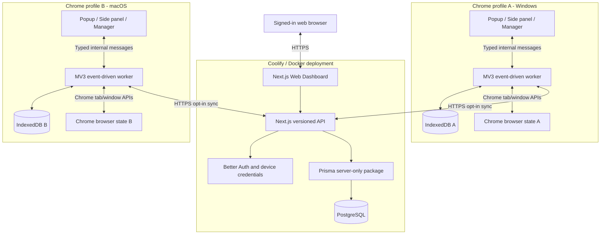
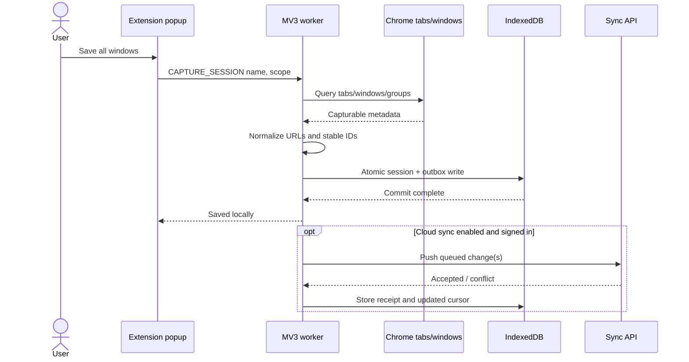
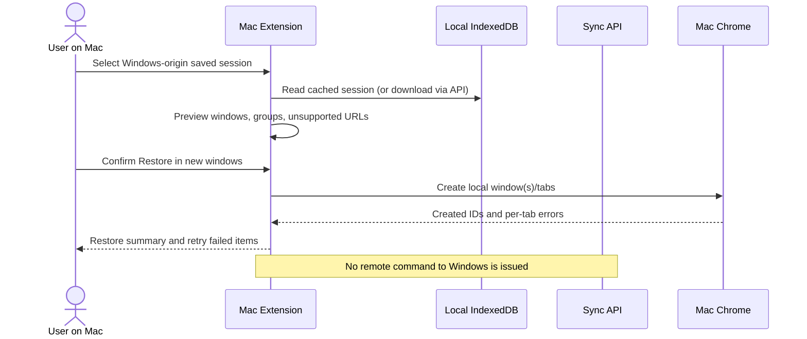
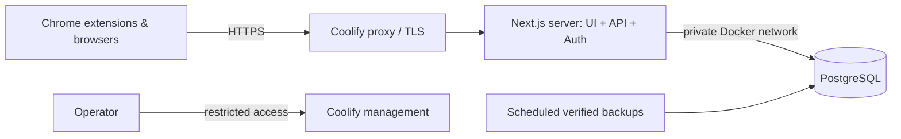
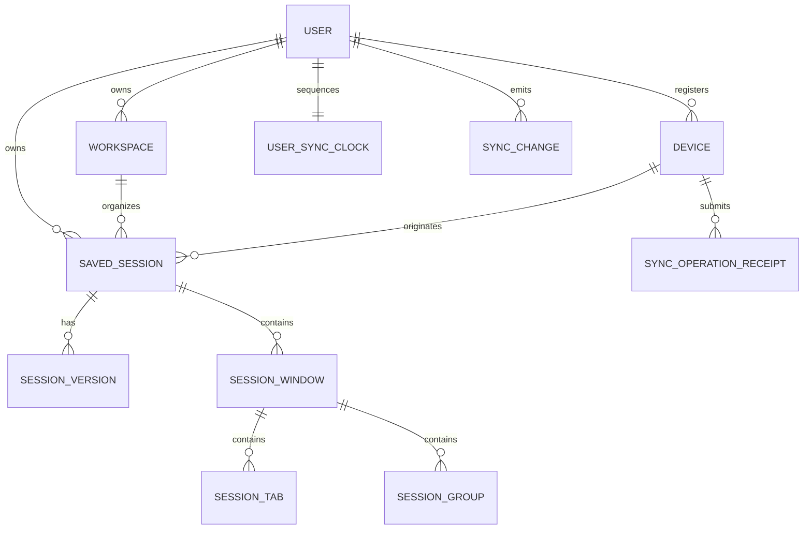
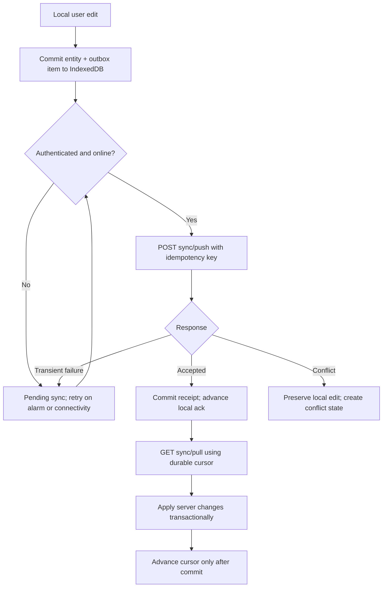

# SessionHub — System Design

> **Document type:** Architecture and system-design reference (initial proposal).  
> **Status:** Unimplemented design; verify choices against actual integrations.  
> **Updated:** 2026-10-16.

## 1. Executive summary

SessionHub comprises a Chrome MV3 extension, a Next.js companion application, and an authenticated synchronization API backed by PostgreSQL. The extension is the **only** part that reads or changes live Chrome tabs/windows. It writes sessions to IndexedDB first. Cloud upload is optional, and the web app reads/writes saved entities through server authorization—not Chrome APIs.

### Architecture goals

- Persist recoverable browser context offline.
- Let one user access saved sessions across browser installations.
- Make retry, crash, conflict, and partial failure safe.
- Keep the runtime and deployment simple: one web/API deployment and one PostgreSQL database for MVP.
- Make privacy and data ownership understandable and enforceable.

### Non-goals

- Continuous mirroring of live tabs across machines.
- Remote execution of browser actions without local user involvement.
- Gathering content of visited web pages.
- Full native history/form/cookie restoration.
- Always-on extension background processes.

## 2. Container / system context



**Trust boundaries:** Browser APIs belong to the extension. The web app does not have extension privileges. The API validates identity, resource ownership, quotas, request shape and operation versions; the browser extension and its IndexedDB are untrusted from the server's perspective.

## 3. Components and responsibilities

| Component | Owns | Must not own |
|---|---|---|
| Extension popup | Fast save/find/restore entry, current sync status | Persistent source-of-truth state |
| Extension manager | Dense browsing/history/workspace UI | Server credentials or direct DB access |
| Extension side panel | Live tab navigation and quick organization | Persistent long-running sync loop |
| MV3 service worker | Chrome API adapters, event coalescing, alarms, sync orchestration, messaging | Reliance on globals after idle shutdown |
| Extension IndexedDB | Local snapshots, saved session drafts, outbox, cursors, cached remote records | Cross-user cloud authority |
| Core package | Serialization, URL classification, restore plans, domain invariants | Browser globals or network side effects |
| Sync package | Operation types, deterministic merge/reconciliation functions | Cookies, Prisma, DB connection |
| Contracts package | Zod schemas, DTOs, error codes | Secrets, database client |
| Web UI | Account/admin screens, saved resources, export, restore-to-extension *intent* | Direct access to `chrome.tabs` |
| API routes | Authentication, ownership, validation, versioned mutations, push/pull | In-process durability guarantees |
| Database package | Prisma schema, repositories, migrations | Imports from browser bundles |
| PostgreSQL | Canonical synced state, versions, idempotency receipts, ordered change log | Automatically controlling live device state |

## 4. Proposed monorepo ownership boundaries

```text
apps/
  extension/
    entrypoints/
      background.ts
      popup/index.html + main.tsx
      sidepanel/index.html + main.tsx
      manager/index.html + main.tsx
    features/{sessions,search,restore,workspaces,sync,settings}/
    adapters/{chrome,storage,api}/
  web/
    src/app/(marketing)/
    src/app/(auth)/
    src/app/(app)/{overview,workspaces,sessions,devices,settings}/
    src/app/api/v1/{devices,workspaces,sessions,sync}/
    src/server/{auth,repositories,services}/
packages/
  core/            # Pure serialization and restore planning
  contracts/       # Cross-client Zod schemas and DTOs
  sync/            # Reconciliation and operation semantics
  database/        # Server-only Prisma client and migrations
  ui/              # Shared tokens and primitives; no server-only imports
  eslint-config/
  typescript-config/
infra/docker/
docs/
references/
```

WXT entrypoints must follow its supported directory naming rules. The exact build-time entrypoint structure should be validated against the current WXT docs.

## 5. Key data ownership and lifecycle

### 5.1 Session capture



**Critical:** A successful local save must not wait for network success. Never show "Synced" before server acknowledgment. Persist failures with retry information.

### 5.2 Restore from another device



### 5.3 Automatic recovery

1. Register Chrome tab/window/group events and `alarms` listeners at worker module initialization.
2. Mark current view as dirty in durable local state when meaningful changes occur.
3. Debounce/coalesce rapid events; periodically read a consistent browser snapshot on a scheduled alarm.
4. Commit the new immutable checkpoint to IndexedDB in one transaction when materially changed.
5. Retain bounded snapshots with explicit retention. Never evict the last good snapshot due solely to an incomplete new snapshot.
6. On startup, reconcile observed Chrome state and show latest snapshots; do not claim crash detection is exact.

Chrome may suspend MV3 service workers after inactivity; closures/updates can interrupt any in-memory work. Durable operations, alarms and idempotent recovery are mandatory.

## 6. Deployment design



### Services

- `web`: stateless Next.js Docker container; includes API Route Handlers and Better Auth.
- `postgres`: persistent volume, private network, least-privileged application user. For production, a separately managed DB is also acceptable.
- `backup`: operator-managed backup job writing encrypted off-host copies, with **tested restores**.
- `proxy`: HTTPS, secure headers, proper forwarded-host trust. Only externally expose application HTTPS.

Prisma migrations occur in an explicit deploy step with safe rollback planning, not separately in every replica at startup. Run web application with server-only generated client. Include `/api/health` that checks readiness without leaking internals; optionally separate liveness and readiness.

### Runtime configuration (examples, not working secrets)

| Variable | Purpose |
|---|---|
| `DATABASE_URL` | Server-only PostgreSQL connection |
| `BETTER_AUTH_SECRET` | Server-only auth signing key |
| `BETTER_AUTH_URL` | Public HTTPS origin |
| `ALLOWED_EXTENSION_IDS` | Explicit extension IDs for trusted origin/bridge |
| `APP_BASE_URL` | Web origin used for generated links |
| `NEXT_PUBLIC_APP_URL` | Safe public web origin only |
| `WXT_API_BASE_URL` | Allowlisted API origin in extension build; no secrets |

No secret values in `NEXT_PUBLIC_*`, `WXT_*` build artifacts, shared packages, or client environment.

## 7. Authentication and extension pairing

### Web

Use Better Auth for email/password, email verification, password reset, session management, and required CSRF protections. Verify the supported adapter and migration flow.

### Extension

Avoid assuming the web app's same-site cookies automatically authenticate the extension. Implement or formally validate a browser-extension-compatible authorization flow:

1. Extension starts pairing, creates random high-entropy state and PKCE verifier if using code exchange, and stores ephemeral proof securely.
2. Opens a user-initiated HTTPS login/consent page on the web app.
3. Web app authenticates the user and presents a clear device authorization prompt.
4. Backend issues a one-time short-lived code bound to state, extension installation, origin, and PKCE challenge where applicable.
5. Use **allowlisted** external message bridge or verified identity redirect flow to return the code; never put long-lived credentials into query parameters.
6. Extension redeems code once for a revocable device session; ensure token rotation/expiry and server-side ownership checks.
7. On device revocation, further API access is rejected and queued changes remain local until a fresh login.

Treat this as a **design requiring security review**, not a drop-in guaranteed Better Auth default feature. Better Auth has an official browser-extension integration guide; validate its exact security model before finalizing the implementation.

The dashboard may expose a **Restore with extension** action only if extension presence/allowed bridge is detected, and a local browser gesture + confirmation is required. An `externally_connectable` message must be strictly origin validated and accept only non-destructive scoped requests; treat external messages as untrusted and consider an in-extension user confirmation mandatory.

## 8. Data model overview



This ERD is **logical, not a complete Prisma schema**. Refer to `DATA_MODEL.md` for entity details, ownership, indices and deletion semantics. Recovery snapshots are primarily local IndexedDB records and are deliberately **not** automatically synced in MVP.

## 9. Sync design — concise

For all editable cloud-synced entities, use account-scoped incremental push/pull. Operations are issued from an IndexedDB outbox and are idempotent. Every accepted mutation increments an account-specific ordered server change sequence *transactionally* alongside its data change. The client uses a durable opaque cursor to fetch changes after a known sequence.

Core entities carry `version` integers for optimistic concurrency. A stale update yields an explicit conflict and the latest server representation. Disjoint metadata edits may be safely merged where specified; for conflicting session structures keep a conflict copy, not last-write-wins deletion.



**Ordering safety:** Sequence assignment and change insertion must be protected by a per-user transactional serialization mechanism. A cursor must never skip a committed change that was assigned an earlier sequence but committed later. Do not use bare database sequences without considering commit-order races.

See `SYNC_PROTOCOL.md` for JSON examples, error taxonomy, tombstones and failure recovery.

## 10. Chrome capabilities and limitations

| Feature | Capability and caution |
|---|---|
| Read tab title/URL/favicon | Requires appropriate Chrome `tabs` permission or host access; disclose sensitive scope |
| Create/rearrange windows/tabs | Use `chrome.windows` and `chrome.tabs`; some URLs cannot be reopened |
| Restore groups | Recreate groups with new runtime group IDs and apply supported metadata |
| Background reliability | MV3 event-driven service worker can terminate; use durable state and alarms |
| IndexedDB | Local durable records while profile/extension remains; not equivalent to independent backup |
| Chrome `storage.sync` | Approx. 100 KB total; not suitable for a session history database |
| Web access to extension | `externally_connectable` bridge possible with exact allowed origins; constrained commands only |
| Website without extension | No direct access to live Chrome tab/window APIs |

A private/incognito window is excluded by default. Chrome internal, restricted, file, and extension URLs require classification and safe handling. URLs may contain sensitive query parameters or access tokens; sync/filter/redaction behavior is specified in `SECURITY_PRIVACY.md`.

## 11. Reliability / operational concerns

| Failure mode | Required behavior |
|---|---|
| Worker idle termination | Resume from IndexedDB outbox/checkpoint, not in-memory global queue |
| Save interrupted | Atomic commit or no state change; previous snapshots retained |
| Offline use | Local save/restore continue; pending sync badge, retry later |
| Duplicate API submission | Same idempotency key gets original result, no duplicate entity/change |
| Concurrent edits | Compare versions; preserve both sides if conflict unresolved |
| Partial restore | Record successes/failures; allow retry failures without reopening successes |
| DB outage | Cloud degraded but local extension remains functional |
| Disk/IDB quota exhaustion | Clearly notify; limit retention; protect latest known-good snapshot |
| Schema migration failure | Preserve prior data and provide export/recovery instructions |
| User account deletion | Confirm irreversible cloud deletion; respect backup retention disclosures |

## 12. Architecture decisions and tradeoffs

| Decision | Rationale | Cost / tradeoff |
|---|---|---|
| Single Next.js app/API for MVP | Fewer services, shared auth/Prisma boundaries | Extracting API requires future refactor |
| WXT + MV3 | Maintained extension development workflow | Must design for worker lifecycle |
| IndexedDB first | Offline durability and resilient UI | Synchronization complexity |
| Snapshot and saved-session separation | Prevent background churn from becoming user's cloud truth | Two data models, retention policy |
| User-initiated restore only | Prevent remote destructive side effects | Not live-tab mirroring |
| Server ordered changelog | Efficient pull and explicit conflict sequence | Requires atomic per-account ordering |
| No realtime WebSocket initially | Lower operational burden, resilient polling | Not instant cross-device UI refresh |
| Cloud recovery snapshots off by default | Stronger privacy / storage control | Recovery history remains local unless enabled later |
| No E2EE claim for MVP | Honest security properties | Server administrators technically can access decrypted records |

### Decisions deliberately deferred

Sharing, pricing, team workspaces, public APIs, encryption vault design, alternative browsers, push notifications, long-term analytics.

## 13. Current implementation status

Verified 2026-10-16 (details in `PROGRESS.md`): monorepo skeleton, and the local extension slice *capture -> IndexedDB -> list/search -> restore into new windows*, plus rename, delete and JSON export. The web app is a static shell with `/api/health`. Auth, database, sync, side panel, recovery snapshots and import are **not implemented**. Everything else in this document is still intended behavior.

## 14. Implementation decisions log

| Date | Decision | Why | Revisit when |
|---|---|---|---|
| 2026-10-16 | TypeScript **6.0.x**, not 7.0 | `typescript-eslint` 8.71 supports `<6.1.0`; TS 7 (native compiler) would break linting | typescript-eslint supports TS 7 |
| 2026-10-16 | Pin dependencies that pass pnpm 11's default `minimumReleaseAge` (1 day): Next 16.4.1, Vitest 5.0.3, jsdom 30.1.2 (workspace override) | Supply-chain guard; no exclusions added | Routine upgrades |
| 2026-10-16 | Prisma **7.x stable** for M3 (not 8.0 RC) | npm `latest` tag is `8.0.0-rc.23`; Better Auth 1.7 peers `prisma ^5 \|\| ^6 \|\| ^7` | Prisma 8 GA and Better Auth support |
| 2026-10-16 | WXT 0.21 with `imports: false` (explicit imports), `srcDir: src`, React module, Tailwind v4 via `@tailwindcss/vite` | Readable module boundaries; no generated globals | - |
| 2026-10-16 | Background worker is the **single writer**. Pages send Zod-validated commands (`session.capture`, `session.rename`, `session.delete`, `restore.start`); pages read IndexedDB directly through Dexie `liveQuery` | A popup closes as soon as a restore focuses a new window, so writes and restores must not run in page context. Reads stay fast and live across contexts | When an outbox is added (M4), commands also enqueue sync operations in the same transaction |
| 2026-10-16 | Messages are accepted only when `sender.id` is this extension and `sender.url` is an extension page; no `externally_connectable` | No content scripts and no web bridge exist yet | Web-to-extension bridge design (M4/M5) |
| 2026-10-16 | Restore planner re-classifies every URL at plan time; only `http(s)` URLs are ever opened | Stored `eligibility` could be tampered with (future import) | URL policy changes (bump `URL_CLASSIFIER_VERSION`) |
| 2026-10-16 | Restore job record (plan + per-tab outcomes) is written **before** any tab opens, then appended per window | An interrupted restore remains inspectable; enables "retry failed only" next | Retry UX and job retention (pending) |
| 2026-10-16 | Local delete is a hard delete with confirmation | No sync exists, so no tombstone consumer yet | M4 adds tombstones for synced sessions |
| 2026-10-16 | Favicons via Chrome's `_favicon` endpoint (`favicon` permission) instead of stored `favIconUrl` | No third-party icon requests and no stored remote icon URLs | - |
| 2026-10-16 | Import sends the **raw file text** in a `session.import` command; the worker parses, re-validates, re-identifies and inserts it with `add()`. The manager builds its preview with the same core functions | Pages are not trusted to hand the worker a prepared session; `add()` makes overwriting impossible | - |
| 2026-10-16 | Imported sessions keep their original name; no automatic renaming on duplicates. They are labeled "Imported from <device>" via `sourceDeviceId: null` | Avoids scanning every stored session on import; provenance is still visible | If users find same-named copies confusing |
| 2026-10-16 | Retry (`restore.retry`) reopens only planned tabs with no `opened` outcome, in **new windows**, from the plan stored in the job (works even if the session was deleted). Concurrency guard: compare-and-set `partial`/`failed` -> `running` in one IndexedDB transaction | The realistic failure is the user closing a restored window mid-restore, so reusing that window isn't safe; the CAS stops a double click from opening tabs twice | Stale `running` jobs after a killed worker need a timeout-based recovery |
| 2026-10-16 | Restore jobs always settle their status from recorded outcomes, even when a step throws | Otherwise a job stays `running` forever and blocks retry | - |
| 2026-10-16 | `packages/database` and `packages/sync` not created yet | Empty packages add no value; created with M3/M4 | M3 / M4 |
| 2026-10-16 | Web app uses the ESLint CLI with the shared config, not `eslint-config-next` | `next lint` was removed in Next 16; `eslint-config-next` 16.4 depends on `eslint-plugin-react` 7.37, which does not declare ESLint 10 support | eslint-plugin-react supports ESLint 10 |

## 15. Authoritative references

- [Chrome extension service-worker lifecycle](https://developer.chrome.com/docs/extensions/develop/concepts/service-workers/lifecycle)
- [Chrome storage API and quotas](https://developer.chrome.com/docs/extensions/reference/api/storage)
- [Chrome tabs API](https://developer.chrome.com/docs/extensions/reference/api/tabs)
- [Chrome messaging and `externally_connectable`](https://developer.chrome.com/docs/extensions/develop/concepts/messaging)
- [Chrome side panel](https://developer.chrome.com/docs/extensions/reference/api/sidePanel)
- [WXT entrypoints](https://wxt.dev/guide/essentials/entrypoints)
- [Better Auth browser extension guide](https://better-auth.com/docs/guides/browser-extension-guide)
- [Prisma / Turborepo guide](https://www.prisma.io/docs/guides/deployment/turborepo)
- [Chrome Web Store policies](https://developer.chrome.com/docs/webstore/program-policies)
