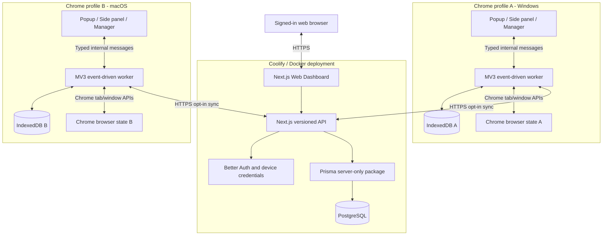
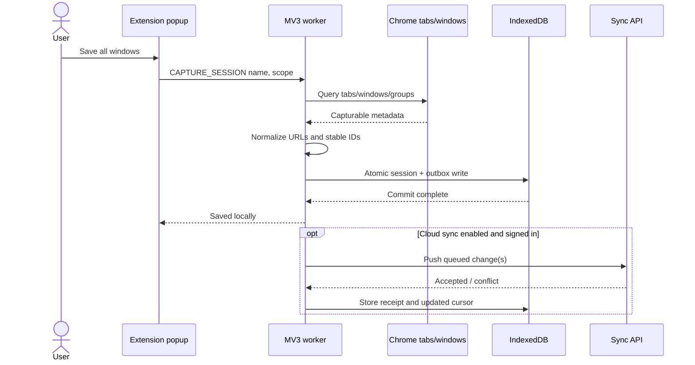
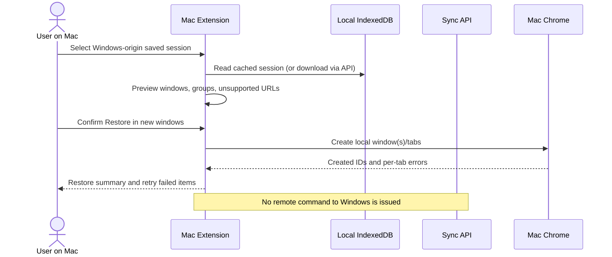
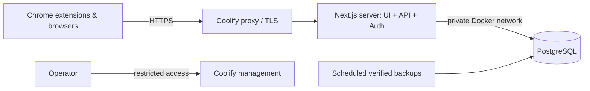
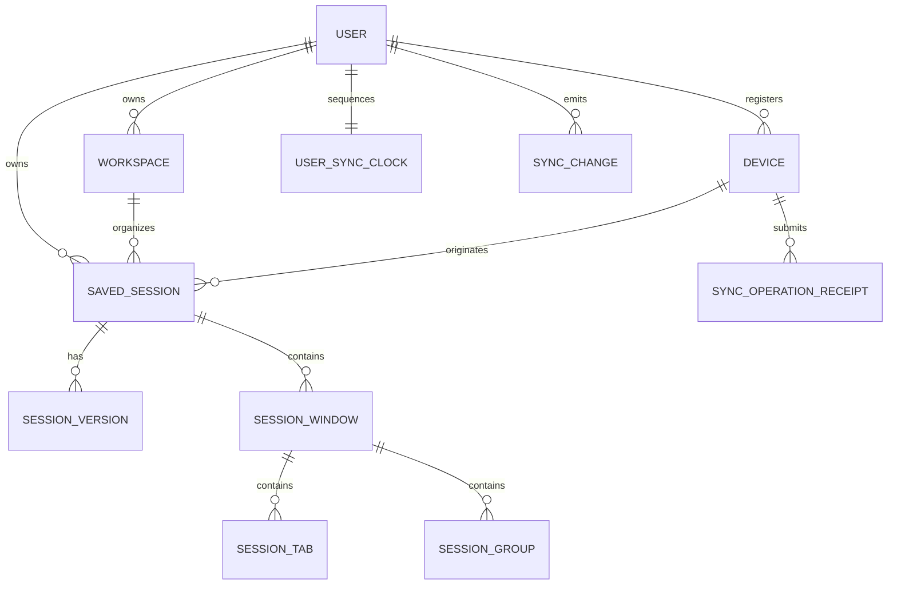
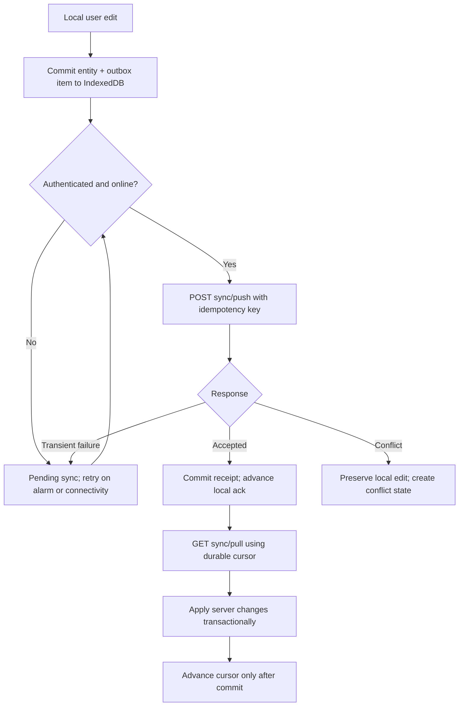

# SessionHub — System Design

> **Document type:** Architecture and system-design reference (initial proposal).  
> **Status:** Unimplemented design; verify choices against actual integrations.  
> **Updated:** 2026-10-16.

## 1. Executive summary

SessionHub comprises a Chrome MV3 extension, a Next.js companion application, and an authenticated synchronization API backed by PostgreSQL. The extension is the **only** part that reads or changes live Chrome tabs/windows. It writes sessions to IndexedDB first. Cloud upload is optional, and the web app reads/writes saved entities through server authorization—not Chrome APIs.

### Architecture goals

- Persist recoverable browser context offline.
- Let one user access saved sessions across browser installations.
- Make retry, crash, conflict, and partial failure safe.
- Keep the runtime and deployment simple: one web/API deployment and one PostgreSQL database for MVP.
- Make privacy and data ownership understandable and enforceable.

### Non-goals

- Continuous mirroring of live tabs across machines.
- Remote execution of browser actions without local user involvement.
- Gathering content of visited web pages.
- Full native history/form/cookie restoration.
- Always-on extension background processes.

## 2. Container / system context



**Trust boundaries:** Browser APIs belong to the extension. The web app does not have extension privileges. The API validates identity, resource ownership, quotas, request shape and operation versions; the browser extension and its IndexedDB are untrusted from the server's perspective.

## 3. Components and responsibilities

| Component | Owns | Must not own |
|---|---|---|
| Extension popup | Fast save/find/restore entry, current sync status | Persistent source-of-truth state |
| Extension manager | Dense browsing/history/workspace UI | Server credentials or direct DB access |
| Extension side panel | Live tab navigation and quick organization | Persistent long-running sync loop |
| MV3 service worker | Chrome API adapters, event coalescing, alarms, sync orchestration, messaging | Reliance on globals after idle shutdown |
| Extension IndexedDB | Local snapshots, saved session drafts, outbox, cursors, cached remote records | Cross-user cloud authority |
| Core package | Serialization, URL classification, restore plans, domain invariants | Browser globals or network side effects |
| Sync package | Operation types, deterministic merge/reconciliation functions | Cookies, Prisma, DB connection |
| Contracts package | Zod schemas, DTOs, error codes | Secrets, database client |
| Web UI | Account/admin screens, saved resources, export, restore-to-extension *intent* | Direct access to `chrome.tabs` |
| API routes | Authentication, ownership, validation, versioned mutations, push/pull | In-process durability guarantees |
| Database package | Prisma schema, repositories, migrations | Imports from browser bundles |
| PostgreSQL | Canonical synced state, versions, idempotency receipts, ordered change log | Automatically controlling live device state |

## 4. Proposed monorepo ownership boundaries

```text
apps/
  extension/
    entrypoints/
      background.ts
      popup/index.html + main.tsx
      sidepanel/index.html + main.tsx
      manager/index.html + main.tsx
    features/{sessions,search,restore,workspaces,sync,settings}/
    adapters/{chrome,storage,api}/
  web/
    src/app/(marketing)/
    src/app/(auth)/
    src/app/(app)/{overview,workspaces,sessions,devices,settings}/
    src/app/api/v1/{devices,workspaces,sessions,sync}/
    src/server/{auth,repositories,services}/
packages/
  core/            # Pure serialization and restore planning
  contracts/       # Cross-client Zod schemas and DTOs
  sync/            # Reconciliation and operation semantics
  database/        # Server-only Prisma client and migrations
  ui/              # Shared tokens and primitives; no server-only imports
  eslint-config/
  typescript-config/
infra/docker/
docs/
references/
```

WXT entrypoints must follow its supported directory naming rules. The exact build-time entrypoint structure should be validated against the current WXT docs.

## 5. Key data ownership and lifecycle

### 5.1 Session capture



**Critical:** A successful local save must not wait for network success. Never show "Synced" before server acknowledgment. Persist failures with retry information.

### 5.2 Restore from another device



### 5.3 Automatic recovery

1. Register Chrome tab/window/group events and `alarms` listeners at worker module initialization.
2. Mark current view as dirty in durable local state when meaningful changes occur.
3. Debounce/coalesce rapid events; periodically read a consistent browser snapshot on a scheduled alarm.
4. Commit the new immutable checkpoint to IndexedDB in one transaction when materially changed.
5. Retain bounded snapshots with explicit retention. Never evict the last good snapshot due solely to an incomplete new snapshot.
6. On startup, reconcile observed Chrome state and show latest snapshots; do not claim crash detection is exact.

Chrome may suspend MV3 service workers after inactivity; closures/updates can interrupt any in-memory work. Durable operations, alarms and idempotent recovery are mandatory.

## 6. Deployment design



### Services

- `web`: stateless Next.js Docker container; includes API Route Handlers and Better Auth.
- `postgres`: persistent volume, private network, least-privileged application user. For production, a separately managed DB is also acceptable.
- `backup`: operator-managed backup job writing encrypted off-host copies, with **tested restores**.
- `proxy`: HTTPS, secure headers, proper forwarded-host trust. Only externally expose application HTTPS. Operator checklist: `DEPLOYMENT.md`.

Prisma migrations occur in an explicit deploy step with safe rollback planning, not separately in every replica at startup. Run web application with server-only generated client. Include `/api/health` that checks readiness without leaking internals; optionally separate liveness and readiness.

### Runtime configuration (examples, not working secrets)

| Variable | Purpose |
|---|---|
| `DATABASE_URL` | Server-only PostgreSQL connection |
| `BETTER_AUTH_SECRET` | Server-only auth signing key |
| `BETTER_AUTH_URL` | Public HTTPS origin (required in production; plain http only for loopback) |
| `TRUSTED_PROXY_COUNT` | Reverse proxies in front of the app that append to `X-Forwarded-For`: 1 (default, Coolify's Traefik), 2 with a CDN in front (`DEPLOYMENT.md` 2) |
| `ALLOWED_EXTENSION_IDS` | Explicit extension IDs for trusted origin/bridge |
| `APP_BASE_URL` | Web origin used for generated links |
| `NEXT_PUBLIC_APP_URL` | Safe public web origin only |
| `WXT_API_BASE_URL` | Allowlisted API origin in extension build; no secrets |
| `EXTENSION_API_BASE_URL` | GitHub Actions repository variable: the origin CI builds the release ZIP for (production `BETTER_AUTH_URL`); unset, CI builds for `https://sessionhub.invalid` and uploads nothing (`DEPLOYMENT.md` 6) |
| `MAIL_TRANSPORT` | `disabled` (default), `mailpit` (development/E2E) or `resend` |
| `MAIL_FROM` | Sender, e.g. `SessionHub <no-reply@example.com>` (required unless disabled; a Resend-verified domain in production) |
| `RESEND_API_KEY` | Server-only Resend key (only with `resend`) |
| `MAILPIT_URL` | Mailpit HTTP API, default `http://127.0.0.1:8025` (dev compose publishes it on `127.0.0.1:58025`) |

No secret values in `NEXT_PUBLIC_*`, `WXT_*` build artifacts, shared packages, or client environment.

## 7. Authentication and extension pairing

### Web

Use Better Auth for email/password, email verification, password reset, session management, and required CSRF protections. Verify the supported adapter and migration flow.

### Extension

Avoid assuming the web app's same-site cookies automatically authenticate the extension. Implement or formally validate a browser-extension-compatible authorization flow:

1. Extension starts pairing, creates random high-entropy state and PKCE verifier if using code exchange, and stores ephemeral proof securely.
2. Opens a user-initiated HTTPS login/consent page on the web app.
3. Web app authenticates the user and presents a clear device authorization prompt.
4. Backend issues a one-time short-lived code bound to state, extension installation, origin, and PKCE challenge where applicable.
5. Use **allowlisted** external message bridge or verified identity redirect flow to return the code; never put long-lived credentials into query parameters.
6. Extension redeems code once for a revocable device session; ensure token rotation/expiry and server-side ownership checks.
7. On device revocation, further API access is rejected and queued changes remain local until a fresh login.

Treat this as a **design requiring security review**, not a drop-in guaranteed Better Auth default feature. Better Auth has an official browser-extension integration guide; validate its exact security model before finalizing the implementation.

**Implemented (2026-10-16):** the user chose an RFC 8628-style device flow with SessionHub-issued device credentials instead of steps 1 to 6 above (no PKCE redirect, no `externally_connectable`, no `identity` permission). The device code never leaves the extension and the server, the user compares a short code on a signed-in approve page, and the extension polls for one-time redemption. Details and threat notes: `SECURITY_PRIVACY.md` 5a; endpoints: `SYNC_PROTOCOL.md` 13d. Step 7 holds: a revoked device gets 401 on every request and its local data stays.

The dashboard may expose a **Restore with extension** action only if extension presence/allowed bridge is detected, and a local browser gesture + confirmation is required. An `externally_connectable` message must be strictly origin validated and accept only non-destructive scoped requests; treat external messages as untrusted and consider an in-extension user confirmation mandatory.

## 8. Data model overview



This ERD is **logical, not a complete Prisma schema**. Refer to `DATA_MODEL.md` for entity details, ownership, indices and deletion semantics. Recovery snapshots are primarily local IndexedDB records and are deliberately **not** automatically synced in MVP.

## 9. Sync design — concise

For all editable cloud-synced entities, use account-scoped incremental push/pull. Operations are issued from an IndexedDB outbox and are idempotent. Every accepted mutation increments an account-specific ordered server change sequence *transactionally* alongside its data change. The client uses a durable opaque cursor to fetch changes after a known sequence.

Core entities carry `version` integers for optimistic concurrency. A stale update yields an explicit conflict and the latest server representation. Disjoint metadata edits may be safely merged where specified; for conflicting session structures keep a conflict copy, not last-write-wins deletion.



**Ordering safety:** Sequence assignment and change insertion must be protected by a per-user transactional serialization mechanism. A cursor must never skip a committed change that was assigned an earlier sequence but committed later. Do not use bare database sequences without considering commit-order races.

See `SYNC_PROTOCOL.md` for JSON examples, error taxonomy, tombstones and failure recovery.

## 10. Chrome capabilities and limitations

| Feature | Capability and caution |
|---|---|
| Read tab title/URL/favicon | Requires appropriate Chrome `tabs` permission or host access; disclose sensitive scope |
| Create/rearrange windows/tabs | Use `chrome.windows` and `chrome.tabs`; some URLs cannot be reopened |
| Restore groups | Recreate groups with new runtime group IDs and apply supported metadata |
| Background reliability | MV3 event-driven service worker can terminate; use durable state and alarms |
| IndexedDB | Local durable records while profile/extension remains; not equivalent to independent backup |
| Chrome `storage.sync` | Approx. 100 KB total; not suitable for a session history database |
| Web access to extension | `externally_connectable` bridge possible with exact allowed origins; constrained commands only |
| Website without extension | No direct access to live Chrome tab/window APIs |

A private/incognito window is excluded by default. Chrome internal, restricted, file, and extension URLs require classification and safe handling. URLs may contain sensitive query parameters or access tokens; sync/filter/redaction behavior is specified in `SECURITY_PRIVACY.md`.

## 11. Reliability / operational concerns

| Failure mode | Required behavior |
|---|---|
| Worker idle termination | Resume from IndexedDB outbox/checkpoint, not in-memory global queue |
| Save interrupted | Atomic commit or no state change; previous snapshots retained |
| Offline use | Local save/restore continue; pending sync badge, retry later |
| Duplicate API submission | Same idempotency key gets original result, no duplicate entity/change |
| Concurrent edits | Compare versions; preserve both sides if conflict unresolved |
| Partial restore | Record successes/failures; allow retry failures without reopening successes |
| DB outage | Cloud degraded but local extension remains functional |
| Disk/IDB quota exhaustion | Clearly notify; limit retention; protect latest known-good snapshot |
| Schema migration failure | Preserve prior data and provide export/recovery instructions |
| User account deletion | Confirm irreversible cloud deletion; respect backup retention disclosures |

## 12. Architecture decisions and tradeoffs

| Decision | Rationale | Cost / tradeoff |
|---|---|---|
| Single Next.js app/API for MVP | Fewer services, shared auth/Prisma boundaries | Extracting API requires future refactor |
| WXT + MV3 | Maintained extension development workflow | Must design for worker lifecycle |
| IndexedDB first | Offline durability and resilient UI | Synchronization complexity |
| Snapshot and saved-session separation | Prevent background churn from becoming user's cloud truth | Two data models, retention policy |
| User-initiated restore only | Prevent remote destructive side effects | Not live-tab mirroring |
| Server ordered changelog | Efficient pull and explicit conflict sequence | Requires atomic per-account ordering |
| No realtime WebSocket initially | Lower operational burden, resilient polling | Not instant cross-device UI refresh |
| Cloud recovery snapshots off by default | Stronger privacy / storage control | Recovery history remains local unless enabled later |
| No E2EE claim for MVP | Honest security properties | Server administrators technically can access decrypted records |

### Decisions deliberately deferred

Sharing, pricing, team workspaces, public APIs, encryption vault design, alternative browsers, push notifications, long-term analytics.

## 13. Current implementation status

Verified 2026-10-16 (details in `PROGRESS.md`): monorepo skeleton, and the local extension slice *capture -> IndexedDB -> list/search -> restore into new windows*, plus rename, delete and JSON export. The web app is a static shell with `/api/health`. Auth, database, sync, side panel, recovery snapshots and import are **not implemented**. Everything else in this document is still intended behavior.

## 14. Implementation decisions log

| Date | Decision | Why | Revisit when |
|---|---|---|---|
| 2026-10-16 | TypeScript **6.0.x**, not 7.0 | `typescript-eslint` 8.71 supports `<6.1.0`; TS 7 (native compiler) would break linting | typescript-eslint supports TS 7 |
| 2026-10-16 | Pin dependencies that pass pnpm 11's default `minimumReleaseAge` (1 day): Next 16.4.1, Vitest 5.0.3, jsdom 30.1.2 (workspace override) | Supply-chain guard; no exclusions added | Routine upgrades |
| 2026-10-16 | Prisma **7.x stable** for M3 (not 8.0 RC) | npm `latest` tag is `8.0.0-rc.23`; Better Auth 1.7 peers `prisma ^5 \|\| ^6 \|\| ^7` | Prisma 8 GA and Better Auth support |
| 2026-10-16 | WXT 0.21 with `imports: false` (explicit imports), `srcDir: src`, React module, Tailwind v4 via `@tailwindcss/vite` | Readable module boundaries; no generated globals | - |
| 2026-10-16 | Background worker is the **single writer**. Pages send Zod-validated commands (`session.capture`, `session.rename`, `session.delete`, `restore.start`); pages read IndexedDB directly through Dexie `liveQuery` | A popup closes as soon as a restore focuses a new window, so writes and restores must not run in page context. Reads stay fast and live across contexts | When an outbox is added (M4), commands also enqueue sync operations in the same transaction |
| 2026-10-16 | Messages are accepted only when `sender.id` is this extension and `sender.url` is an extension page; no `externally_connectable` | No content scripts and no web bridge exist yet | Web-to-extension bridge design (M4/M5) |
| 2026-10-16 | Restore planner re-classifies every URL at plan time; only `http(s)` URLs are ever opened | Stored `eligibility` could be tampered with (future import) | URL policy changes (bump `URL_CLASSIFIER_VERSION`) |
| 2026-10-16 | Restore job record (plan + per-tab outcomes) is written **before** any tab opens, then appended per tab as each one opens (per window until 2026-10-17) | An interrupted restore remains inspectable; enables "retry failed only" next | Retry UX and job retention (pending) |
| 2026-10-16 | Local delete is a hard delete with confirmation | No sync exists, so no tombstone consumer yet | M4 adds tombstones for synced sessions |
| 2026-10-16 | Favicons via Chrome's `_favicon` endpoint (`favicon` permission) instead of stored `favIconUrl` | No third-party icon requests and no stored remote icon URLs | - |
| 2026-10-16 | Import sends the **raw file text** in a `session.import` command; the worker parses, re-validates, re-identifies and inserts it with `add()`. The manager builds its preview with the same core functions | Pages are not trusted to hand the worker a prepared session; `add()` makes overwriting impossible | - |
| 2026-10-16 | Imported sessions keep their original name; no automatic renaming on duplicates. They are labeled "Imported from <device>" via `sourceDeviceId: null` | Avoids scanning every stored session on import; provenance is still visible | If users find same-named copies confusing |
| 2026-10-16 | Retry (`restore.retry`) reopens only planned tabs with no `opened` outcome, in **new windows**, from the plan stored in the job (works even if the session was deleted). Concurrency guard: compare-and-set `partial`/`failed` -> `running` in one IndexedDB transaction | The realistic failure is the user closing a restored window mid-restore, so reusing that window isn't safe; the CAS stops a double click from opening tabs twice | Addressed by worker-start settling (same day) |
| 2026-10-16 | Restore jobs always settle their status from recorded outcomes, even when a step throws | Otherwise a job stays `running` forever and blocks retry | - |
| 2026-10-16 | Recovery checkpoints: durable dirty flag + `lastChangeAt` in IndexedDB; one-shot 30 s debounce alarm armed only on the clean-to-dirty transition (bursts coalesce, continuous activity can't starve it); 30 min periodic safety alarm; fingerprint skip; insert + eviction + state in one transaction | Matches section 5.3; no timers or worker globals as truth; a failed insert can't evict anything | Retention settings UI; quota benchmarks |
| 2026-10-16 | Material change = URLs, order, pinned, groups, window structure. Titles are ignored | Badge counts in titles would create a checkpoint every few seconds | - |
| 2026-10-16 | SessionHub's own extension pages are never captured (sessions or checkpoints) | Opening the manager would otherwise itself trigger checkpoints, and the rows could never be restored | - |
| 2026-10-16 | Checkpoints reuse the `SavedSession` shape and restore through `recovery.restore` -> the same planner, job and retry flow | One restore path to keep safe | - |
| 2026-10-16 | Restore-job housekeeping on every worker start: settle jobs still `running` with `updatedAt` before the worker's start time (captured synchronously at module load), then prune (50 / 30 days, keys only) | Compares against the worker start instead of a fixed age, so a job created by the message that woke the worker is never mistaken for a stale one, and a cut-off job becomes retryable at the next wake | - |
| 2026-10-16 | Quota handling: `storage-full` error code with per-command messages; checkpoints evict to half (protections kept) and retry once; manual saves/imports only report, they never delete recovery history | Automatic history may be thinned automatically (it already is by retention); deleting it to make room for a manual save would be a silent destructive choice | If users hit this, offer "Free space by removing old checkpoints" as an explicit action |
| 2026-10-16 | A restore stops at the first window whose outcomes can't be recorded | Continuing would open tabs that retry might later open again | - |
| 2026-10-16 | Prisma **7.10.0** (7.10.1 was under a day old), `prisma-client` generator with output in `packages/database/src/generated` (git-ignored, generated on install), `@prisma/adapter-pg`, `prisma.config.ts` loading `.env` with Node's `process.loadEnvFile` (no dotenv) | Prisma 7 requires a driver adapter and config file; Better Auth 1.7 supports Prisma up to 7 | Prisma 8 GA with Better Auth support |
| 2026-10-16 | Ownership enforced by composite foreign keys in PostgreSQL, in addition to service checks | A service bug can't create a cross-account reference | - |
| 2026-10-16 | Local PostgreSQL 18 via `infra/docker/compose.dev.yaml` on `127.0.0.1:54329` with a `pg_isready` healthcheck and a separate `sessionhub_test` database; integration tests (`pnpm test:db`) reset only a database whose name ends in `_test` | Port 5432 is often taken; tests must never touch dev data | Production compose in M6 |
| 2026-10-16 | Web image = Next.js `output: "standalone"` (tracing root = monorepo root) on `node:24-alpine`, non-root, read-only root fs; migrations are a separate `migrate` image/service (`prisma migrate deploy`) that `web` waits for via `service_completed_successfully`; `pnpm start` and the web E2E run the same standalone server | Small runtime image without the Prisma CLI or devDependencies; migrations never run inside web replicas; E2E covers the server that ships | Slim the migrate image if pull time matters; readiness check including PostgreSQL |
| 2026-10-16 | Email via a small `MailTransport` interface: Resend over plain `fetch` (no SDK) for production, Mailpit's HTTP send API for development and E2E, `disabled` by default; templates are text + escaped HTML | User's choice (provider-agnostic + Resend); no new npm dependency; E2E reads the real messages back from Mailpit | Add another transport (e.g. SMTP) only if an operator needs it |
| 2026-10-16 | Auth emails are queued with Next.js `after()` (falls back to a background promise outside a request) and never awaited; Better Auth callbacks return immediately | Better Auth awaits `sendVerificationEmail` and (without a background handler) `sendResetPassword`, so provider latency would reveal which emails have accounts | - |
| 2026-10-16 | Unconfirmed email doesn't block sign-in; a banner asks to confirm; reset revokes all sessions; password change revokes the others | Accounts are optional and the extension works without one; confirmation becomes mandatory where it protects data (sync, pairing in M4) | Revisit if accounts start holding data before sync |
| 2026-10-16 | Deleting a workspace that still has live sessions is refused (409 `WORKSPACE_NOT_EMPTY`) | Unassigning sessions would bump every session's version and emit changes as a hidden side effect of one click | Offer "move sessions to..." in the M5 workspace UI |
| 2026-10-16 | Shared `ServiceError` (`src/server/service-errors.ts`) and transaction helpers (`src/server/sync/transaction.ts`: `runMutation`, lock-first `nextSequence`) used by sessions and workspaces | One lock order and one error mapping for every synced entity; `sync/push` (M4) reuses them | - |
| 2026-10-16 | Device registration (`POST /api/v1/devices`) deferred to M4 pairing; M3 ships list/rename/revoke only | A registered device without a credential would be an unused row; registration and credential issuance must be designed together | - |
| 2026-10-16 | Pairing = own device flow (RFC 8628-style) with SessionHub device credentials: 15 min access + 30 day rotating refresh, SHA-256 hashed at rest, bound to `Device` + `auth_credential_version`, checked in the database on every request; refresh reuse revokes the device except a single lost-response retry | User's choice over Better Auth's device plugin (its token is a full web session) and `launchWebAuthFlow` (needs `identity`, hard to E2E). Testable end to end in real Chromium | Revisit rate-limit storage and token lifetimes before scaling out |
| 2026-10-16 | Extension API origin fixed at build time (`WXT_API_BASE_URL`, https unless localhost) with exactly one matching host permission; tokens in extension IndexedDB; pairing polled by the open manager page | Self-hosted deployments build their own extension; no runtime-entered server URL means no broad optional host permissions. Alarms can't fire every 5 s | Runtime-configurable server with `optional_host_permissions` if self-hosters need a store-published build |
| 2026-10-16 | The extension lint config forbids importing `@sessionhub/database`, `@prisma/*` and `pg` | Makes the AGENTS.md boundary machine-checked | - |
| 2026-10-16 | Better Auth **1.7.9** (1.7.10 under a day old) with `prismaAdapter(getPrisma(), { provider: "postgresql", transaction: true })`, email/password (10 to 128 chars, auto sign-in, no email verification yet), `nextCookies()` last; instance and env validation are lazy so `next build` needs no secrets | Matches the planned stack; builds in CI without secrets | Email verification + password reset when email delivery exists |
| 2026-10-16 | Sign-up and sign-in forms post to Better Auth's **HTTP endpoints** via `better-auth/react`'s client; only sign-out is a server action | Verified in E2E: calling `auth.api.signInEmail` from a server action **bypasses Better Auth's rate limiter** (4 wrong passwords, no 429), while the HTTP endpoint returns 429 after 3 per window | - |
| 2026-10-16 | Server-side name rules (trimmed, 1 to 120 chars) in `databaseHooks.user.create/update.before` | The HTTP endpoint accepts any name string | - |
| 2026-10-16 | Post-login `next` is limited to same-site relative paths (`safeNextPath`) | Prevents open redirects | - |
| 2026-10-16 | Web authorization: `src/proxy.ts` only checks that a session cookie exists (redirects to `/login?next=<path>`); the `/app` layout **and every page** call `requireSession()`, which validates the session against the database; dashboard queries take the user id from that session only | Proxy is optimistic by design (Next.js docs); layouts don't re-run on client navigation | - |
| 2026-10-16 | Dashboard reads (`src/server/queries/dashboard.ts`) are plain server-component queries, not an HTTP API yet | Nothing else consumes them; the versioned `/api/v1` comes with the sync/API slice | When the extension or another client needs them |
| 2026-10-16 | Saved-session API + shared mutation service (SYNC_PROTOCOL.md 13a): per-user clock row locked first in every write; version-guarded UPDATE as a second guard; replays/conflicts roll back so the change log has no gaps | Section 8 ordering without a separate sequence object; both guards proven by mutation tests | - |
| 2026-10-16 | Child ids (window/group/tab) are server-assigned per version; only the session id is stable | Removes cross-session id collisions; children are never referenced outside the payload | If sync needs stable child ids for diffing |
| 2026-10-16 | Create is idempotent by client UUID + content checksum (no receipts for web writes) | Receipts require a device; web clients have none until M4 | M4 adds receipts for device pushes |
| 2026-10-16 | Web-to-browser restore goes through **Export JSON -> extension Import** (same file format, unit-tested with the extension's own import functions); no `externally_connectable` bridge | Keeps the "no remote browser actions" invariant with zero new attack surface | If a bridge is designed and threat-reviewed (section 7) |
| 2026-10-16 | In-memory per-user token bucket for `/api/v1` writes (30 burst, 1/s), applied after origin and auth checks | One web container in the MVP; no new service (SYSTEM_DESIGN avoids Redis for MVP) | Before running more than one web instance |
| 2026-10-16 | Pairing and `/devices/me` return `account.id` (Better Auth user id); the extension scopes cached account data and the outbox as `account:<id>` | The email can change; a scope key must not. Additive contract change; older stored connections get the id at the next account check and see only `local` data until then | - |
| 2026-10-16 | Existing and new captures/imports stay `local` when a browser connects; nothing moves into an account scope without the user's choice | AGENTS.md: sync is opt-in; DATA_MODEL: ask before migrating local sessions. The upload preview (sync-status slice) will decide copy vs move | Upload-preview slice |
| 2026-10-16 | Sync bookkeeping (`sync: { serverVersion, state }`) lives on the local record beside the session, not in `savedSessionSchema` | The local `version` guards page-to-page edits and drifts from the server version when queued edits merge; the export format stays unchanged | - |
| 2026-10-16 | Account-scoped deletes leave a tombstone (id, scope, time; no URLs) until the pull slice sees the server's delete; local deletes stay hard deletes | A pull must not bring a deleted session back before its delete is uploaded | Pull slice purges tombstones |
| 2026-10-16 | Outbox: one immutable payload per operation, `seq` order, `expectedVersion` chained (`previous + 1`); a still-`queued` operation is merged in place; deleting a never-sent create drops it | Retries with one `clientOperationId` always carry the same content; no uploads of sessions deleted before sync; no wait for the server between edits | If cross-entity ordering (workspaces) needs more than `seq` |
| 2026-10-16 | Repository reads used inside `liveQuery` await Dexie promises directly (no `Promise.all`, no nested async helpers) | Verified: either one makes Dexie stop tracking the later queries, so lists stop updating (caught by the import UI test; regression test added) | Dexie upgrade |
| 2026-10-16 | Sync push: at most **25** operations per push, each costing one token of the shared write budget (`TokenBucketLimiter.take(key, cost)`) | A push is N writes; per-request charging would let a device bypass the budget the web app has. 25 stays under the 30-token burst | Shared limiter storage (multi-instance) |
| 2026-10-16 | Each push operation is its own transaction (clock lock, receipt lookup, shared mutation, receipt), validated one by one; a push is not all-or-nothing | One bad or conflicting operation must not block or undo the others; same lock order as every web write | - |
| 2026-10-16 | Replays answer the stored result with `replayed: true` instead of a separate `duplicate` status; conflict and rejection receipts are stored too (after the rollback); validation and retryable errors are not | One client code path; a stale edit can never become accepted on retry (tested), and the change log stays gap-free | - |
| 2026-10-16 | One operation per session per push (server 400 otherwise); the uploader holds back every later operation of a session whose operation conflicted or was rejected | A chained follow-up (`expectedVersion + 1`) could otherwise be accepted on top of another device's edit: silent last-write-wins | Conflict resolution slice |
| 2026-10-16 | Uploads need `syncState.enabledAt` (local consent) besides a connection; nothing sets it until the opt-in slice | SECURITY_PRIVACY 10: sync can't start before consent is recorded locally; the gate lives where data leaves | Opt-in / upload-preview slice |
| 2026-10-16 | Upload triggers: worker start, after `session.rename`/`session.delete`, a `sync-retry` alarm at the backoff time, `sync.pushNow`; one run at a time via an in-memory promise | No polling loop; alarms survive worker restarts; the single flight is an optimization, receipts make overlap harmless | Network-change trigger, periodic safety alarm with pull |
| 2026-10-16 | Uploads leave out tabs with an empty URL (never loaded) and windows left empty | The server requires a URL; such tabs can't be restored anyway | - |
| 2026-10-16 | Session mutations split into `*InTx(tx, userId, sequence, ...)` cores plus the unchanged public wrappers | Push needs the receipt lookup and write inside the same transaction as the mutation, after the clock lock | - |
| 2026-10-16 | Pull cursors `c1.<sequence>.<mac>`: HMAC over (user id, sequence) with a key derived from `BETTER_AUTH_SECRET` | "Safe cursors": tamper and cross-account use are detected; no new secret to manage. Queries stay user-scoped either way | Separate key if secrets get rotated often |
| 2026-10-16 | `CURSOR_EXPIRED` (410) when the cursor is past the clock or the next change is missing; detected through the gap-free log | Covers pruning (none yet) and backup restores without a retention table; a false positive only costs a bootstrap | A pruning job (record a floor then) |
| 2026-10-16 | Bootstrap returns the latest state per session including tombstones (as deletes), keyset by id, cursor read before the rows; client keeps the first page's cursor | One apply path for pull and bootstrap; deletes reach stale clients; nothing written during the rebuild is missed (version-based apply makes overlaps harmless) | Workspaces in bootstrap when the extension stores them |
| 2026-10-16 | Pull never overwrites a session with outbox operations of any status; it holds the newest server state in `serverCopies` (Dexie v5), settled after acceptance (dropped as an own echo, applied if newer and nothing else waits, kept for review on conflict) | Invariant: local edits are never lost to a download; without settling, a newer remote version seen while dirty would be skipped forever because the cursor passed it | Conflict review UI |
| 2026-10-16 | Reconciliation rules live in `packages/sync` (pure, unit-tested); the extension only reads state and performs the decision inside the page transaction | AGENTS.md package boundary; the rules are the riskiest code and are easiest to verify in isolation | - |
| 2026-10-16 | `sync.now` (push, then pull) replaces `sync.pushNow`; background runs the same; a 10-minute `sync-periodic` alarm picks up remote changes | Pull after push brings back fresh versions to settle held copies; remote changes have no local trigger | Network-change trigger; adaptive interval |
| 2026-10-16 | Downloads need the same local consent (`enabledAt`) as uploads, and a confirmed email on the server | Sync is one opt-in; reading account data with a device token follows the same rule as pairing and push | - |
| 2026-10-16 | Upload preview **moves** chosen sessions into the account; **all are ticked** by default | User's choices: one copy synced everywhere; least friction, and nothing uploads before the explicit confirm | If users want a local copy kept on disconnect |
| 2026-10-16 | While sync is on, new captures and imports go to the account (queued create); turning sync off clears only `enabledAt` | USER_FLOWS.md Flow 2; turning off must never delete or hide anything | - |
| 2026-10-16 | Opt-in lives in the Account view; the disclosure mentions only features that exist (no site exclusions yet) | No extension Settings page exists; claims in the UI must be true | Settings page, URL exclusions |
| 2026-10-16 | Status chip renders nothing until known; per-row status has its own line | Never show a guessed state; never truncate a status away on narrow widths | - |
| 2026-10-16 | `syncNow` queues one follow-up run for requests arriving mid-run instead of joining the run | A change made after a run's upload would otherwise wait for the periodic alarm (E2E found it; regression test added) | - |
| 2026-10-17 | The sync gate (connection's account + `enabledAt`) is checked again before every push round and pull page, not only at the start of a run | AGENTS.md: no uploads without approval. Turning sync off mid-run kept uploading up to 9 more rounds; a token read per request could also push one account's queue with another account's connection (PR #9 review) | - |
| 2026-10-17 | Only a completed download records a successful run (`lastSyncAt`, backoff reset); the upload records failures only | An upload with nothing queued makes no request and always "succeeded", so a failing download restarted the backoff at 5 s on every run instead of growing to 15 minutes, and "Last synced" claimed a download that failed (PR #9 review) | Separate upload and download timestamps in the UI |
| 2026-10-16 | Conflict review uses the held outbox operation (local side) and `serverCopies` (server side) instead of a `conflictDrafts` table; the uploader stores `lastErrorCode` and `conflictServerVersion` on the operation | Both sides already exist durably; a third copy would only drift | Version history / multiple drafts per session |
| 2026-10-16 | Five review situations with explicit choices (`packages/sync/src/review.ts`); only choices that can be carried out are offered; nothing resolves automatically | SYNC_PROTOCOL section 9: no destructive merge, deliberate resolution; every outcome keeps at least one copy | Field-level merge rules |
| 2026-10-16 | "Keep mine" uploads on top of the server's current version (a new conflict if it moved again); "Keep both" keeps the server's under the id and saves this browser's as "<name> (this browser's version)"; a server-deleted session comes back only as a new session | Never a blind overwrite; tombstones can't be edited back | - |
| 2026-10-16 | User copy says "the other version" and "your account", not "server" | Plain language for the people choosing | - |
| 2026-10-16 | Rate limits move from per-process memory to PostgreSQL token buckets (`rate_limit_buckets`), one atomic upsert per check on the database clock; Better Auth uses them via `rateLimit.customStorage` | Correct with more than one web instance; no new service (no Redis for the MVP); the database clock avoids skew between instances. Supersedes the in-memory row above | If limiter traffic becomes a measurable share of database load |
| 2026-10-16 | Per-user read budget (120 burst, 2/s) on every `/api/v1` GET, separate from writes | Pull/bootstrap and dashboard API reads were unbounded; the burst covers a 20-page bootstrap run | Usage data |
| 2026-10-16 | Better Auth's "max per window" rules become buckets of `max` refilled `max` per window | One mechanism and table; same burst, refilled gradually instead of all at once | - |
| 2026-10-17 | Client IP = the `X-Forwarded-For` entry `TRUSTED_PROXY_COUNT` places from the right (default 1); Better Auth is handed only that address | Proxies append, so only the rightmost entries are ours; the leftmost is whatever the client sent. A hop count fits Coolify (Traefik appends by default) without listing proxy IP ranges | Better Auth's `trustedProxies` (CIDR list) if the topology gets more complex |
| 2026-10-17 | Production refuses a non-https `BETTER_AUTH_URL` (loopback excepted); `/api/health` answers 503 while the configuration is invalid | An http URL silently drops the `Secure` cookie flag; a health check that ignores config lets a broken deploy replace a working one | - |
| 2026-10-17 | CI builds the Chrome Web Store ZIP twice per run and fails unless both are byte-identical and the manifest and bundle pass `check-release-zip.ts`; origin from the repository variable `EXTENSION_API_BASE_URL`, placeholder `https://sessionhub.invalid` when unset | Catches permission creep, a missing or wrong API origin and non-reproducible builds on every PR; a variable (not a secret) because the origin ships inside the extension anyway; the reserved `.invalid` name can't reach a real server | Signing or automated store upload |
| 2026-10-17 | No framing anywhere: `Content-Security-Policy: frame-ancestors 'none'` plus `X-Frame-Options: DENY` on every route, in every environment | Nothing embeds the app; a framed `/app/pair` could be clickjacked into connecting an attacker's device. Site-wide is simpler than a page list and also covers the login page. `SameSite=Lax` cookies already kept other sites' frames signed out, but not same-site ones | An embed the product needs (allowlist it in `frame-ancestors`); a full CSP must keep `frame-ancestors 'none'` |
| 2026-10-17 | HSTS (`max-age=31536000`, this host only) sent by the app in production builds | Travels with the app whatever the proxy config; ignored over plain http, so local production runs are unaffected | `includeSubDomains`/preload once the domain layout is fixed |
| 2026-10-17 | Structured JSON logs (stdout/stderr) with redaction inside the logger: URLs, emails and tokens scrubbed from every string, content and secret field names dropped; request ids via AsyncLocalStorage, a proxy's id accepted when well-formed | Logs are where URL leaks happen in practice; redacting at the single exit point protects every call site, including Better Auth's messages | A log shipper or metrics backend (keep the same redaction) |
| 2026-10-17 | Access log: method, id-free path, status, duration only (no user id, IP, query or body) | Enough to debug and spot abuse patterns by request id; nothing personal to protect or delete later | If abuse investigation needs a pseudonymous user key |
| 2026-10-17 | Request bodies read with a hard byte cap (`/api/v1` 2 MB, `/api/auth` 64 KB) | The old check trusted `Content-Length` and then read everything: a chunked upload could stream an unbounded body into memory | - |
| 2026-10-17 | Database pool limits: statement 15 s, idle-in-transaction 30 s, connection wait 10 s | A slow query or stuck transaction must not hold locks or connections indefinitely | Real load data |
| 2026-10-17 | At most 5,000 live sessions per account (`LIMIT_REACHED`), checked after the clock lock | Rate limits bound speed, not total storage; 5,000 is far above normal use | If users need more (or a per-account byte budget) |
| 2026-10-16 | `packages/sync` created with the pull slice (was deferred) | It now holds real logic (reconciliation rules) | - |
| 2026-10-16 | `packages/sync` not created yet | Empty packages add no value; created with M3/M4 | M3 / M4 |
| 2026-10-16 | Web app uses the ESLint CLI with the shared config, not `eslint-config-next` | `next lint` was removed in Next 16; `eslint-config-next` 16.4 depends on `eslint-plugin-react` 7.37, which does not declare ESLint 10 support | eslint-plugin-react supports ESLint 10 |

## 15. Authoritative references

- [Chrome extension service-worker lifecycle](https://developer.chrome.com/docs/extensions/develop/concepts/service-workers/lifecycle)
- [Chrome storage API and quotas](https://developer.chrome.com/docs/extensions/reference/api/storage)
- [Chrome tabs API](https://developer.chrome.com/docs/extensions/reference/api/tabs)
- [Chrome messaging and `externally_connectable`](https://developer.chrome.com/docs/extensions/develop/concepts/messaging)
- [Chrome side panel](https://developer.chrome.com/docs/extensions/reference/api/sidePanel)
- [WXT entrypoints](https://wxt.dev/guide/essentials/entrypoints)
- [Better Auth browser extension guide](https://better-auth.com/docs/guides/browser-extension-guide)
- [Prisma / Turborepo guide](https://www.prisma.io/docs/guides/deployment/turborepo)
- [Chrome Web Store policies](https://developer.chrome.com/docs/webstore/program-policies)
