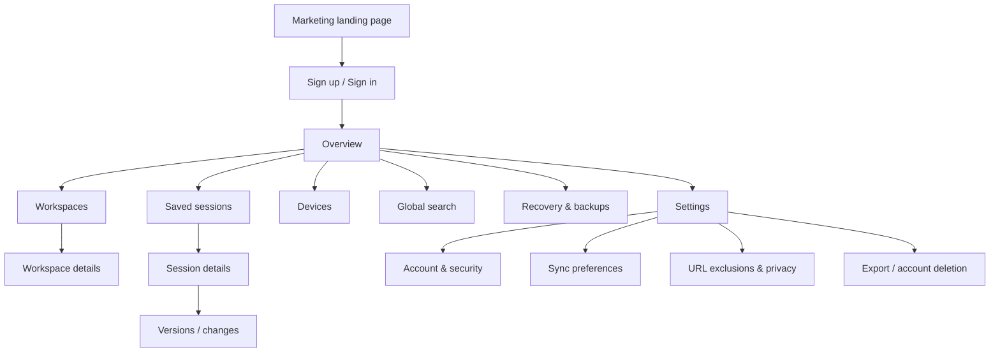

# SessionHub — UI/UX Design, Structure & Layout Specification

> **Reference only:** These are proposed layouts and interaction contracts, not completed UI.  
> **Updated:** 2026-10-16.  
> **Style:** Modern productivity SaaS / understated editorial / information-dense.  
> **Design preview:** [`../references/ui-layout-preview.html`](../references/ui-layout-preview.html).

## 1. UX north star

The product should feel **as fast as a keyboard-powered tab utility, as organized as a project workspace, and as trustworthy as a backup application**.

- **Recognize > recall:** show clear session names, source devices, dates, tab count and favicons.
- **Choose, then save:** saving always shows the open windows and tabs first, with the current window's web pages ticked, so the common save is still "open popup, press Save", and nothing is saved (or uploaded) that the user didn't tick (user's decision, 2026-10-17, after one-click saves were judged dangerous; replaces "one primary action saves the current window"; section 18i).
- **Safe by default:** restore to new windows; preview before bulk changes; explicit device identity.
- **Low visual noise:** compact lists for dense data; reserve large cards for a small Overview surface.
- **Never conceal data status:** local-only, queued, syncing, synced, conflict and failed must be distinct.
- **Quick return:** every list needs an obvious search and accessible keyboard navigation.
- **Progressive disclosure:** popup = quick tasks; side panel = active navigation; manager = organization/recovery; web = cross-device library and account.

## 2. Product surfaces and responsibility split

| Surface | Primary jobs | Typical width | Content density |
|---|---|---:|---|
| Popup | One-click save, recent sessions, quick search, sync | 360–400 px | Medium/high |
| Side panel | Live tab tree and window navigation | User-resizable ~320–460 px | Very high |
| Full extension manager | Local sessions, live tabs, recovery history, bulk ops | Browser-tab full page | High |
| Web dashboard | Cross-device saved sessions, workspaces, devices | Desktop >1024 px | High |
| Mobile web | Search/view/manage/export saved sessions | 320–767 px | Moderate |

**Never expose an action that a surface cannot perform.** The web dashboard can manage saved cloud entities but cannot restore tabs into an arbitrary remote browser installation. A web-to-extension handoff is local, allowlisted and user-confirmed.

## 3. Information architecture

### 3.1 Web dashboard sitemap



Suggested route topology (confirm route grouping during implementation):

```text
/
/login
/signup
/onboarding
/app
/app/workspaces
/app/workspaces/[workspaceId]
/app/sessions
/app/sessions/[sessionId]
/app/sessions/[sessionId]/versions
/app/devices
/app/recovery
/app/search
/app/settings/profile
/app/settings/sync
/app/settings/privacy
/app/settings/backups
/app/settings/security
```

For MVP, `Recovery` on the web must clearly state that local-only automatic snapshots are not in cloud storage. It can include backup guidance and any manually cloud-saved versions—not invent a remote snapshot library.

### 3.2 Extension navigation

```text
Browser toolbar -> Popup
  - Search
  - Save tabs: choose windows and tabs, then save (section 18i)
  - Recent sessions
  - Open manager
  - Open side panel
  - Sync/status/account/settings

Side panel
  - Current tabs, grouped by window -> tab group
  - Search/filter
  - Workspace selector
  - Quick save / recently saved

Manager full page
  - Overview
  - Live tabs
  - Saved sessions
  - Workspaces
  - Recovery snapshots (local)
  - Imports / exports
  - Settings
```

## 4. Design foundations

### 4.1 Color tokens (starting values, tune for accessible contrast)

| Token | Light | Dark | Purpose |
|---|---|---|---|
| `--bg` | `#F7F8F5` | `#111815` | Application canvas |
| `--surface` | `#FFFFFF` | `#18221D` | Cards, panels, dialogs |
| `--surface-muted` | `#F0F3EF` | `#233027` | Hover, secondary regions |
| `--text-primary` | `#192522` | `#ECF5EF` | Headings, body copy |
| `--text-secondary` | `#66736C` | `#ABB9B0` | Metadata, supporting copy |
| `--border` | `#DEE6DF` | `#34473B` | Dividers and fields |
| `--brand` | `#13694C` | `#5DD6A7` | Primary CTA / interactive accent |
| `--brand-hover` | `#0E523B` | `#8BE5BD` | Hover / active elements |
| `--danger` | `#A32938` | `#FF8D97` | Destructive and error actions |
| `--warning` | `#87550A` | `#F3C16C` | Sync issue warning |

Do not communicate status solely by color: pair statuses with text, icons and accessible labels. Muted values must meet WCAG 2.2 AA contrast in real components; tune if audit fails.

**Theme (user's choice, 2026-10-17):**
- **Light is the default**, including on a dark system. A **Light / Dark / System** toggle (sun, moon and monitor icons; radios labelled "Theme") is always visible:
  - web: in the home header, the top-right corner of the sign-in pages, the dashboard top bar and the privacy page
  - extension: in the popup header and the manager's sidebar footer (its top bar on narrow screens)
- **System** follows the operating system live.
- **Stored per browser** in `localStorage` (`sessionhub-theme`). The website and the extension keep separate choices; the popup and the manager share one. If the browser refuses to store it (blocked site data), the choice still holds, toggle included, for the open page (PR #29 review).
- **Applied before the first paint:** `@sessionhub/core/theme`'s init script sets `data-theme="light" | "dark"` on `<html>`, so there's no flash of the wrong theme. It runs as an inline `<head>` script on the web and as `theme-init.js` in the extension, generated from the same string. `tokens.css` switches colors on that attribute, not on `prefers-color-scheme`.
- **Content Security Policy:** if the web app adds a `script-src` CSP, the inline script needs a nonce.

### 4.2 Typography

- System UI font stack for fast rendering; optional properly licensed sans such as Inter.
- Major page title: `28–32px / 1.2`, weight 650–700.
- Section title: `16–18px / 1.3`, weight 600–650.
- Primary body/list labels: `13–14px / 1.5`, weight 400–550.
- Metadata: `12–13px / 1.4`, clear contrast.
- Popup labels: `12–13px`, minimum accessible target size.
- Use tabular-nums for tab counts, snapshot ages, and other numeric metadata.
- Truncate long titles **visually** but keep title/URL available via tooltip and details view.

### 4.3 Spacing, radius, elevation

- Spacing increments: `4, 8, 12, 16, 20, 24, 32, 40, 48` px.
- Main desktop padding: 24–32 px; mobile: 16 px.
- List rows: ~44–52 px; compact side panel 32–40 px.
- Navigation width desktop: 236–252 px; inspector: 320–380 px.
- Extension manager (2026-10-17, section 18l): the list is the narrow column (360 px, 400 px from 1536 px) and the inspector takes the rest of the width.
- Inputs/buttons: min 36–40 px visual height; touch-oriented targets preferably >=44 px.
- Radius: inputs 8 px, cards 12 px, dialogs 14–16 px; avoid overly rounded pill-shaped everything.
- Elevation: subtle shadow only for floating popovers/dialogs, not every card.

### 4.4 Iconography and visual hierarchy

Lucide icons, typically 16–18 px. Prefer recognizable browser favicons for individual tabs, with generic fallback. Window rows use window icon, group rows use group marker/color, saved sessions use document/stack icon, automatic checkpoints use history/shield icon. Use consistent icon labels and hover tooltips.

## 5. Extension popup wireframe

**Baseline:** target width 380 px; height auto within Chrome popup constraints; scroll content after recent sessions. Only the primary action should have brand-filled treatment. *Superseded 2026-10-17 by section 18k:* Open and Save tabs, at most 600 px, with one scroll area between a fixed header and footer.

```text
┌────────────────────────────────────────────┐
│  ◈ SessionHub                   ● Local ▾  │  ← brand + state/account
├────────────────────────────────────────────┤
│  🔎 Search tabs or sessions...    [Ctrl K] │
│                                            │
│  ┌──────────────────┐ ┌─────────────────┐  │
│  │ ▣ Save window    │ │ Save all (3)    │  │  ← two fast actions
│  └──────────────────┘ └─────────────────┘  │
│                                            │
│  Active workspace                          │
│  ▣ Client Project Alpha             [▾]   │
│                                            │
│  Recent sessions                    View → │
│  ┌──────────────────────────────────────┐  │
│  │  ◫ Frontend research      18 tabs  > │  │
│  │     Today · This device              │  │
│  │  ◫ PR review             7 tabs   > │  │
│  │     Yesterday · Windows              │  │
│  │  ◫ Pickleball app        12 tabs  > │  │
│  │     Oct 14 · MacBook                 │  │
│  └──────────────────────────────────────┘  │
│                                            │
├────────────────────────────────────────────┤
│ [Open manager]    [Side panel]    [⚙]      │
└────────────────────────────────────────────┘
```

### Interaction specifics

- Focus search with popup shortcut where Chrome permits; never hijack OS/browser reserved shortcuts.
- (Superseded 2026-10-17 by section 18i: the popup no longer has **Save window** / **Save all (N)**; it shows the save picker.) A save commits locally at once and says `Saved locally`, or that it will sync; `Synced` only after acknowledgment.
- Recent session click -> short preview sheet with Restore (new window), View in manager, Copy URL list. *(2026-10-17, section 18k: a tap shows the session's tree with the open picker in the popup; each row also has an Open button for the whole session.)*
- First run: local capture remains usable without signup. Show small secondary banner to enable optional sync, not a blocking modal.
- Signed out: `Local only` with optional `Enable sync` action; signed in with sync off must still show `Sync off`.
- Errors: show retry action; never hide save behind cloud timeout.

## 6. Extension side-panel wireframe

**Baseline:** user-resizable; optimize scanning and hierarchy. Avoid oversized padding and cards.

```text
┌───────────────────────────────────────┐
│ SessionHub                 [Save] [⋯] │
│ [🔎 Filter current tabs...]          │
│                                       │
│ WORKSPACE  Project Alpha       [▾]   │
│                                       │
│ ▾ Window 1 · 16 tabs          [⋯]    │
│   ▾ Development (5)                  │
│      ●  localhost:3000               │
│         GitHub / pull requests       │
│         TypeScript handbook          │
│   ▸ Research (11)                    │
│                                       │
│ ▸ Window 2 · 8 tabs            [⋯]    │
│                                       │
│ ───────────────────────────────────── │
│ RECENT SAVED                          │
│   ◫ Sprint review · 24 tabs          │
│   ◫ Docs references · 11 tabs        │
│                                       │
│ [Open full manager →]                 │
└───────────────────────────────────────┘
```

### Side panel behavior

- Click row -> focus browser tab and window; current tab highlighted with more than color alone.
- Group/window disclosure arrows support Arrow keys, Enter/Space; expanded state persists per session.
- List virtualized when tab count is high. Pinned tabs visible as an optional section.
- Search filters without dropping current selection/focus unexpectedly.
- Drag-and-drop has an accessible Move-to menu/button alternative.
- Bulk close requires a clear warning and, where feasible, an undo affordance; never close tabs when workspace switches in MVP.
- Tab/group update events update only affected list items where possible.

## 7. Full extension manager wireframe

**Baseline:** desktop-wide 3-pane application for users managing history/recovery locally. A native extension page is appropriate for Chrome-specific actions.

```text
┌──────────────────┬────────────────────────────────────────┬────────────────────────┐
│ SESSIONHUB       │ Saved Sessions            [New Save +]│ Session details        │
│                  │ [🔎 Search all...] [Filter] [Sort]    │                        │
│ Overview         │ ┌──────────────────────────────────┐   │ Frontend research      │
│ Live Tabs        │ │ □ Frontend research    18  Today │   │ From Windows Desktop   │
│ Saved Sessions ● │ │ □ Project docs         12  Wed   │   │ 2 windows · 18 tabs   │
│ Workspaces       │ │ □ API experiments       8  Tue   │   │ Last saved 9:42 AM    │
│ Recovery         │ │ □ UX inspirations      26  Mon   │   │ [Restore ▾] [Export]  │
│ Imports/Exports  │ └──────────────────────────────────┘   │                        │
│                  │                                        │ Window 1 · 13 tabs     │
│ Settings         │                                        │   ▣ Dev group          │
│                  │                                        │     localhost:3000     │
│                  │                                        │     GitHub PR #42      │
│                  │                                        │ Window 2 · 5 tabs      │
└──────────────────┴────────────────────────────────────────┴────────────────────────┘
```

Desktop widths: 220–244 px navigation, fluid center minimum 420 px, right inspector 320–380 px. At 900–1150 px, collapse inspector into an on-demand drawer. Under 900 px, replace persistent navigation with a top menu and use dedicated details view.

**Superseded for the extension manager (2026-10-17, section 18l):** the list and inspector widths are swapped, because the inspector holds the tab tree and the list rows hold three short facts.

### Recovery page layout

- Header: `Recovery checkpoints` with explanation: automatic, local-only, may not include all unsaved application state.
- Timeline grouped by `Today`, `Yesterday`, `Previous 7 days`.
- Each entry: capture time, number of windows/tabs, origin profile, change summary if known, inspect/restore/export actions.
- Restore opens preview with unsupported URL count and a checked selection list.
- Snapshot retention settings are in Preferences rather than cluttering the recovery list.

## 8. Web dashboard wireframe

**Baseline:** 1440 px desktop reference. Outer canvas warm-neutral; restrained cards and structured data.

```text
┌────────────────────────┬─────────────────────────────────────────────────────────────┐
│  ◈ SessionHub           │  Search sessions, workspaces, tabs...    [⌘ K]  [Avatar]  │
│                        ├─────────────────────────────────────────────────────────────┤
│  Overview            ● │  Good morning                                      [?]      │
│  Workspaces            │  Your workspaces and saved sessions, across devices.        │
│  Saved Sessions        │                                                             │
│  Devices               │  ┌────────────┐ ┌────────────┐ ┌────────────┐                │
│  Recovery              │  │ Sessions 42│ │ Saved tabs │ │ Devices    │                │
│  Search                │  │            │ │  1,284     │ │  2 active* │                │
│                        │  └────────────┘ └────────────┘ └────────────┘                │
│                        │                                                             │
│  ────────────────────  │  Recent workspaces                            View all →    │
│  Settings              │  [ Client Site ] [ Personal Apps ] [ Research ]             │
│  Help                  │                                                             │
│                        │  Recent saved sessions                           View all →  │
│  ────────────────────  │  ┌─────────────────────────────────────────────────────────┐  │
│  ● Synced just now     │  │ Session                  Source        Tabs   Updated  │  │
│  Windows / MacBook     │  │ Frontend research        Windows       18   2m ago   │  │
│                        │  │ Sprint reviews           MacBook        9   Today    │  │
│                        │  │ Pickleball web app       Windows       25   Oct 14   │  │
│                        │  └─────────────────────────────────────────────────────────┘  │
└────────────────────────┴─────────────────────────────────────────────────────────────┘
```

`*` Do **not** label a device active based solely on registration; only show `Online` with a defined heartbeat. Otherwise use `Last seen`.

**Superseded 2026-10-17 (18n):** no top bar (search lives in the Saved sessions list, Ctrl/Cmd+K still reaches it); the Overview has no number tiles.

### Overview layout rules

- Main content max 1440 px, responsive padding 24–32 px.
- KPI cards not required for function; maximum three quiet summary tiles.
- Workspaces as small clickable cards with icon, name, count, last touched.
- Recent sessions as sortable compact table on desktop and structured list on mobile.
- Dashboard should not hide Restore/Export behind excessive menus.

## 9. Saved Sessions page — master/detail layout

**Implemented 2026-10-17 (18n)** as a list rail and the open session, like the extension manager (18l); bulk selection, sort and versions aren't built yet.

```text
┌────────────────┬────────────────────────────────────┬─────────────────────────────┐
│ Nav            │ Saved Sessions                     │ Selected Session            │
│                │ [Search...] [Workspace ▾] [Sort ▾] │                             │
│                │                                    │ Frontend research           │
│                │ □ Frontend research                │ From Windows Desktop        │
│                │   18 tabs  · 2 windows · synced    │ Updated today · version 4   │
│                │ □ Project docs                     │                             │
│                │   12 tabs  · MacBook · synced      │ [Restore with extension]    │
│                │ □ UI inspirations                  │ [Export] [Edit] [Versions]  │
│                │   26 tabs  · Windows · syncing     │                             │
│                │ ...                                │ Window 1                     │
│                │                                    │  ▾ Group: Development      │
│                │                                    │   ▣ localhost:3000          │
│                │                                    │   ▣ React docs              │
└────────────────┴────────────────────────────────────┴─────────────────────────────┘
```

### Information structure

**List row**:

1. Checkbox (bulk selection).
2. Name + secondary workspace/device/timestamp.
3. Tab/window counts.
4. Sync status text + icon.
5. Hover/keyboard action menu with Rename, Duplicate, Move, Export, Archive, Delete.

**Inspector**:

1. Name, edit affordance, note/description.
2. Source device and saved version/time.
3. Primary restore/export depending on extension availability.
4. Window/group/tab tree with favicon and safe URL display.
5. History/versions entry.
6. Non-destructive archive/delete actions.

In any state where the extension is unavailable, replace the restore CTA with `Install extension to restore` and allow `Export JSON` / `Open links` (with a warning for multiple tabs). Never claim a cloud API can command remote Chrome instances.

## 10. Workspaces page

- Header, `New workspace` CTA, description of grouping.
- Grid/card view for up to ~12 workspaces, switch to list for many.
- Workspace detail: breadcrumb, name/icon/color, description, saved sessions list, search within workspace.
- Workspace switches in the extension should change current organizational context, **not auto-close** currently open Chrome windows in MVP.
- Empty workspace state: `No sessions yet — Save a session and assign it here` with primary action that leads to the extension/manager where possible.

## 11. Devices page

```text
┌────────────────────────────────────────────────────┐
│ Devices                           [+ Add a device] │
│ Your devices are browser installations.            │
│                                                    │
│ ┌────────────────────────────────────────────────┐ │
│ │ 🖥 Windows Desktop                 This device │ │
│ │ Chrome · last seen 2 minutes ago               │ │
│ │ Last successful sync: 2 minutes ago            │ │
│ │ [Rename] [View sessions] [Revoke]               │ │
│ ├────────────────────────────────────────────────┤ │
│ │ 💻 MacBook                                      │ │
│ │ Chrome · last seen yesterday                   │ │
│ │ Last successful sync: yesterday                │ │
│ │ [Rename] [View sessions] [Revoke]               │ │
│ └────────────────────────────────────────────────┘ │
└────────────────────────────────────────────────────┘
```

Clarify that revoking a device blocks new cloud sync but does not remotely erase local sessions from that computer. Provide session export and account-management hints. `Add a device` opens platform-independent install/sign-in instructions, not a magic remote install.

## 12. Restore modal — safety-critical interaction

**Required structure:**

```text
┌─────────────────────────────────────────────────┐
│ Restore "Frontend research"                    X │
│                                                 │
│ From Windows Desktop · 2 windows · 18 tabs      │
│ Last saved: Oct 16, 2026                       │
│                                                 │
│ Destination                                     │
│ ● Open in new window(s) (recommended)          │
│ ○ Add to current window                         │
│                                                 │
│ Tabs to open                                    │
│ [✓] Window 1 (13)                               │
│ [✓] Window 2 (5)                                │
│                                                 │
│ ⚠ 1 restricted tab cannot be restored          │
│                                                 │
│                [Cancel] [Restore 17 tabs]        │
└─────────────────────────────────────────────────┘
```

- Default `new window(s)` and selected supported URLs only.
- Unsupported tabs are clearly labeled and excluded; user can optionally copy their URLs where safe.
- Initial action triggers one restore plan, persisted `restoreJobId`, with progress and completion summary.
- Large jobs display `X of Y restored`; cancellation applies only to not-yet-started actions. Describe unavoidable partial outcomes honestly.
- Never automatically close existing windows. Destructive "replace session" is out of MVP.

**Update 2026-10-17 (user's decision, after research into Session Buddy v4):** the modal is replaced by an in-place open picker in the manager's session and checkpoint inspectors (section 18j) and in the popup (section 18k).

- Destinations: **Open in new windows** (one per saved window, default), **Open in one new window**, **Open in this window** (appended after its tabs; "Skip tabs already open here" on by default). Still additive: nothing is closed or replaced, and there is no "replace this window".
- Selection: tick windows and single tabs in the session's own tree (tri-state window boxes, Shift ranges); tabs that can't reopen are listed and can't be ticked.
- One split button that repeats the last destination used; its menu lists all three.
- The ticked tree is the preview, so opening needs no extra dialog, except above 50 tabs ("Open 120 tabs?").
- Retry still opens the remaining tabs in a new window, whatever the first destination.

## 13. Sync indicators and UX state contract

| State | Visual label | Meaning | Primary user action |
|---|---|---|---|
| Local only | `Local only` + device icon | No cloud account/sync active | Enable sync (optional) |
| Sync off | `Sync off` | Signed in but cloud upload disabled | Enable in Settings |
| Pending | `Waiting to sync` + clock | Durable queued changes | Retry / inspect status |
| Syncing | `Syncing…` + activity | Attempt underway; not yet confirmed | None required |
| Synced | `Synced` + check | Server acknowledged latest known revision | View device/sync details |
| Conflict | `Needs review` + warning | Conflicting edits saved for review | Review copies/resolve |
| Error | `Sync failed` + warning | Retryable/permanent sync issue | View details / retry |
| Offline | `Offline` + wifi-off | No connection; local capture still works | No loss; retry automatically |

If device hasn't synced for hours, do not display a misleading green dot merely because it was once connected.

## 14. Responsive behavior

| Breakpoint | Web layout | Navigation | Inspector |
|---|---|---|---|
| >=1280 px | Three-pane list/inspector, comfortable tables | Persistent 236–252 px | Visible 340–380 px |
| 1024–1279 px | Two-pane main + optional drawer | Persistent/collapsible | Slide-in drawer |
| 768–1023 px | Single main column, compact summary cards | Collapsed sidebar | Dedicated drawer/detail |
| <768 px | Stacked session cards/list, sticky primary actions | Top header/bottom compact nav | Dedicated route |

Mobile web is primarily **read/manage/export**. Session restoration into Chrome desktop is not promised on mobile.

## 15. Key interaction patterns

### Search and command palette

- Unified search can include names, tab titles, URL hostnames, workspaces and device names.
- Show recently used queries and clear scopes (`All`, `Open tabs`, `Saved sessions`, `Workspaces`).
- Keyboard command palette shortcut: `Ctrl+K` Windows/Linux or `⌘+K` macOS **where the browser permits**; customizable/disabled when reserved.
- Implement accessible combobox/listbox and proper focus semantics; avoid trapping normal text-editing shortcuts.

### Bulk selection and actions

- Explicit checkboxes; `Shift` range-select in dense lists.
- Sticky bulk-action toolbar with count and clear selection.
- Delete requires confirmation and shows what will be affected.
- Archive or remove-from-workspace should be preferred over destructive delete where possible.

### Empty, loading, failed states

| Screen | Empty state | Error state |
|---|---|---|
| Popup recent | `No saved sessions yet. Choose tabs above and save them to get started.` (the save picker is above it; manager: `Choose tabs to save in Open tabs or from the SessionHub toolbar icon, or import a SessionHub export.`) | `Couldn't load saved items` + Retry (local data remains) |
| Saved Sessions | `Save your first session using the extension` | `Sessions couldn't sync. Showing local cache.` when applicable |
| Devices | `Install and sign in on another computer` | `Devices unavailable` with last cached view |
| Workspaces | `Create a workspace to organize projects` | `Couldn't save workspace` + retry |
| Recovery | `Automatic checkpoints appear as you browse` | `Snapshot storage unavailable` + export current good data |

Loading UI uses subtle skeletons with stable layout, not endless full-screen spinners.

## 16. Accessibility checklist

- Keyboard-only control for all primary actions.
- Visible focus indicator with adequate contrast.
- Accessible field labels and dialog titles.
- Semantics for treeview, listbox or grid chosen deliberately (don't over-ARIA native elements).
- Screen-reader announcements for saved/synced/failed/restore-progress transitions without excessive chatter.
- Contrast checked for text, focus outlines, status labels, icons.
- No status communicated by color alone.
- Reordering has Move Up/Down or Move To alternative.
- Reduced-motion support and zoom to 200–400% without loss of functions.
- Touch target sizes and tooltips that do not hide required information.
- Follow WCAG 2.2 AA and WAI-ARIA Authoring Practices rather than inventing keyboard schemes.

## 17. Component inventory

**Global:** AppShell, NavSidebar, TopSearch, CommandPalette, UserMenu, SyncStatus, DeviceBadge, EmptyState, InlineError, ConfirmDialog, Toast, Skeleton, ResponsiveDrawer.

**Domain:** SessionList, SessionRow, SessionInspector, SessionVersions, SavedTabTree (selectable window/group/tab tree), OpenPanel and OpenBar (the open picker, replacing RestorePreview), SplitButton, TabFavicon, RestoreProgress, WorkspaceSwitcher, WorkspaceCard, DeviceCard, RecoveryTimeline, ImportPreview, ExportButton, ConflictReview.

**Extension-only:** QuickSaveActions, LiveWindowTree, PopupHeader, ExtensionConnectionBanner, SidePanelQuickSearch, PermissionExplanation.

Component states must cover default, hover, keyboard-focus, selected, disabled, loading, sync failure, offline, and empty where applicable.

## 18. UI acceptance criteria

- A first-time user can save their current window from the popup without signing in.
- A returning user can find a saved session in manager/search and restore it safely.
- On each device, the source device of a saved session is easy to identify.
- Offline state never makes the user think their local save failed when it succeeded.
- A session with 500 tabs remains navigable and searchable; scrolling is smooth and uses virtualization where needed.
- At 375 px web width, labels/actions are available without horizontal scrolling.
- Every destructive action has explicit scope and confirmation/undo where feasible.
- Web without the extension never offers a fake one-click browser restore.
- Accessible keyboard/screen reader acceptance checks pass for search, dialogs, selection, and action menus.

## 18a. Implementation notes (2026-10-16)

Built so far: popup (search, Save window, Save all (N), recent sessions, Open manager; the save buttons were replaced by the save picker on 2026-10-17, section 18i) and the manager's Saved Sessions view (list, search, inspector with window/group/tab tree, rename, export, delete confirmation, restore preview and summary). Deviations from the wireframes, all deliberate for this slice:

- Popup recent-session click opens the manager on that session (`manager.html#session=<id>`) instead of a preview sheet. Restoring from the popup is unsafe because the popup closes when the new window takes focus. *Changed 2026-10-17 (section 18k):* the popup has Open and Save tabs and opens sessions itself; the worker runs restores, so a popup closing mid-restore doesn't stop one (tested), and the result stays in the manager's Last restore.
- Popup has no workspace selector, side-panel button or settings entry yet: those features don't exist, and the UI must not expose actions a surface can't perform.
- Restore modal offers only "Open in new windows" (stated as text, no radio). *Replaced 2026-10-17 by the open picker (section 18j)*, which offers new windows, one new window and this window.
- Restore summary (2026-10-17) says where tabs went ("in 2 new windows", "in 1 new window", "in this window"), lists tabs skipped because they were already open in that window, and reads "Nothing to open: every tab you chose is already open in this window." when nothing was left; the Last restore line then says "everything was already open".
- Manager nav shows Saved sessions and Recovery (a horizontal row under the top bar below 1024 px). Below 1280 px the inspector replaces the list with a Back link; below 1024 px the sidebar collapses to a top bar.
- Sync status: see 18e (it was always "Local only" before sync existed).
- The window tree is not virtualized yet (fine at hundreds of tabs; M5 item).
- Restore summary lists tabs that didn't open with a plain-language reason (Chrome's raw "No window with id" errors are mapped), notes tabs never reached, and offers **Retry N tabs**, explaining that only those tabs open, in a new window. After a retry the summary shows "Opened X of Y tabs after N attempts"; the Retry button disappears when nothing is left. A refused retry (for example another manager tab already finished it) keeps the summary and shows the reason.
- Recovery view (`manager.html#view=recovery`): explanation (automatic, local-only, links and groups only), last checkpoint time, last error if any, "Checkpoint now" with a result message, timeline grouped Today / Yesterday / Previous 7 days / Older with "N opened, M closed" against the previous checkpoint and a Manual badge. The inspector shows the window tree, Restore (same safe preview and retry), **Save as session** and Export JSON, and explains that checkpoints are replaced over time and that Save as session keeps one, stating where it saves before saving, like the save picker ("Saves in this browser only." / "Saves to your account: it uploads at the next sync."; the button stays disabled until that is known). Saving makes a copy with fresh ids, saved like any session (into the account when sync is on); the note then reads "Saved locally as a session." or "Saved as a session. It will sync to your account." with a **View session** link, or "Not saved: ...", and the button reads "Saved as session" (disabled) until another checkpoint is opened. No retention settings UI yet; no delete for individual checkpoints.
- Session and checkpoint inspectors show a live "Last restore <date>: opened X of Y" line (red when tabs are missing, ", interrupted" when a later worker settled it) with **View summary**, which reopens the same summary and Retry in a dialog. Summaries of settled jobs explain the restore was cut off; a job still running shows "Still restoring" and no Retry.
- Storage full: popup save shows "Not saved: Storage for SessionHub is full, so this wasn't saved. Delete or export sessions you no longer need, then try again." with Retry; import and rename show the same pattern; restore errors now read "Restore stopped:" (a restore can stop after opening some tabs). "Checkpoint now" reports "Storage was full, so N older checkpoints were removed to make room." If the checkpoint still fails after that removal, the error says so ("...wasn't saved, even after removing N older checkpoints to make room."); "Earlier checkpoints are kept" is shown only when nothing was removed. The Recovery view's persisted error line reads "Last checkpoint failed" and is hidden while the same error is shown as the action's notice.
- Import lives in the manager header (Import button -> file picker -> preview dialog). The preview shows name, origin, export date, window/tab counts, tabs that will be reference-only and how many file statuses were re-checked, and states that the import is added as a new session. Invalid files get a "Can't import this file" dialog with a specific reason. No drag-and-drop yet, and the popup has no import entry.

## 18b. Web auth pages (2026-10-16)

`/signup` and `/login` use a centered card (brand mark, title, one-line purpose, fields with labels, inline per-field errors linked with `aria-describedby`, a form-level `role="alert"` message, `autocomplete` hints) and a note that an account is optional for the extension. Signed-in visitors are redirected to `/app` (a minimal "Signed in" page with sign-out until the dashboard shell exists). The landing header has Sign in and Create account. Verified at 1280 and 375 px and in dark mode.

**Superseded 2026-10-18 (18o):** the card is now a form beside "What an account is for"; the landing header has Sign in only (its hero offers Create account).

## 18c. Web dashboard shell (2026-10-16)

Built under `/app` with a shared signed-in layout: 240 px sidebar (Overview, Saved sessions, Devices, Settings; "Sync off" with "Cloud sync isn't available yet. Nothing has been uploaded."; Sign out), top bar with search (Ctrl+K, or Cmd+K on Apple platforms, focuses it; ignored while typing in another field) and an initials avatar linking to Settings. Below 1024 px the sidebar is replaced by a fixed bottom tab bar and the search moves under the brand row. Deliberate deviations:

- Nav shows only pages that exist (no Workspaces, Recovery or Search page yet).
- Search submits to `/app/sessions?q=` and matches session names only; the query stays in the box on that page.
- "Welcome, <first name>" instead of a time-of-day greeting (the server doesn't know the viewer's time zone).
- Overview: sync notice, three tiles (saved sessions, saved tabs, active devices) and up to five recent sessions; no workspace cards yet.
- Session rows aren't links yet (no session detail route). Devices show "last seen ..." (or "not seen yet") and "Access revoked", never "Online".
- Empty states say plainly that sync isn't available yet and where sessions live meanwhile. A skeleton (`loading.tsx`) and a generic error boundary with Try again (`error.tsx`) cover slow and failed loads.
- Verified at 1440, 900 and 390 px and in dark mode.

## 18c-update. Dashboard sync wording (2026-10-17)

Sync shipped in M4, so the dashboard no longer says it "isn't available yet". The website can't know whether sync is on, because that is a per-browser choice in the extension. So it reports what the server knows: connected (not revoked) browsers and their latest activity.

- **Sidebar:** "No browser connected" (sessions stay in the extension until you connect a browser and turn on sync there), or "N browsers connected" with "Last activity: <relative>" and "Turn sync on or off in each browser's extension". It says where sync is changed, never what it is set to (PR #20 review): never "Sync on/off", never "online".
- **Overview:** the notice ("No browser is connected yet...") shows only while no browser is connected; the empty state says to turn on sync in the extension (Account, then Sync).
- **Settings, Sync section:** the connected-browser count, where to turn sync on or off, and a pointer to Devices. Privacy says synced data *is* readable by the server operator.
- **Sign-in pages:** "an account lets you sync saved sessions between your browsers".
- **Landing page:** workspaces moved from "Coming next" to what works today.

## 18e. Extension sync opt-in and status (2026-10-16)

Implemented in `apps/extension/src/features/account/` (`sync-section.tsx`, `upload-preview.tsx`), `components/sync-status-chip.tsx`, `lib/sync-status.ts` (pure, unit-tested).

- **Status chip** (popup header, manager sidebar, Account view's Sync card): the section 13 labels `Local only` (not connected), `Sync off` (connected, not turned on), `Synced`, `Waiting to sync`, `Needs review`, `Sync failed`, `Offline` (last failure was a network error).
  - Priority: failure, then review, then waiting.
  - The tooltip always says when the last sync was, so an old sync never looks current.
  - The chip renders nothing until the state is known (no guessed "Local only" flash).
- **Per session:** every list row shows its own status on a separate line under the date (`Local only`, `Waiting to sync`, `Synced`, `Needs review`, `Sync failed`, or `Sync off` when the account's session is here but sync is off), so narrow widths never truncate it. Problems are in the warning color. The inspector shows the same badge.
- **Opt-in** lives in the Account view (no extension Settings page yet), below the connection card.
  - Off: one paragraph and **Turn on sync...**
  - On:
    - last synced time, waiting and needs-review counts
    - the last error with the next retry time ("Saving and restoring still work")
    - **Sync now**
    - **Upload sessions from this browser (N)** when local sessions remain
    - **Turn off sync**
  - Results appear in a polite live region (`syncNowMessage`: what moved, or "Everything is up to date"; refused changes are called out).
- **Upload preview** (dialog):
  - The disclosure follows SECURITY_PRIVACY.md section 2 without promising site exclusions, which don't exist yet. It names the server host and says that recovery checkpoints are never uploaded.
  - Then a list of this browser's sessions, **all ticked** (user's choice), with tab counts, a live "N sessions · M tabs selected" summary and Select all/none.
  - It explains that uploaded sessions **move** to the account (user's choice): hidden here while disconnected, back on reconnect. Non-restorable tabs go along as reference, and unticked sessions stay local.
  - Confirm: "Turn on sync and upload N sessions" / "Turn on sync" / "Upload N sessions".
- **Delete** of an account session says it is removed from the account and from other connected browsers at their next sync. Open tabs anywhere are unaffected.
- **Popup save** says "Saved: N tabs in M windows. It will sync to your account." while sync is on, otherwise "Saved locally: ...".
- **Deviations:**
  - no per-row "Syncing..." state (a run is in worker memory, not IndexedDB)
  - no first-run sync banner in the popup yet
  - conflict review: see 18f
- Verified at 390 and 1280 px (and dark mode at 390 px) with no horizontal overflow.

## 18f. Extension conflict review (2026-10-16)

`apps/extension/src/features/review/` (`review-dialog.tsx`, `review-compare.tsx`, `review-list.tsx`), copy in `lib/review-text.ts`.

- **Entry points:**
  - The session inspector shows a "Needs review" banner ("Your account didn't accept the last change. Both versions are kept until you choose.") with **Review...**.
  - The Account view's Sync card lists every change to review (name and a short reason) with **Review...**. This is the only entry for a session deleted here but changed elsewhere, which has no row.
- **Dialog** "Review "<name>"":
  - a one-line explanation of the situation
  - "This browser" and "Other version" side by side: name, tab and window counts, when it changed, and which device it came from ("Deleted in this browser" / "Deleted elsewhere" / "Not downloaded yet")
  - up to three links only in each version, with "and N more". Links are plain text, never opened.
- **Choices** are full-width buttons with a label and one line of detail (18f labels: Keep mine, Keep the other version, Keep both; Keep mine as a new session, Delete it here too; Restore the other version, Delete it everywhere; Upload as a new session, Keep in this browser only; Drop this change).
  - Only possible choices are shown. With none yet: "The other version hasn't downloaded yet. Sync now, then choose. Nothing is lost in the meantime." plus **Sync now**.
  - **Decide later** closes the dialog and changes nothing. Errors read "Nothing was changed: ...".
  - After Keep both the manager opens the new session.
- "Server" is avoided in user copy: "the other version", "your account".
- Verified at 390 and 1280 px and dark mode at 390 px (inspector banner, dialog, Sync card list): no horizontal overflow.

## 18g. Extension workspaces (2026-10-17)

`apps/extension/src/features/workspaces/` (`workspace-switcher.tsx`, `workspaces-dialog.tsx`, `workspace-row.tsx`, `workspace-fields.tsx`, `workspace-picker.tsx`). Rules: `SYNC_PROTOCOL.md` 13j.

- **Switcher** in the Saved sessions header, beside search, while connected (and sync is on or workspaces exist): a native select "Workspace" with All sessions, each workspace with its session count, and No workspace (which includes sessions only in this browser). It filters the list only: no tabs open or close. The choice is in the URL hash (`#workspace=<id|none>`, kept when a session is selected); an unknown id shows all sessions.
- **List rows** name the session's workspace before the tab counts while All sessions is shown. An empty filtered list says "No sessions in <name>" and "Open a session and choose its workspace in the details."
- **Workspaces dialog** (folder button "Manage workspaces"): one line on what workspaces are, a name + color form with **Add workspace** (only while sync is on; otherwise "Turn on sync in Account to add workspaces."), then each workspace with a color dot, session count and "Waiting to sync", plus **Edit** (name and color in place) and **Delete**. The delete confirmation is inline and states the scope: "Its N sessions move to No workspace. No session is deleted and no tabs close, here or in your other browsers." A new workspace is selected in the switcher.
- **Inspector:** "Workspace" select (No workspace + workspaces) for account sessions; "Not downloaded yet" for an assigned workspace this browser doesn't have. Sessions only in this browser get "Only sessions in your account can be in a workspace. Upload this one first: Account, then Sync." Errors read "Not moved: ...".
- **A workspace the account refused** shows "Not added to your account: <reason>. Its sessions wait until you delete it." in the dialog, and under "Needs review" in the Sync card with **Remove workspace**.
- **Deviations:** native selects (not the customizable `base-select` picker); no workspace in the popup or side panel yet; no "move sessions to..." target on delete (they go to No workspace, user's choice); new saves are not put in the selected workspace.
- Verified at 1280 and 390 px (list, dialog, delete confirmation, inspector) and the Sync card in dark mode at 390 px: no horizontal overflow.

## 18i. Choosing what to save (2026-10-17)

Replaces the popup's one-click **Save window** and **Save all (N)**, which saved every tab (and, with sync on, uploaded it) without showing anything first. Modelled on Session Buddy v4, whose windows and tabs are selectable "for more precise actions like saving just a portion of a session" (checkboxes, Ctrl/Cmd-click, Shift-click ranges, an action bar), with its ignore rules for browser pages. Code: `apps/extension/src/features/save/` (`save-panel.tsx`, `tab-picker.tsx`, `save-bar.tsx`, `open-tabs-view.tsx`), `hooks/use-open-windows.ts`, rules in `lib/tab-selection.ts`.

- **Where:** the popup's Save tab (the current window expanded, others collapsed; since 2026-10-17 the popup scrolls as one and the save bar sticks to the bottom, 18k) and the manager's **Open tabs** view (`#view=open-tabs`, every window expanded; its layout and tab actions since 2026-10-17 are in 18m), reached from the popup's **Open full view** or the manager nav.
- **The list:** open normal windows, the current one first with a "This window" badge; tab groups as labelled runs; each tab with a checkbox, favicon, title, address, pin icon and "Won't reopen" for browser pages. Incognito windows and SessionHub's own pages are never listed. It follows the browser live: closed tabs leave the list and the selection; new tabs appear unticked; a ticked web page that turns into a browser page (it navigated to `chrome://...`) is unticked, while a browser page ticked by hand stays ticked (PR #25 review).
- **Defaults (user's choices):** the current window's web pages are ticked; other windows and every browser page (`chrome://`, new tab, local files) start unticked.
- **Selecting:** a window's checkbox ticks its web pages (in a window of browser pages only, all of them) and, once checked, unticks the whole window; a partly ticked window shows the mixed state. Single tabs tick or untick; Shift-click sets a range in visible order; **Select all** (web pages of every window) and **Select none**. The chevron hides or shows a window's tabs without changing what is ticked.
- **Save bar:** "N tabs in M windows selected" (plus "K browser pages kept for reference only"), the name field prefilled with "Window, <date>" or "M windows, <date>" (the user's edit is kept), where it goes *before* saving ("Saves in this browser only." / "Saves to your account: it uploads at the next sync."), and **Save N tabs**, disabled when nothing is ticked and until the destination is known ("Checking where this saves…"; PR #25 review).
- **After saving:** "Saved locally: …" or "Saved: … It will sync to your account.", plus browser pages saved as reference and ticked tabs that closed before the save. The selection returns to the default.
- **Worker contract:** the page sends only the ticked tab ids and the name (`session.capture` with `scope: { kind: "tabs" }`); the worker reads titles and URLs from Chrome itself and saves only those tabs still open. `window` and `all-windows` scopes remain for tests and fixtures; no UI sends them. Recovery checkpoints are unchanged: automatic, local-only, never uploaded.
- Verified at the 380 px popup width and the manager at 1280 and 390 px, light and dark (the manager's mobile nav now wraps to two rows).

## 18j. Open picker (2026-10-17)

Opening a saved session or a recovery checkpoint happens in its inspector, Session Buddy style (user's decisions in section 12 update). The restore dialog and the read-only window tree are gone.

- **Open bar** (sticky above the tree):
  - Summary "3 of 5 tabs · 2 windows" ("No tabs selected" at none).
  - Select all, Select none, and "Select matches (N)" when the list's search matches tabs by title or URL. It is hidden when only the session name, device or a group matches.
  - The split button "Open 3 tabs in 2 new windows", "... in 1 new window" or "... in this window", shown as "Open" when nothing is ticked (disabled). Its menu "Choose where to open" offers New windows, as saved / One new window / This window (radio items).
  - The choice is remembered per browser in `localStorage` (`sessionhub-open-target`) and shared with the popup. Choosing doesn't open; the main button does.
  - "Skip tabs already open here", only for this window, on by default and remembered (`sessionhub-open-skip`).
- **Large opens:** above 50 planned tabs, Open turns into an inline "Open 120 tabs? Cancel / Open 120 tabs".
- **Keep tabs unloaded until clicked** (checkbox, off by default, remembered in `sessionhub-open-lazy`, used by the popup's row buttons too):
  - Background tabs unload once their page starts loading, and load again when clicked; the selected tab stays loaded.
  - The tooltip says each page starts loading first. Chrome can't open a tab unloaded (spike in the SYSTEM_DESIGN decisions log).
- **Tree** (`region "Window N"`, `list "Group X"`):
  - Every tab that can reopen starts ticked, re-checked from its URL. Window boxes are tri-state; Shift-click ticks a range in visible order.
  - Browser pages, files and other links that can't reopen show "Won't open", and their box is disabled.
  - A tab title is a plain link (`target="_blank"`, `noopener`), so a click, Ctrl/Cmd-click, Shift-click or middle-click opens that one page the way Chrome opens links, without a restore job.
  - The "N tabs can't be reopened" notice sits under the bar, in Recovery too.
- **Result:** the restore summary shows inline under the bar, with Retry and Done; "Last restore" and View summary are unchanged. Errors read "Restore stopped: ..." with Dismiss.
- **Updates:** a new version of the same session (a rename, a sync download) keeps the ticks of tabs still there; ticks are per session.
- The menu is `position: fixed` and opens above the button near the bottom of the window, so a scroll area can't clip it.

## 18k. Popup: Open and Save tabs (2026-10-17)

The toolbar popup is two tabs (user's choice, mock approved 2026-10-17) and never exceeds Chrome's 600 px popup height.

- **Shell:**
  - Fixed header (brand, sync chip, theme) and a tablist **Open | Save** (arrow keys move between them).
  - One scrolling area (`main`, `relative` so `sr-only` text can't stretch the page; PR #35) and a fixed footer with Open manager.
  - The root is `max-h-[600px]`: with 20 sessions and 14 browser-page tabs, the page has no overflow on either tab (`e2e/popup.spec.ts`).
  - The popup opens on the tab used last (`sessionhub-popup-tab`), Open the first time.
- **Open tab:**
  - A sticky search, then up to 20 recent or matching sessions.
  - A hint says where Open puts tabs ("Open puts all of a session's tabs in this window", plus ", unloaded until clicked" when that's on).
  - Each row is a button that shows the session's tree, plus a compact **Open ▾** split button for the whole session. Its accessible name says what and where: `Open "Name" (12 tabs) in this window`.
  - The remembered destination is shared with the manager; above 50 tabs a row asks first.
  - After opening into this window the row says "Opened 12 of 12 tabs in this window."; if some failed, "See what didn't open" opens the manager on the session.
  - Tapping a row shows "← All sessions", the name and the open picker (section 18j) with its bar stuck to the bottom. Only the first window is expanded, and the search carries over for Select matches.
  - Empty state: "No saved sessions yet. Save tabs from the Save tab to get started."
- **Save tab:**
  - The save picker (18i) without its own 260 px scroll box: the popup scrolls as one, and the save bar sticks to the bottom.
  - It stays mounted while hidden, so ticks and the typed name survive switching tabs.
- **Closing:** opening new windows focuses them and closes the popup. The worker finishes the restore (`e2e/popup.spec.ts` closes the page right after Open). Opening into this window keeps the popup open.

## 18l. Manager: list rail and wide inspector (2026-10-17)

The user's report: on a wide screen the session list took most of the width for a few short rows, while the inspector (the tab tree) was fixed at 400 px and cut tab titles short. Their choice: a narrow list and a wide detail, keeping the current colors and type. Saved sessions and Recovery share the layout (`components/master-detail.tsx`).

- **Columns (>=1280 px):** navigation 232 px | list rail 360 px (400 px from 1536 px) | inspector, fluid. Each pane scrolls on its own; the Saved sessions header (title, Import, search, workspace switcher) stays at the top of the rail. Each pane is `relative` (as the popup's scroll area is, PR #35): `sr-only` text is absolutely positioned, and in a pane that isn't positioned it escaped and stretched the page by about a screen of blank space (fixed 2026-10-17, `e2e/manager-layout.spec.ts`). Below 1280 px nothing changed: the inspector replaces the list and has its own back link.
- **List rows:** name and date on the first line, counts and sync status on the second. Date and sync status never shrink, so the narrow rail can't truncate them away. The icon is a favicon tile: up to four sites from the session (distinct hosts, saved order, tabs that can reopen; `lib/session-preview.ts`), one favicon for a single site, the stack icon when nothing can reopen. Decorative (`aria-hidden`): the row text names the session.
- **Inspector header:** title (24 px) with the rename pencil right after it, and Export JSON / Delete on the same row, wrapping under a long title or on narrow screens. Counts, sync badge, origin, saved date and version on one line under it, then the workspace picker. A border separates the header from the open picker. The Recovery checkpoint inspector uses the same header.
- **Wide tab tree (container query, tree >= 672 px):** one line per tab, the URL in a last column 30% of the tree's width (`30cqw`), so URLs line up across pinned, "Won't open" and grouped rows. Narrower trees, including the popup, keep the two-line rows.
- **Wide open bar (container >= 672 px):** the selection summary and Select links on the left, the open options and the split button on the right, in one row when they fit; otherwise the controls wrap under it, right-aligned. The popup's stacked bar is unchanged.

## 18m. Manager: Open tabs view (2026-10-17)

The user's request: fix the view's layout and structure and add relevant features. Their choices: a list with a save panel beside it, and all four proposed features (search, go to a tab, close tabs, duplicates). Colors and type unchanged. Code: `features/save/open-tabs-view.tsx`, `use-save-picker.ts` (the picker's state, shared with the popup's Save tab), `tab-picker.tsx`, `open-tab-row.tsx`, `close-tabs-control.tsx`; rules in `lib/open-tabs.ts`, Chrome calls in `lib/open-tab-actions.ts`.

- **Layout (>=1280 px):** the list column (header, then the windows) | a panel for the ticked tabs, 360 px (400 px from 1536 px). Each scrolls on its own and is `relative`, like the Saved sessions panes (18l). Narrower, the panel sticks to the bottom of the page. The list was capped at 768 px before, leaving the right half of a wide screen empty.
- **Header:** "Open tabs", then "4 windows · 24 tabs · 1 duplicate" (duplicates only when there are any), one line of help ("Tick tabs to save them as a session or to close them. Click a title to go to that tab.") and the search.
- **Rows:** one line per tab once the list is >= 672 px wide, the address in a fixed-width last column (as in 18l); two lines in narrower lists. The popup's Save tab is unchanged (no search, no actions, two-line rows).
- **Search:** every term in the title or address. Windows without matches are hidden; the rest expand and keep their number ("Window 2 · 12 tabs, 2 matching"). No matches: `No open tabs match "x".` **Select matches (N)** replaces the selection with the matches. A window's checkbox still ticks the whole window, hidden tabs included; the panel's count says how many are ticked.
- **Go to a tab:** the title is a button inside the row's label, so it doesn't tick the box. It selects the tab and focuses its window (`tabs.update` + `windows.update`).
- **Duplicates:** a later copy of an exact address (this window first, then tab-strip order) has a "Duplicate" badge; the first copy doesn't. **Select duplicates (N)** ticks only the later copies. Tabs still loading (no address) never count.
- **Closing** (both ways ask first, AGENTS.md: preview + clear, in-context consent; PR #44 review):
  - A row's **✕** (shown on hover or keyboard focus, always on touch screens) only asks: it turns into **Close tab** (focused) and **Cancel** in the row (`group` "Close tab: Title?"). Cancel, Escape or moving focus away keeps the tab and returns focus to the ✕. The ✕ sits outside the label, so its name ("Close tab: Title") isn't part of the checkbox's.
  - **Close N tabs…** in the panel opens an inline confirmation (`alertdialog` "Confirm closing"): "Close N tabs?", then a scrollable list (`list` "Tabs to close": favicon, title, address) of every tab it would close, including ticked tabs a search or a collapsed window hides, then "To keep them as a session, save them first. Closed pages stay in Chrome's history." with **Cancel**, **Save and close** and **Close N tabs**.
  - **Save and close** saves the ticked tabs under the panel's name, then closes them; if the save fails, nothing closes and the save bar shows the error. It is disabled while a save is running, so one tick can't be saved twice. Afterwards: "Closed N tabs."
  - Tabs close one by one, so one already gone doesn't stop the rest. SessionHub's own pages are never listed, so the manager can't close itself.
- Verified at 1920, 1440, 1180 and 390 px, light and dark, with a search, a hovered row and the confirmation; the popup's Save tab compared before and after.

## 18n. Web dashboard redesign (2026-10-17)

The user asked for the website's signed-in app to get the extension manager's structure (18l, 18m). Their choices: the dashboard first (landing and sign-in pages in a later PR), a list rail with the open session beside it, an Overview of things to act on, no top bar. Colors and type unchanged.

- **Shell** (`components/dashboard/app-shell.tsx`): 232 px sidebar with navigation, then the connection note, the account (avatar, name, email; links to Settings; the email in its tooltip) and the theme toggle beside Sign out. No top bar. The email banner (region "Confirm your email") is a strip above the content. From 1024 px the content scrolls inside a `relative` `main` (sr-only text can't stretch the page, 18m); below that a slim header (brand, theme, account) and the bottom tab bar.
- **Search:** in the Saved sessions list (`components/sessions/session-search.tsx`, `searchbox` "Search saved sessions", by name). Ctrl/Cmd+K from any page focuses it, or goes to Saved sessions first and focuses it there (`#search`; `components/dashboard/search-shortcut.tsx`).
- **Saved sessions** (`/app/sessions`, `/app/sessions/<id>`; `sessions-split.tsx`, `sessions-rail.tsx`, `session-detail.tsx`):
  - >=1280 px: list rail 360 px (400 px from 1536 px) | the open session, each scrolling on its own and `relative`. Narrower: the open session replaces the list, with "All sessions" back to it.
  - Both pages render the list themselves (layouts can't read `searchParams`). Its search, view and workspace stay in the URL, and links into a session carry them (`/app/sessions/<id>?q=…`), so opening one keeps the list as it was; Delete returns to that list. With no view in the URL (older bookmarks, or right after archiving), an open session shows the list it is in, Archived or Active (PR #48 review).
  - The rail: "Saved sessions" (h1 with nothing open, h2 beside a session, whose title is then the h1), count, a line saying what is shown ("Sessions in “Alpha”."), search, Active/Archived, the workspace filter (`combobox` "Filter by workspace", so it never clashes with the session's own "Workspace" picker), rows with name and date, then workspace, tabs and source. The open row is `aria-current="page"`.
  - Nothing open: "Select a session to see its windows and tabs."
- **Open session:** title (h1, Pinned/Archived badges) with a rename pencil ("Rename"), and Export JSON, Open N links, Archive and Delete on the same row, wrapping on a phone. While renaming the title stays and the form opens under it, so a conflict shows the latest name next to the user's edit. Then the facts line, the workspace picker, a one-line note on reopening tabs through the extension, and the tree.
- **Tab tree** (`window-tree.tsx`): one line per tab once the tree is >= 672 px (address in a `30cqw` column, as in 18l). Each web page has a **site mark**: the host's first letter on a tab-group color picked from the host (`lib/host-mark.ts`; grey and yellow left out for legibility; browser pages keep a globe). The website can't read Chrome's favicon cache, and a third-party icon service would learn which sites were saved.
- **Overview:** "Welcome, Name", then one line "6 saved sessions · 80 tabs · 2 connected browsers" instead of number tiles. While no browser is connected, three numbered setup steps (Add the extension, Connect this account, Turn on sync; they are a sequence). Then "Recently updated" (six sessions, each opening beside the list) and, beside it, "Browsers" (last seen, never "online") and "Workspaces" (sessions per workspace, each linking to the filtered list).
- **Devices, Settings, pair:** unchanged content inside the shared page padding (`PageBody`). Dates mid-sentence keep their capital ("last seen Oct 16"; `formatRelativeInline`).
- Verified at 1920, 1440 and 390 px, light and dark; Saved sessions skeleton while loading (`app/app/sessions/loading.tsx`).

## 18o. Website landing and sign-in pages (2026-10-18)

The user asked for the landing and sign-in/sign-up pages to get the dashboard's treatment (18n). Their choices: a live product preview in the hero, "Get the extension" as the main button, the form beside what an account is for, and "How it works" plus privacy instead of the project-status lists. Colors and type unchanged.

- **Shared:** `components/brand.tsx` (the mark, used by the dashboard, landing, auth and privacy pages) and `components/public/public-header.tsx` (brand and theme; "Sign in" on the landing page). The privacy page uses that header; its text is unchanged.
- **Landing** (`app/page.tsx`):
  - Hero: "Save your windows. / Find them again. / Reopen them later." (three lines, the type is the visual), one paragraph, **Get the extension** (primary, to the README's build and load steps, `lib/links.ts`) and **Create account**, and a line saying it's free, open source, not on the Chrome Web Store yet, and that an account is only for sync.
  - Beside it, `components/public/product-preview.tsx`: Saved sessions as they look (the list rail beside a session's window with a tab group, site marks and workspace dots) with sample data. `role="img"` with a description, its content `inert`, so it is one image to assistive technology and nothing in it can be focused. `inert` on the image itself would hide it and its description (PR #49 review, checked in Chrome's accessibility tree). Below a 576 px container, only the session's tabs.
  - "How it works": Save, Find, Reopen, numbered because they are a sequence.
  - "Where your sessions live": four facts with checks, then the limit marked differently: "No end-to-end encryption. Whoever runs the server can read the sessions you sync."
  - Footer: "SessionHub is an early preview.", Privacy policy (the page's only link by that name) and Source code.
- **Sign in, sign up, password pages** (`app/(auth)/layout.tsx`, `components/auth/account-panel.tsx`): from 1024 px the form (in `main`, headings 24 px) is on the left and an `aside` "About accounts" on the right: sync between computers, optional, you choose what uploads (checkpoints never do), disconnect any time. Narrower, the panel follows the form. Fields, errors and buttons are unchanged.
- Verified at 1920, 1440 and 390 px, light and dark; no horizontal overflow at 375 px on any public page (`e2e/public-pages.spec.ts`).

## 18h. Web workspaces on Saved sessions (2026-10-17)

`apps/web/src/app/app/sessions/page.tsx`, `[id]/page.tsx`; `components/dashboard/workspace-filter.tsx`, `components/sessions/workspace-select.tsx`; queries in `server/queries/dashboard.ts`.

- **Filter:** a "Workspace" select to the right of the Active/Archived tabs, shown once the account has a workspace: All sessions, each workspace with its count in the current view, and No workspace. It lives in the URL (`?workspace=<id|none>`) and combines with `view` and `q`; the tabs keep it. An id that isn't one of the user's live workspaces shows all sessions. The description reads "Sessions in “<name>”." (or "Results for “q” in “<name>”").
- **Rows** name their workspace (color dot + name) under the session name while All sessions is shown.
- **Empty states:** "No sessions in “<name>”" ("Open a session and choose this workspace for it, here or in the SessionHub extension."), "No archived sessions in no workspace" and so on. The no-sessions state now says to turn on sync in the extension (Account, then Sync) instead of "once cloud sync is available".
- **Session page:** a "Workspace" select (No workspace + workspaces) above the actions. It saves with the version the page loaded: a change made elsewhere first shows the usual conflict notice with **Load latest version**, and the select goes back to the saved value. Success reads "Moved to “<name>”." or "Moved out of its workspace." Without workspaces it says to create them in the extension's manager (the web has no workspace management yet).
- The delete dialog now says browsers with sync on remove the session at their next sync (it said "when sync is available").
- Verified at 1440 and 390 px and in dark mode at 390 px; E2E checks no horizontal overflow at 390 px on the list, the filtered list and the session page.

## 18d. Web session detail (2026-10-16)

`/app/sessions/[id]` (list rows link to it; the list has Active / Archived views). Layout: breadcrumb, name with Pinned/Archived badges, "From <source> · N windows · N tabs · updated ... · version N", an action row, a restore note, and the window tree (groups as labelled runs in saved order, pinned icon, "Won't open" badge with a screen-reader reason).

- **Rename / Archive / Unarchive / Delete** go through `/api/v1/sessions` with the version the page loaded. A 409 shows "This session was changed somewhere else (now version N). Load the latest version, then make your change again." with **Load latest version**; the rename form stays open with the user's text so the edit isn't lost. Delete uses a confirmation dialog that states scope (account library and, later, other devices; never open tabs or extension copies) and returns to the list.
- **Export JSON** downloads the same `sessionhub.session-export` file the extension's Import accepts. This is the website's honest restore path: the restore note says to export here and import in the extension, and that the website can't open or change browser windows (no web-to-extension bridge exists).
- **Open N links** opens only http(s) pages, asks for confirmation when there is more than one, and reports how many the browser's pop-up blocker stopped. Individual tab titles are links with `target="_blank" rel="noopener noreferrer"`.
- Missing, deleted, malformed or another user's ids show "Session not found".
- Verified at 1440 and 390 px and in dark mode.

## 19. Reference materials

- [W3C WAI-ARIA combobox](https://www.w3.org/WAI/ARIA/apg/patterns/combobox/)
- [W3C keyboard interface practices](https://www.w3.org/WAI/ARIA/apg/practices/keyboard-interface/)
- [Chrome side panel API](https://developer.chrome.com/docs/extensions/reference/api/sidePanel)
- [Chrome extension user interface guidelines](https://developer.chrome.com/docs/extensions/develop/ui)

See also [`USER_FLOWS.md`](USER_FLOWS.md) and [`SYSTEM_DESIGN.md`](SYSTEM_DESIGN.md).

## M6 privacy and restore clarification (2026-10-17)

The landing page links a public, unsigned `/privacy` page describing actual capture, automatic local checkpoints, upload consent, full URL exposure, cached data, tombstones/versions/receipts, account deletion limitations and Limited Use. It marks deployment-specific operator/contact/provider/retention details as pre-launch requirements. Landing/metadata now describe implemented opt-in sync rather than planned sync.

Restore results track successful URL opens. Pinning and group styling are best effort; a failed pin after opening the first tab does not report the whole window failed or offer those opened URLs for retry. No cosmetic-warning UI is added; the known limitation is documented in RELEASE.md. Synthetic 1280x800 store screenshots show the actual manager, preview and result.

## Local-only conflict resolution recovery (2026-10-17)

Choosing **Keep in this browser only** keeps the edited contents in an independent local session and selects that copy in the manager. A held account version appears immediately as a separate synced session. If the account version has not downloaded (or the previous cursor already passed its unchanged version), next sync refreshes the account cache so both can appear. The local copy is never uploaded automatically; sync consent stays unchanged. If offline or sync is off, the local copy is usable immediately and the account version returns once normal sync can resume. No live browser tabs/windows change.
