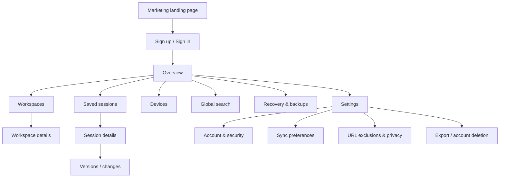

# SessionHub — UI/UX Design, Structure & Layout Specification

> **Reference only:** These are proposed layouts and interaction contracts, not completed UI.  
> **Updated:** 2026-10-16.  
> **Style:** Modern productivity SaaS / understated editorial / information-dense.  
> **Design preview:** [`../references/ui-layout-preview.html`](../references/ui-layout-preview.html).

## 1. UX north star

The product should feel **as fast as a keyboard-powered tab utility, as organized as a project workspace, and as trustworthy as a backup application**.

- **Recognize > recall:** show clear session names, source devices, dates, tab count and favicons.
- **Two-second task:** saving the current window should require one primary action when the popup opens.
- **Safe by default:** restore to new windows; preview before bulk changes; explicit device identity.
- **Low visual noise:** compact lists for dense data; reserve large cards for a small Overview surface.
- **Never conceal data status:** local-only, queued, syncing, synced, conflict and failed must be distinct.
- **Quick return:** every list needs an obvious search and accessible keyboard navigation.
- **Progressive disclosure:** popup = quick tasks; side panel = active navigation; manager = organization/recovery; web = cross-device library and account.

## 2. Product surfaces and responsibility split

| Surface | Primary jobs | Typical width | Content density |
|---|---|---:|---|
| Popup | One-click save, recent sessions, quick search, sync | 360–400 px | Medium/high |
| Side panel | Live tab tree and window navigation | User-resizable ~320–460 px | Very high |
| Full extension manager | Local sessions, live tabs, recovery history, bulk ops | Browser-tab full page | High |
| Web dashboard | Cross-device saved sessions, workspaces, devices | Desktop >1024 px | High |
| Mobile web | Search/view/manage/export saved sessions | 320–767 px | Moderate |

**Never expose an action that a surface cannot perform.** The web dashboard can manage saved cloud entities but cannot restore tabs into an arbitrary remote browser installation. A web-to-extension handoff is local, allowlisted and user-confirmed.

## 3. Information architecture

### 3.1 Web dashboard sitemap



Suggested route topology (confirm route grouping during implementation):

```text
/
/login
/signup
/onboarding
/app
/app/workspaces
/app/workspaces/[workspaceId]
/app/sessions
/app/sessions/[sessionId]
/app/sessions/[sessionId]/versions
/app/devices
/app/recovery
/app/search
/app/settings/profile
/app/settings/sync
/app/settings/privacy
/app/settings/backups
/app/settings/security
```

For MVP, `Recovery` on the web must clearly state that local-only automatic snapshots are not in cloud storage. It can include backup guidance and any manually cloud-saved versions—not invent a remote snapshot library.

### 3.2 Extension navigation

```text
Browser toolbar -> Popup
  - Search
  - Save current window / Save all windows
  - Recent sessions
  - Open manager
  - Open side panel
  - Sync/status/account/settings

Side panel
  - Current tabs, grouped by window -> tab group
  - Search/filter
  - Workspace selector
  - Quick save / recently saved

Manager full page
  - Overview
  - Live tabs
  - Saved sessions
  - Workspaces
  - Recovery snapshots (local)
  - Imports / exports
  - Settings
```

## 4. Design foundations

### 4.1 Color tokens (starting values, tune for accessible contrast)

| Token | Light | Dark | Purpose |
|---|---|---|---|
| `--bg` | `#F7F8F5` | `#111815` | Application canvas |
| `--surface` | `#FFFFFF` | `#18221D` | Cards, panels, dialogs |
| `--surface-muted` | `#F0F3EF` | `#233027` | Hover, secondary regions |
| `--text-primary` | `#192522` | `#ECF5EF` | Headings, body copy |
| `--text-secondary` | `#66736C` | `#ABB9B0` | Metadata, supporting copy |
| `--border` | `#DEE6DF` | `#34473B` | Dividers and fields |
| `--brand` | `#13694C` | `#5DD6A7` | Primary CTA / interactive accent |
| `--brand-hover` | `#0E523B` | `#8BE5BD` | Hover / active elements |
| `--danger` | `#A32938` | `#FF8D97` | Destructive and error actions |
| `--warning` | `#87550A` | `#F3C16C` | Sync issue warning |

Do not communicate status solely by color: pair statuses with text, icons and accessible labels. Muted values must meet WCAG 2.2 AA contrast in real components; tune if audit fails.

### 4.2 Typography

- System UI font stack for fast rendering; optional properly licensed sans such as Inter.
- Major page title: `28–32px / 1.2`, weight 650–700.
- Section title: `16–18px / 1.3`, weight 600–650.
- Primary body/list labels: `13–14px / 1.5`, weight 400–550.
- Metadata: `12–13px / 1.4`, clear contrast.
- Popup labels: `12–13px`, minimum accessible target size.
- Use tabular-nums for tab counts, snapshot ages, and other numeric metadata.
- Truncate long titles **visually** but keep title/URL available via tooltip and details view.

### 4.3 Spacing, radius, elevation

- Spacing increments: `4, 8, 12, 16, 20, 24, 32, 40, 48` px.
- Main desktop padding: 24–32 px; mobile: 16 px.
- List rows: ~44–52 px; compact side panel 32–40 px.
- Navigation width desktop: 236–252 px; inspector: 320–380 px.
- Inputs/buttons: min 36–40 px visual height; touch-oriented targets preferably >=44 px.
- Radius: inputs 8 px, cards 12 px, dialogs 14–16 px; avoid overly rounded pill-shaped everything.
- Elevation: subtle shadow only for floating popovers/dialogs, not every card.

### 4.4 Iconography and visual hierarchy

Lucide icons, typically 16–18 px. Prefer recognizable browser favicons for individual tabs, with generic fallback. Window rows use window icon, group rows use group marker/color, saved sessions use document/stack icon, automatic checkpoints use history/shield icon. Use consistent icon labels and hover tooltips.

## 5. Extension popup wireframe

**Baseline:** target width 380 px; height auto within Chrome popup constraints; scroll content after recent sessions. Only the primary action should have brand-filled treatment.

```text
┌────────────────────────────────────────────┐
│  ◈ SessionHub                   ● Local ▾  │  ← brand + state/account
├────────────────────────────────────────────┤
│  🔎 Search tabs or sessions...    [Ctrl K] │
│                                            │
│  ┌──────────────────┐ ┌─────────────────┐  │
│  │ ▣ Save window    │ │ Save all (3)    │  │  ← two fast actions
│  └──────────────────┘ └─────────────────┘  │
│                                            │
│  Active workspace                          │
│  ▣ Client Project Alpha             [▾]   │
│                                            │
│  Recent sessions                    View → │
│  ┌──────────────────────────────────────┐  │
│  │  ◫ Frontend research      18 tabs  > │  │
│  │     Today · This device              │  │
│  │  ◫ PR review             7 tabs   > │  │
│  │     Yesterday · Windows              │  │
│  │  ◫ Pickleball app        12 tabs  > │  │
│  │     Oct 14 · MacBook                 │  │
│  └──────────────────────────────────────┘  │
│                                            │
├────────────────────────────────────────────┤
│ [Open manager]    [Side panel]    [⚙]      │
└────────────────────────────────────────────┘
```

### Interaction specifics

- Focus search with popup shortcut where Chrome permits; never hijack OS/browser reserved shortcuts.
- Press primary **Save window** -> immediately commit locally, show `Saved locally` toast; update to `Synced` only after acknowledgment.
- Save all (N) includes visible number of regular Chrome windows; exclusions explained in help tooltip.
- Recent session click -> short preview sheet with Restore (new window), View in manager, Copy URL list.
- First run: local capture remains usable without signup. Show small secondary banner to enable optional sync, not a blocking modal.
- Signed out: `Local only` with optional `Enable sync` action; signed in with sync off must still show `Sync off`.
- Errors: show retry action; never hide save behind cloud timeout.

## 6. Extension side-panel wireframe

**Baseline:** user-resizable; optimize scanning and hierarchy. Avoid oversized padding and cards.

```text
┌───────────────────────────────────────┐
│ SessionHub                 [Save] [⋯] │
│ [🔎 Filter current tabs...]          │
│                                       │
│ WORKSPACE  Project Alpha       [▾]   │
│                                       │
│ ▾ Window 1 · 16 tabs          [⋯]    │
│   ▾ Development (5)                  │
│      ●  localhost:3000               │
│         GitHub / pull requests       │
│         TypeScript handbook          │
│   ▸ Research (11)                    │
│                                       │
│ ▸ Window 2 · 8 tabs            [⋯]    │
│                                       │
│ ───────────────────────────────────── │
│ RECENT SAVED                          │
│   ◫ Sprint review · 24 tabs          │
│   ◫ Docs references · 11 tabs        │
│                                       │
│ [Open full manager →]                 │
└───────────────────────────────────────┘
```

### Side panel behavior

- Click row -> focus browser tab and window; current tab highlighted with more than color alone.
- Group/window disclosure arrows support Arrow keys, Enter/Space; expanded state persists per session.
- List virtualized when tab count is high. Pinned tabs visible as an optional section.
- Search filters without dropping current selection/focus unexpectedly.
- Drag-and-drop has an accessible Move-to menu/button alternative.
- Bulk close requires a clear warning and, where feasible, an undo affordance; never close tabs when workspace switches in MVP.
- Tab/group update events update only affected list items where possible.

## 7. Full extension manager wireframe

**Baseline:** desktop-wide 3-pane application for users managing history/recovery locally. A native extension page is appropriate for Chrome-specific actions.

```text
┌──────────────────┬────────────────────────────────────────┬────────────────────────┐
│ SESSIONHUB       │ Saved Sessions            [New Save +]│ Session details        │
│                  │ [🔎 Search all...] [Filter] [Sort]    │                        │
│ Overview         │ ┌──────────────────────────────────┐   │ Frontend research      │
│ Live Tabs        │ │ □ Frontend research    18  Today │   │ From Windows Desktop   │
│ Saved Sessions ● │ │ □ Project docs         12  Wed   │   │ 2 windows · 18 tabs   │
│ Workspaces       │ │ □ API experiments       8  Tue   │   │ Last saved 9:42 AM    │
│ Recovery         │ │ □ UX inspirations      26  Mon   │   │ [Restore ▾] [Export]  │
│ Imports/Exports  │ └──────────────────────────────────┘   │                        │
│                  │                                        │ Window 1 · 13 tabs     │
│ Settings         │                                        │   ▣ Dev group          │
│                  │                                        │     localhost:3000     │
│                  │                                        │     GitHub PR #42      │
│                  │                                        │ Window 2 · 5 tabs      │
└──────────────────┴────────────────────────────────────────┴────────────────────────┘
```

Desktop widths: 220–244 px navigation, fluid center minimum 420 px, right inspector 320–380 px. At 900–1150 px, collapse inspector into an on-demand drawer. Under 900 px, replace persistent navigation with a top menu and use dedicated details view.

### Recovery page layout

- Header: `Recovery checkpoints` with explanation: automatic, local-only, may not include all unsaved application state.
- Timeline grouped by `Today`, `Yesterday`, `Previous 7 days`.
- Each entry: capture time, number of windows/tabs, origin profile, change summary if known, inspect/restore/export actions.
- Restore opens preview with unsupported URL count and a checked selection list.
- Snapshot retention settings are in Preferences rather than cluttering the recovery list.

## 8. Web dashboard wireframe

**Baseline:** 1440 px desktop reference. Outer canvas warm-neutral; restrained cards and structured data.

```text
┌────────────────────────┬─────────────────────────────────────────────────────────────┐
│  ◈ SessionHub           │  Search sessions, workspaces, tabs...    [⌘ K]  [Avatar]  │
│                        ├─────────────────────────────────────────────────────────────┤
│  Overview            ● │  Good morning                                      [?]      │
│  Workspaces            │  Your workspaces and saved sessions, across devices.        │
│  Saved Sessions        │                                                             │
│  Devices               │  ┌────────────┐ ┌────────────┐ ┌────────────┐                │
│  Recovery              │  │ Sessions 42│ │ Saved tabs │ │ Devices    │                │
│  Search                │  │            │ │  1,284     │ │  2 active* │                │
│                        │  └────────────┘ └────────────┘ └────────────┘                │
│                        │                                                             │
│  ────────────────────  │  Recent workspaces                            View all →    │
│  Settings              │  [ Client Site ] [ Personal Apps ] [ Research ]             │
│  Help                  │                                                             │
│                        │  Recent saved sessions                           View all →  │
│  ────────────────────  │  ┌─────────────────────────────────────────────────────────┐  │
│  ● Synced just now     │  │ Session                  Source        Tabs   Updated  │  │
│  Windows / MacBook     │  │ Frontend research        Windows       18   2m ago   │  │
│                        │  │ Sprint reviews           MacBook        9   Today    │  │
│                        │  │ Pickleball web app       Windows       25   Oct 14   │  │
│                        │  └─────────────────────────────────────────────────────────┘  │
└────────────────────────┴─────────────────────────────────────────────────────────────┘
```

`*` Do **not** label a device active based solely on registration; only show `Online` with a defined heartbeat. Otherwise use `Last seen`.

### Overview layout rules

- Main content max 1440 px, responsive padding 24–32 px.
- KPI cards not required for function; maximum three quiet summary tiles.
- Workspaces as small clickable cards with icon, name, count, last touched.
- Recent sessions as sortable compact table on desktop and structured list on mobile.
- Dashboard should not hide Restore/Export behind excessive menus.

## 9. Saved Sessions page — master/detail layout

```text
┌────────────────┬────────────────────────────────────┬─────────────────────────────┐
│ Nav            │ Saved Sessions                     │ Selected Session            │
│                │ [Search...] [Workspace ▾] [Sort ▾] │                             │
│                │                                    │ Frontend research           │
│                │ □ Frontend research                │ From Windows Desktop        │
│                │   18 tabs  · 2 windows · synced    │ Updated today · version 4   │
│                │ □ Project docs                     │                             │
│                │   12 tabs  · MacBook · synced      │ [Restore with extension]    │
│                │ □ UI inspirations                  │ [Export] [Edit] [Versions]  │
│                │   26 tabs  · Windows · syncing     │                             │
│                │ ...                                │ Window 1                     │
│                │                                    │  ▾ Group: Development      │
│                │                                    │   ▣ localhost:3000          │
│                │                                    │   ▣ React docs              │
└────────────────┴────────────────────────────────────┴─────────────────────────────┘
```

### Information structure

**List row**:

1. Checkbox (bulk selection).
2. Name + secondary workspace/device/timestamp.
3. Tab/window counts.
4. Sync status text + icon.
5. Hover/keyboard action menu with Rename, Duplicate, Move, Export, Archive, Delete.

**Inspector**:

1. Name, edit affordance, note/description.
2. Source device and saved version/time.
3. Primary restore/export depending on extension availability.
4. Window/group/tab tree with favicon and safe URL display.
5. History/versions entry.
6. Non-destructive archive/delete actions.

In any state where the extension is unavailable, replace the restore CTA with `Install extension to restore` and allow `Export JSON` / `Open links` (with a warning for multiple tabs). Never claim a cloud API can command remote Chrome instances.

## 10. Workspaces page

- Header, `New workspace` CTA, description of grouping.
- Grid/card view for up to ~12 workspaces, switch to list for many.
- Workspace detail: breadcrumb, name/icon/color, description, saved sessions list, search within workspace.
- Workspace switches in the extension should change current organizational context, **not auto-close** currently open Chrome windows in MVP.
- Empty workspace state: `No sessions yet — Save a session and assign it here` with primary action that leads to the extension/manager where possible.

## 11. Devices page

```text
┌────────────────────────────────────────────────────┐
│ Devices                           [+ Add a device] │
│ Your devices are browser installations.            │
│                                                    │
│ ┌────────────────────────────────────────────────┐ │
│ │ 🖥 Windows Desktop                 This device │ │
│ │ Chrome · last seen 2 minutes ago               │ │
│ │ Last successful sync: 2 minutes ago            │ │
│ │ [Rename] [View sessions] [Revoke]               │ │
│ ├────────────────────────────────────────────────┤ │
│ │ 💻 MacBook                                      │ │
│ │ Chrome · last seen yesterday                   │ │
│ │ Last successful sync: yesterday                │ │
│ │ [Rename] [View sessions] [Revoke]               │ │
│ └────────────────────────────────────────────────┘ │
└────────────────────────────────────────────────────┘
```

Clarify that revoking a device blocks new cloud sync but does not remotely erase local sessions from that computer. Provide session export and account-management hints. `Add a device` opens platform-independent install/sign-in instructions, not a magic remote install.

## 12. Restore modal — safety-critical interaction

**Required structure:**

```text
┌─────────────────────────────────────────────────┐
│ Restore "Frontend research"                    X │
│                                                 │
│ From Windows Desktop · 2 windows · 18 tabs      │
│ Last saved: Oct 16, 2026                       │
│                                                 │
│ Destination                                     │
│ ● Open in new window(s) (recommended)          │
│ ○ Add to current window                         │
│                                                 │
│ Tabs to open                                    │
│ [✓] Window 1 (13)                               │
│ [✓] Window 2 (5)                                │
│                                                 │
│ ⚠ 1 restricted tab cannot be restored          │
│                                                 │
│                [Cancel] [Restore 17 tabs]        │
└─────────────────────────────────────────────────┘
```

- Default `new window(s)` and selected supported URLs only.
- Unsupported tabs are clearly labeled and excluded; user can optionally copy their URLs where safe.
- Initial action triggers one restore plan, persisted `restoreJobId`, with progress and completion summary.
- Large jobs display `X of Y restored`; cancellation applies only to not-yet-started actions. Describe unavoidable partial outcomes honestly.
- Never automatically close existing windows. Destructive "replace session" is out of MVP.

## 13. Sync indicators and UX state contract

| State | Visual label | Meaning | Primary user action |
|---|---|---|---|
| Local only | `Local only` + device icon | No cloud account/sync active | Enable sync (optional) |
| Sync off | `Sync off` | Signed in but cloud upload disabled | Enable in Settings |
| Pending | `Waiting to sync` + clock | Durable queued changes | Retry / inspect status |
| Syncing | `Syncing…` + activity | Attempt underway; not yet confirmed | None required |
| Synced | `Synced` + check | Server acknowledged latest known revision | View device/sync details |
| Conflict | `Needs review` + warning | Conflicting edits saved for review | Review copies/resolve |
| Error | `Sync failed` + warning | Retryable/permanent sync issue | View details / retry |
| Offline | `Offline` + wifi-off | No connection; local capture still works | No loss; retry automatically |

If device hasn't synced for hours, do not display a misleading green dot merely because it was once connected.

## 14. Responsive behavior

| Breakpoint | Web layout | Navigation | Inspector |
|---|---|---|---|
| >=1280 px | Three-pane list/inspector, comfortable tables | Persistent 236–252 px | Visible 340–380 px |
| 1024–1279 px | Two-pane main + optional drawer | Persistent/collapsible | Slide-in drawer |
| 768–1023 px | Single main column, compact summary cards | Collapsed sidebar | Dedicated drawer/detail |
| <768 px | Stacked session cards/list, sticky primary actions | Top header/bottom compact nav | Dedicated route |

Mobile web is primarily **read/manage/export**. Session restoration into Chrome desktop is not promised on mobile.

## 15. Key interaction patterns

### Search and command palette

- Unified search can include names, tab titles, URL hostnames, workspaces and device names.
- Show recently used queries and clear scopes (`All`, `Open tabs`, `Saved sessions`, `Workspaces`).
- Keyboard command palette shortcut: `Ctrl+K` Windows/Linux or `⌘+K` macOS **where the browser permits**; customizable/disabled when reserved.
- Implement accessible combobox/listbox and proper focus semantics; avoid trapping normal text-editing shortcuts.

### Bulk selection and actions

- Explicit checkboxes; `Shift` range-select in dense lists.
- Sticky bulk-action toolbar with count and clear selection.
- Delete requires confirmation and shows what will be affected.
- Archive or remove-from-workspace should be preferred over destructive delete where possible.

### Empty, loading, failed states

| Screen | Empty state | Error state |
|---|---|---|
| Popup recent | `No saved sessions yet` + Save window | `Couldn't load saved items` + Retry (local data remains) |
| Saved Sessions | `Save your first session using the extension` | `Sessions couldn't sync. Showing local cache.` when applicable |
| Devices | `Install and sign in on another computer` | `Devices unavailable` with last cached view |
| Workspaces | `Create a workspace to organize projects` | `Couldn't save workspace` + retry |
| Recovery | `Automatic checkpoints appear as you browse` | `Snapshot storage unavailable` + export current good data |

Loading UI uses subtle skeletons with stable layout, not endless full-screen spinners.

## 16. Accessibility checklist

- Keyboard-only control for all primary actions.
- Visible focus indicator with adequate contrast.
- Accessible field labels and dialog titles.
- Semantics for treeview, listbox or grid chosen deliberately (don't over-ARIA native elements).
- Screen-reader announcements for saved/synced/failed/restore-progress transitions without excessive chatter.
- Contrast checked for text, focus outlines, status labels, icons.
- No status communicated by color alone.
- Reordering has Move Up/Down or Move To alternative.
- Reduced-motion support and zoom to 200–400% without loss of functions.
- Touch target sizes and tooltips that do not hide required information.
- Follow WCAG 2.2 AA and WAI-ARIA Authoring Practices rather than inventing keyboard schemes.

## 17. Component inventory

**Global:** AppShell, NavSidebar, TopSearch, CommandPalette, UserMenu, SyncStatus, DeviceBadge, EmptyState, InlineError, ConfirmDialog, Toast, Skeleton, ResponsiveDrawer.

**Domain:** SessionList, SessionRow, SessionInspector, SessionVersions, WindowTree, TabGroupRow, TabRow, TabFavicon, RestorePreview, RestoreProgress, WorkspaceSwitcher, WorkspaceCard, DeviceCard, RecoveryTimeline, ImportPreview, ExportButton, ConflictReview.

**Extension-only:** QuickSaveActions, LiveWindowTree, PopupHeader, ExtensionConnectionBanner, SidePanelQuickSearch, PermissionExplanation.

Component states must cover default, hover, keyboard-focus, selected, disabled, loading, sync failure, offline, and empty where applicable.

## 18. UI acceptance criteria

- A first-time user can save their current window from the popup without signing in.
- A returning user can find a saved session in manager/search and restore it safely.
- On each device, the source device of a saved session is easy to identify.
- Offline state never makes the user think their local save failed when it succeeded.
- A session with 500 tabs remains navigable and searchable; scrolling is smooth and uses virtualization where needed.
- At 375 px web width, labels/actions are available without horizontal scrolling.
- Every destructive action has explicit scope and confirmation/undo where feasible.
- Web without the extension never offers a fake one-click browser restore.
- Accessible keyboard/screen reader acceptance checks pass for search, dialogs, selection, and action menus.

## 18a. Implementation notes (2026-10-16)

Built so far: popup (search, Save window, Save all (N), recent sessions, Open manager) and the manager's Saved Sessions view (list, search, inspector with window/group/tab tree, rename, export, delete confirmation, restore preview and summary). Deviations from the wireframes, all deliberate for this slice:

- Popup recent-session click opens the manager on that session (`manager.html#session=<id>`) instead of a preview sheet. Restoring from the popup is unsafe because the popup closes when the new window takes focus.
- Popup has no workspace selector, side-panel button or settings entry yet: those features don't exist, and the UI must not expose actions a surface can't perform.
- Restore modal offers only "Open in new windows" (stated as text, no radio). "Add to current window" is not implemented.
- Manager nav shows only Saved sessions. Below 1280 px the inspector replaces the list with a Back link; below 1024 px the sidebar collapses to a top bar.
- Sync status is always "Local only" because sync doesn't exist.
- The window tree is not virtualized yet (fine at hundreds of tabs; M5 item).

## 19. Reference materials

- [W3C WAI-ARIA combobox](https://www.w3.org/WAI/ARIA/apg/patterns/combobox/)
- [W3C keyboard interface practices](https://www.w3.org/WAI/ARIA/apg/practices/keyboard-interface/)
- [Chrome side panel API](https://developer.chrome.com/docs/extensions/reference/api/sidePanel)
- [Chrome extension user interface guidelines](https://developer.chrome.com/docs/extensions/develop/ui)

See also [`USER_FLOWS.md`](USER_FLOWS.md) and [`SYSTEM_DESIGN.md`](SYSTEM_DESIGN.md).
