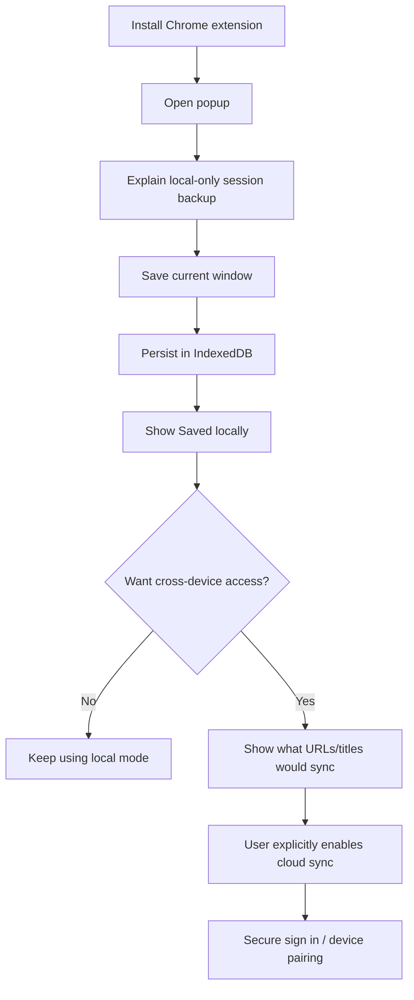
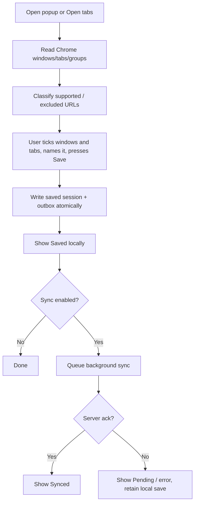
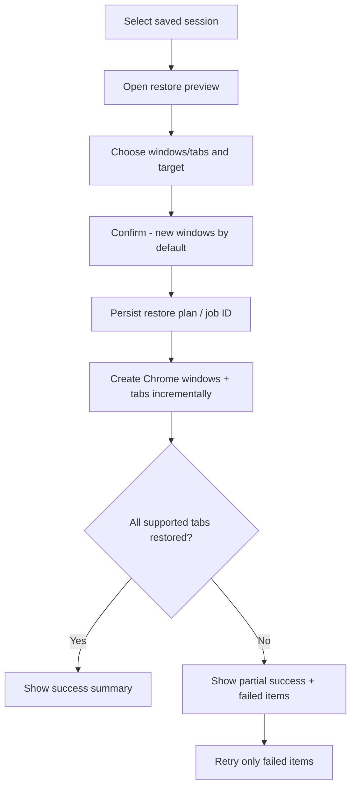
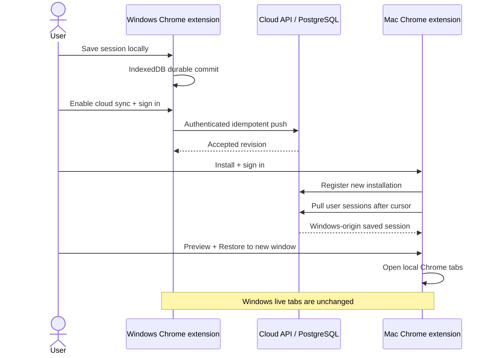
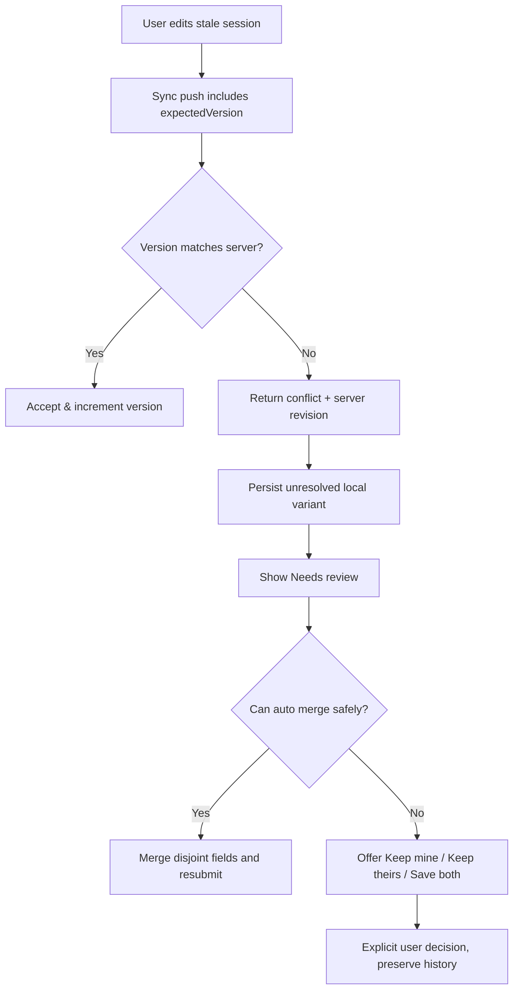

# SessionHub — User Flows & Interaction Contracts

**Status:** Proposed UX and technical handoff. See `UI_UX_DESIGN.md` for layouts and `SYNC_PROTOCOL.md` for technical guarantees.

## Flow 1 — First installation (no account)

**UX details:** Cloud sync prompt is secondary and dismissible. Do not delay a local save for a signup step. The extension should show an easy-to-understand first-run privacy notice regarding tab URLs.

## Flow 2 — Save current window / all windows

Since 2026-10-17 the user always chooses first (UI_UX_DESIGN.md 18i): the picker lists the open windows and tabs with the current window's web pages ticked and browser pages unticked; saving sends only the ticked tab ids.

**Edge cases:** No tabs, only restricted tabs, incognito windows, saved snapshot unchanged, IndexedDB quota reached, Chrome API call failure, worker termination mid-event. Classify and report, never silently omit an entire window.

## Flow 3 — Restore saved session safely

**Safety guarantees:** Never close existing tabs by default. Run restore only on the device where the user confirmed. Respect tab order/pin/group metadata when the browser supports it. Protect against repeating the same restore job unintentionally.

## Flow 4 — Windows save -> macOS restore

**UX details:** Mac session list displays `From Windows Desktop`, `Synced`, `Last saved`. Remote session does not auto-open. No remote device live-tab control.

## Flow 5 — Offline edits and reconnect

1. User disables network.
2. Renames or changes a saved session in extension.
3. Local entity and pending operation are committed in one IndexedDB transaction.
4. UI shows `Waiting to sync` and remains fully usable.
5. On network availability, a scheduled/on-demand worker retries with the *same* operation ID.
6. If accepted, receipt is committed locally, then incremental pull applies server changes.
7. If conflicting, the local edit is retained for review; user chooses a resolution or preserves both copies.

**Acceptance:** Force-kill worker between steps 3 and 5; pending operations survive, and retry does not create duplicate sessions.

## Flow 6 — Conflict resolution

Conflict resolution must not discard the original variant before the chosen result commits successfully.

## Flow 7 — Web dashboard without extension

1. User signs in via browser to website.
2. Sees their synced saved sessions and workspaces.
3. Opens session detail and exports JSON or copies specific URLs.
4. If the Chrome extension is unavailable or unpaired, `Restore with extension` is replaced by clear instructions (`Install extension`) and safe alternatives.
5. If extension is installed and pairing/bridge validated, a *user gesture* may request opening the local extension restore preview. The extension must confirm before any tab creation.

## Flow 8 — Device revocation

1. User opens `Settings -> Security -> Connected devices`.
2. Chooses a device and sees last-seen time plus revocation consequences.
3. Confirms `Revoke cloud access`.
4. Server invalidates device's refresh/active credentials as applicable and rejects subsequent sync.
5. Remote machine retains locally stored sessions unless the user personally deletes that local profile data.
6. User sees `Device revoked` in security history.

Never claim cloud revocation deletes offline data already present on a lost laptop.

## Flow 9 — Recovery after data loss

1. User opens `Recovery` in the installed extension.
2. Sees checkpoints grouped by time (local device only for MVP).
3. Inspects one immutable snapshot to review windows/tabs/groups.
4. Restores in a new window, or exports a copy before restoring.
5. Failed URLs are shown with reasons and retry/copy URL options.

If the profile/extension was uninstalled, recovery from local IndexedDB may no longer be possible; guide user to their independent exported backup. Cloud-synced **saved sessions** remain accessible if previously uploaded.

## Flow 10 — Session deletion vs archive

- **Archive** hides a session from active lists but preserves versions per retention.
- **Delete** requires confirmation, adds a tombstone for cloud sync, and enters recoverable retention where policy allows.
- UI must explain if all synced devices will eventually see the deletion. Remote **live tabs** are never closed.
- Deletion of a last good recovery checkpoint is governed by separate recovery retention, not by deleting a saved session.

## Cross-cutting checklist for every flow

- Offline/loading/sync failure state included.
- User and source device labels visible.
- Keyboard and screen-reader behavior defined.
- Confirmation for destructive/expensive changes.
- Idempotency of network mutation and restore command considered.
- Browser limitations and excluded URLs visible.
- No unapproved upload or cross-device browser action.
